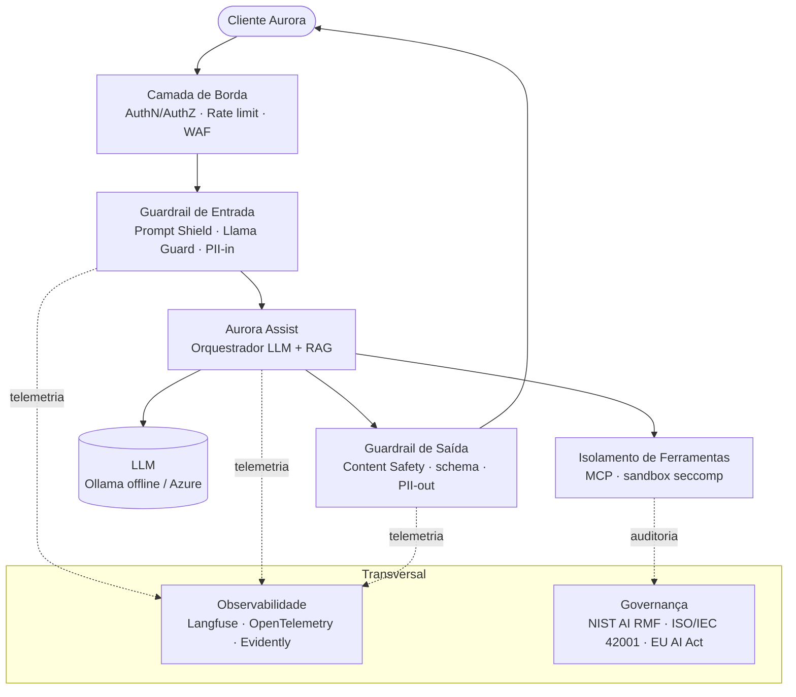

# 9mlet-llm-security


Repositório acadêmico da disciplina **Segurança, Guardrails e Conformidade para LLMs** (pós-graduação/mestrado em Engenharia de Machine Learning).

## 📋 Sobre

Este repositório reúne materiais práticos e conceituais para **projetar, implementar e operar** sistemas de LLM seguros. O foco **não** é treinar/avaliar modelos de ML clássico, e sim construir **sistemas defensivos executáveis**: guardrails de entrada/saída/comportamento, Zero Trust, isolamento de ferramentas (MCP), proteção de dados (Presidio), observabilidade (Langfuse/OpenTelemetry), deploy seguro (blue/green + canary) e governança (NIST AI RMF, ISO/IEC 42001, EU AI Act).

A disciplina adota como fio condutor o **Banco Aurora** e o assistente **Aurora Assist**, um chatbot bancário com LLM. Ao longo das 8 aulas, o sistema evolui de um protótipo vulnerável para uma solução com **defesa em profundidade**, privacidade, auditoria, observabilidade, governança e implantação segura.

A abordagem equilibra **didática** (notebooks explicados e reprodutíveis) e **prática de mercado** (aplicações reais executáveis via Docker Compose, offline-first com Ollama). Cada aula cobre riscos do **OWASP Top 10 for LLM Applications** e conecta teoria, frameworks de risco e experimentação aplicada.

O público-alvo são estudantes de mestrado/pós-graduação, engenheiros de ML, arquitetos de software e profissionais de segurança interessados em IA generativa confiável, auditável e aderente a requisitos regulatórios.

## 🎯 Objetivos de Aprendizagem

Ao concluir a disciplina, o aluno deverá ser capaz de:

- Identificar, classificar e demonstrar ameaças específicas de LLMs (prompt injection, jailbreak, *excessive agency*, vazamento de dados).
- Projetar guardrails de entrada, saída e comportamento com **defesa em profundidade** e *policy-as-code*.
- Implementar proteção de dados sensíveis (detecção/anonimização de PII) e **isolamento seguro de ferramentas** (MCP + sandbox).
- Automatizar **red teaming**, auditoria e geração de evidências técnicas em CI/CD.
- Traduzir requisitos de **LGPD, GDPR e EU AI Act** em controles de engenharia verificáveis.
- Operar **observabilidade**, monitoramento e detecção de *drift* (LLMOps) em produção.
- Avaliar **qualidade, viés e fairness** em aplicações com LLMs.
- Integrar **governança de IA**, AI-BOM/SBOM e DevSecOps em pipelines de implantação segura.

## 🛡️ Arquitetura de Segurança (resumo)

O Aurora Assist é protegido por **camadas defensivas** — nenhuma camada é suficiente sozinha. Detalhes em [docs/architecture/overview.md](docs/architecture/overview.md).



## 📚 Conteúdo das Aulas

### 1. [Ameaças e Vulnerabilidades em LLMs](aula01_ameacas_vulnerabilidades/)
**Objetivo:** identificar e classificar ameaças de LLMs no contexto do Aurora Assist.
**Teoria-chave:** *prompt injection* (direta/indireta), *jailbreak* e *excessive agency* são riscos centrais em sistemas com ferramentas e dados sensíveis. OWASP Top 10 for LLM e MITRE ATLAS organizam a superfície de ataque.
**Riscos OWASP:** LLM01, LLM06, LLM08, LLM10.
**Tecnologias:** Garak, PyRIT, OWASP Top 10 for LLM, MITRE ATLAS, NIST AI 100-2.

### 2. [Guardrails e Políticas para LLMs](aula02_guardrails_politicas/)
**Objetivo:** implementar guardrails de input, output e comportamento com defesa em profundidade.
**Teoria-chave:** *defense-in-depth* e *policy-as-code* permitem versionar e testar políticas como artefatos de engenharia, interceptando entradas/saídas inseguras.
**Riscos OWASP:** LLM01, LLM02, LLM09.
**Tecnologias:** NeMo Guardrails (Colang), Guardrails AI, Llama Guard 3, Azure AI Content Safety, HarmBench, AdvBench.

### 3. [Proteção de Dados e Isolamento de Ferramentas](aula03_protecao_dados_isolamento/)
**Objetivo:** proteger PII e isolar ferramentas do assistente bancário.
**Teoria-chave:** anonimização/minimização reduzem exposição de dados; Zero Trust e *least privilege* limitam o impacto de falhas e restringem permissões de ferramentas.
**Riscos OWASP:** LLM06, LLM07, LLM08.
**Tecnologias:** Microsoft Presidio (recognizers BR), MCP, Azure Key Vault, Entra ID, Confidential Computing.

### 4. [Testes de Segurança e Auditoria em LLMs](aula04_testes_seguranca_auditoria/)
**Objetivo:** automatizar red teaming e auditoria para gerar evidências de *due diligence*.
**Teoria-chave:** red teaming sistemático (ex.: PAIR) torna testes adversariais repetíveis; trilhas imutáveis e métricas de severidade sustentam rastreabilidade.
**Riscos OWASP:** LLM01–LLM10 (avaliação sistemática).
**Tecnologias:** PyRIT, Garak, promptfoo, Azure Monitor/Sentinel, WORM/hash chains, CVSS-AI.

### 5. [Conformidade e Proteção de Dados (LGPD/GDPR)](aula05_conformidade_lgpd_gdpr/)
**Objetivo:** traduzir regulação de privacidade e IA em controles técnicos.
**Teoria-chave:** bases legais, DPIA e direitos do titular orientam arquitetura, logs, retenção e consentimento; LGPD/GDPR/EU AI Act exigem governança proporcional ao risco.
**Riscos OWASP:** LLM06 (+ LGPD/GDPR/EU AI Act).
**Tecnologias:** Presidio, Azure Log Analytics, DPIA, LGPD, GDPR, EU AI Act.

### 6. [Governança de Dados e Monitoramento de LLMs](aula06_governanca_monitoramento/)
**Objetivo:** operar observabilidade, monitoramento e detecção de *drift* (LLMOps).
**Teoria-chave:** SLIs/SLOs acompanham qualidade, custo, latência e segurança; técnicas de *drift* (KS, PSI, MMD) + *tracing* detectam degradação.
**Riscos OWASP:** LLM09 (+ degradação operacional).
**Tecnologias:** Evidently AI, Langfuse, OpenTelemetry, Azure Workbooks, Grafana.

### 7. [Ética, Viés e Validação em LLMs](aula07_etica_vies_validacao/)
**Objetivo:** auditar viés/fairness e validar qualidade em cenários sensíveis.
**Teoria-chave:** métricas de fairness (paridade demográfica, *equalized odds*) investigam desigualdades; LLM-as-Judge e RAGAS medem qualidade semântica e *groundedness*.
**Riscos OWASP:** LLM09 (+ vieses e danos).
**Tecnologias:** Fairlearn, AIF360, RAGAS, Azure AI Evaluation SDK.

### 8. [Governança de IA e Implantação Segura em Produção](aula08_governanca_deploy_seguro/)
**Objetivo:** integrar controles e implantar o Aurora Assist com governança contínua.
**Teoria-chave:** DevSecOps, AI-BOM/SBOM e governança contínua incorporam segurança ao ciclo de vida; NIST AI RMF e ISO/IEC 42001 guiam gestão de risco e melhoria contínua.
**Riscos OWASP:** LLM05 (+ governança e deploy).
**Tecnologias:** Azure AI Foundry, Microsoft Agent Framework, Purview AI Hub, Azure Policy, DevSecOps.

## 🚀 Como Usar Este Repositório

### Pré-requisitos
- **Python 3.12+** (o `uv` pode instalá-lo automaticamente).
- [`uv`](https://docs.astral.sh/uv/) para pacotes e ambientes.
- **Docker** (labs com serviços isolados / Docker Compose).
- **[Ollama](https://ollama.com/)** para LLM local (offline-first).
- **Node.js/npm** para o `promptfoo` (Aula 4).

### Instalação
```powershell
# 1) Instale o uv (se ainda não tiver)
powershell -ExecutionPolicy ByPass -c "irm https://astral.sh/uv/install.ps1 | iex"   # Windows
# curl -LsSf https://astral.sh/uv/install.sh | sh                                    # Linux/macOS

# 2) Clone e sincronize o ambiente
git clone https://github.com/miyake-san/9mlet-llm-security.git
cd 9mlet-llm-security
uv sync

# 3) Configure variáveis de ambiente (offline-first via Ollama)
copy .env.example .env        # Windows  (Linux/macOS: cp .env.example .env)
ollama pull llama3.1:8b
ollama pull llama-guard3:8b   # usado na Aula 2

# 4) Ferramenta Node usada na Aula 4
npm install -g promptfoo
```

> Estrutura do zero? Rode o scaffold idempotente: **`./scaffold.ps1`** (Windows) ou **`bash scaffold.sh`** (Linux/macOS/WSL).

### Execução por aula
Cada pasta `aula0N_...` traz notebooks, `app/`, `docker-compose.yml`, datasets sintéticos e testes próprios (gerados/preenchidos pelo fluxo de código da disciplina).

```powershell
cd aula03_protecao_dados_isolamento
docker compose up -d          # sobe o Lab (offline-first)
uv run task test              # testes de segurança/regressão
uv run jupyter lab            # notebooks conceituais + Lab E2E
```

## 📂 Estrutura do Repositório

```text
9mlet-llm-security/
├── README.md                              # este documento
├── pyproject.toml                         # projeto e dependências (uv) — por aula + dev tooling
├── uv.lock                                # lockfile reproduzível (uv)
├── .python-version                        # versão de Python fixada (3.12)
├── .gitignore                             # inclui .env, reports/, saídas efêmeras
├── .env.example                           # LLM_BACKEND (ollama|azure) — sem segredos reais
├── LICENSE                                # MIT
├── scaffold.ps1                           # scaffold idempotente (Windows/PowerShell)
├── scaffold.sh                            # scaffold idempotente (Linux/macOS/Bash)
├── docs/
│   ├── architecture/
│   │   ├── overview.md                    # arquitetura de segurança / defense-in-depth
│   │   ├── diagrams/
│   │   │   ├── threat-model.md            # OWASP LLM Top 10 → Aurora Assist
│   │   │   ├── zero-trust-architecture.md # identidade, microssegmentação, sandbox
│   │   │   └── secure-deployment.md       # blue/green + canary + gates de red team
│   │   └── adr/
│   │       ├── template.md
│   │       ├── 0001-framework-guardrails.md
│   │       ├── 0002-estrategia-pii.md
│   │       ├── 0003-isolamento-ferramentas-mcp.md
│   │       ├── 0004-observabilidade-llmops.md
│   │       └── 0005-deploy-seguro-gates.md
│   ├── business/
│   │   ├── README.md
│   │   ├── use-cases.md
│   │   ├── business-case-aurora-assist-guardrails.md
│   │   ├── business-case-conformidade-lgpd.md
│   │   ├── business-case-deploy-seguro-governanca.md
│   │   └── process-diagrams/
│   │       ├── secure-sdlc.md
│   │       └── incident-response.md
│   ├── compliance/
│   │   ├── README.md
│   │   └── mapa-lgpd-gdpr-euaiact.md       # LGPD/GDPR/EU AI Act ↔ aulas ↔ controles
│   └── contributing.md
├── aula01_ameacas_vulnerabilidades/       # preenchidas pelo fluxo de código (PROMPT B V2)
├── aula02_guardrails_politicas/
├── aula03_protecao_dados_isolamento/
├── aula04_testes_seguranca_auditoria/
├── aula05_conformidade_lgpd_gdpr/
├── aula06_governanca_monitoramento/
├── aula07_etica_vies_validacao/
└── aula08_governanca_deploy_seguro/
```

## 📖 Documentação

- **Arquitetura:** [visão de segurança](docs/architecture/overview.md) · [threat model](docs/architecture/diagrams/threat-model.md) · [Zero Trust](docs/architecture/diagrams/zero-trust-architecture.md) · [deploy seguro](docs/architecture/diagrams/secure-deployment.md)
- **ADRs:** [índice](docs/architecture/adr/) — guardrails, PII, isolamento MCP, observabilidade, deploy seguro.
- **Negócio:** [business cases](docs/business/) do Banco Aurora · [Secure SDLC](docs/business/process-diagrams/secure-sdlc.md) · [Incident Response](docs/business/process-diagrams/incident-response.md)
- **Conformidade:** [mapa LGPD/GDPR/EU AI Act](docs/compliance/mapa-lgpd-gdpr-euaiact.md)
- **Contribuição:** [contributing.md](docs/contributing.md)

## ⚠️ Uso Ético e Legal

Este repositório contém **payloads e técnicas adversariais** (jailbreak, prompt injection, scanners de vulnerabilidade). Eles existem **exclusivamente para uso defensivo em ambiente de laboratório controlado**, com o objetivo de **testar e fortalecer** o Aurora Assist.

- **Não** utilize estas técnicas contra sistemas de terceiros sem autorização explícita.
- Datasets de PII são **100% sintéticos** — nunca use dados pessoais reais.
- **Nunca** versione segredos: use `.env` (ignorado pelo git) a partir do `.env.example`.

## 📄 Licença

Distribuído sob a licença [MIT](LICENSE).
