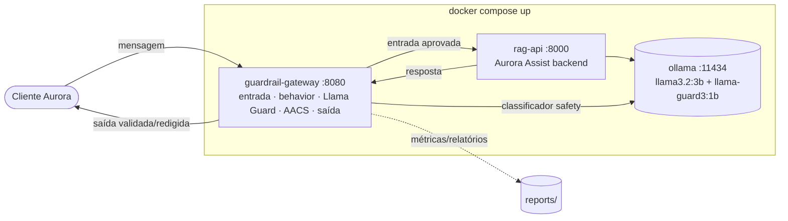

# Aula 02 — Guardrails e Políticas de Segurança para LLMs

> **Disciplina:** Segurança, Guardrails e Conformidade para LLMs
> **Caso condutor:** Banco **Aurora** / assistente **Aurora Assist**
> **Documento-base:** `MATERIAIS/AULA 2/DOCUMENTO_AULA_2.md` · **Status:** ✅ Lab executável

Na Aula 01 deixamos o **Aurora Assist** exposto: mapeamos suas vulnerabilidades, mas não construímos defesa. Esta aula transforma o assistente vulnerável em um sistema resiliente por meio de **defense-in-depth** — uma **arquitetura de camadas** de *guardrails* (entrada, comportamento, moderação e saída), medindo o **trade-off** entre segurança, latência e custo com dados, não com medo.

> [!WARNING]
> ⚠️ **Uso ético e legal.** Este diretório contém *payloads* adversariais (prompt injection, jailbreak) e gatilhos de conteúdo, **exclusivamente para uso defensivo em laboratório controlado**. Não os utilize contra sistemas de terceiros. Toda PII é **100% sintética** (Faker). Nunca versione segredos reais — use `.env` a partir de `.env.example`.

---

## 🎯 Objetivos (Doc 04)

Ao concluir esta aula, o estudante será capaz de:

- Explicar **defense-in-depth** e por que um único filtro não basta (FP × FN) — Doc 04, seções 1-2.
- Distinguir os **três tipos de guardrail** — entrada, saída e comportamento — e combiná-los — Doc 04, seção 2.
- Relacionar **Constitutional AI**, **RLHF** e **RLAIF** ao alinhamento probabilístico do modelo — Doc 04, seções 3-4.
- Implementar **policy-as-code** com **NeMo Guardrails/Colang**, **Rail Spec** (Guardrails AI) e **Llama Guard 3** — Doc 04, seções 5-7.
- Aplicar **Azure AI Content Safety** com **severidade graduada** e políticas por fluxo — Doc 04, seção 7.
- Medir eficácia com **ROC**, **F1**, falso positivo/negativo e *benchmarks* adversariais (**HarmBench**/**AdvBench**) — Doc 04, seções 8-9.

## 🛡️ Riscos OWASP cobertos

| Risco | Onde aparece no lab |
|---|---|
| **LLM01 — Prompt Injection** | guardrail de entrada (`input_guardrails.py`), behavior policy, Llama Guard, notebooks 02/04 |
| **LLM02 — Insecure Output Handling** | guardrail de saída (`output_guardrails.py`): Rail Spec, DetectPII, toxicidade |
| **LLM09 — Misinformation / Overreliance** | política de escopo (Colang) recusa temas fora do domínio bancário |

## 🧱 Arquitetura do Lab



As muralhas concêntricas da **Figura 1 do Doc 04**: a entrada passa por validação e política; o modelo responde; a saída é validada (contrato + PII + toxicidade) antes de chegar ao cliente. O `guardrail-gateway` e o `rag-api` são a **mesma imagem** em papéis distintos (`APP_ROLE`).

## 🚀 Como subir

Pré-requisitos: [Docker](https://docs.docker.com/), [uv](https://docs.astral.sh/uv/) e [Ollama](https://ollama.com/) (para uso fora do container).

```bash
# 1) ambiente Python (offline-first) desta aula
uv sync

# 2) segredos / endpoints (sem valores reais)
cp .env.example .env            # Windows: copy .env.example .env

# 3) suba a stack do Lab (gateway + rag-api + ollama)
uv run task up                  # docker compose up -d

# 4) baixe os modelos locais (uma vez)
docker compose exec ollama ollama pull llama3.2:3b
docker compose exec ollama ollama pull llama-guard3:1b

# 5) gere os datasets sintéticos (seed fixa)
uv run task seed-data

# 6) avalie os guardrails (offline in-process ou contra o gateway vivo)
uv run task eval                # pipeline in-process (backend stub)
uv run task scan                # ataca o gateway em execução (--live)

# encerrar
uv run task down
```

> **Groq (padrão):** configure `GROQ_API_KEY`; o modelo é `openai/gpt-oss-20b` e `GROQ_MIN_INTERVAL_SECONDS=1` espaça as chamadas para reduzir `429`. Testes e notebooks usam `stub` e não consomem a API. Para operação offline, use Ollama e defina `LLM_BACKEND=ollama`. O perfil local mais leve usa `llama3.2:3b` para geração e `llama-guard3:1b` para classificação de segurança.

## 📓 Notebooks (vídeos 1-4)

| Vídeo | Notebook | Tipo | Conteúdo |
|---|---|---|---|
| **1 de 4** — Fundamentos de Guardrails | *(sem notebook)* | conceitual/teórico | defense-in-depth, tipos de guardrail, Constitutional AI (a base de código serve aos vídeos 2-4) |
| **2 de 4** — Frameworks: NeMo, Guardrails AI e Llama Guard | [`notebooks/02_frameworks_guardrails.ipynb`](notebooks/02_frameworks_guardrails.ipynb) | conceitual + prático | Colang, Rail Spec, Llama Guard, comparativo e latência |
| **3 de 4** — Azure AI Content Safety | [`notebooks/03_azure_content_safety.ipynb`](notebooks/03_azure_content_safety.ipynb) | conceitual + prático | severidade graduada, políticas por fluxo, Prompt Shield |
| **4 de 4** — Lab: pipeline multi-camada + avaliação adversarial | [`notebooks/04_lab_e2e.ipynb`](notebooks/04_lab_e2e.ipynb) | conceitual + prático (E2E) | consome a stack, mede FP/FN, ROC/F1 e gera `reports/` |

Abra com `uv run task lab` (JupyterLab). Execute em **Restart & Run All** — seeds fixas garantem reprodutibilidade (o notebook 04 roda offline se a stack não estiver no ar).

## 📦 Datasets

Corpora de **texto** (não CSV numérico), sintéticos e reprodutíveis. Detalhes, proveniência, licença e **advertência ética** no **[DATASHEET](data/README.md)**.

| Pasta | Conteúdo | Uso |
|---|---|---|
| `data/attacks/` | prompt injection, jailbreak, off-topic, dados de terceiros, gatilhos de conteúdo — rotulados por OWASP | medir *attack success rate* / recall |
| `data/benign/` | pedidos bancários legítimos | medir **falso positivo** |
| `data/pii_samples/` | PII PT-BR sintética (CPF/CNPJ/RG/CEP/e-mail/telefone/cartão) | validar redação de PII na **saída** |

> `data/rag_corpus/` e `data/golden/` **são omitidos** nesta aula: o foco é o **fluxo conversacional** (guardrails). O corpus RAG com injeção indireta pertence à Aula 01, e o `golden/` (RAGAS) à Aula 07.

## 🧪 Testes

```bash
uv run task test    # pytest — determinístico, offline, sem LLM
uv run task lint    # ruff check
```

Cobrem: ataques conhecidos **devem** ser bloqueados e benignos **devem** passar, com asserção de **FP=0/recall=100%** no fluxo transacional (`test_guardrails.py`); detecção/anonimização de PII BR com validação de dígitos (`test_pii.py`); e **regressão de segurança** — um ataque já corrigido não pode voltar a passar (`test_security_regression.py`).

## ⚠️ Uso Ético

Os payloads destinam-se **apenas ao aprendizado defensivo em laboratório**. Nenhum segredo ou PII real é versionado. Consulte o [DATASHEET](data/README.md) e a política do repositório em [`../README.md`](../README.md#-uso-ético-e-legal).

## 📚 Referências do Doc 04

- Sutton, S. (2025). *AI-Native LLM Security.* Packt. ISBN 9781836203759.
- Bai, Y. et al. (2022). *Constitutional AI: Harmlessness from AI Feedback.* arXiv:2212.08073.
- Rebedea, T. et al. (2023). *NeMo Guardrails: A Toolkit for Controllable and Safe LLM Applications.* EMNLP 2023.
- Inan, H. et al. (2023). *Llama Guard: LLM-based Input-Output Safeguard for Human-AI Conversations.* Meta AI.
- Guardrails AI (2024). *Guardrails AI Documentation.* https://www.guardrailsai.com/docs
- Microsoft (2024a). *Azure AI Content Safety Documentation.* https://learn.microsoft.com/azure/ai-services/content-safety/
- Mazeika, M. et al. (2024). *HarmBench.* ICML 2024. · Zou, A. et al. (2023). *Universal and Transferable Adversarial Attacks.* arXiv:2307.15043.
- OWASP Foundation (2025). *Top 10 for LLM Applications.* https://genai.owasp.org/

## 🎥 Vídeos relacionados

1. Fundamentos de Guardrails: Input, Output e Behavior — *25 min*
2. Frameworks de Guardrails: NeMo, Guardrails AI e Llama Guard — *35 min*
3. Azure AI Content Safety: Prompt Shield, Jailbreak Detection e Custom Policies — *35 min*
4. Lab: Pipeline RAG com Guardrails Multi-Camada e Avaliação Adversarial — *25 min*

## 🧭 Navegação

- ⬅️ [Voltar ao README principal](../README.md) · Anterior: [Aula 01 — Ameaças e Vulnerabilidades](../aula01_ameacas_vulnerabilidades/README.md)
- 📖 [Arquitetura](../docs/architecture/overview.md) · 💼 [Business Cases](../docs/business/README.md)
- ➡️ Próxima: [Aula 03 — Proteção de Dados e Isolamento](../aula03_protecao_dados_isolamento/README.md)
