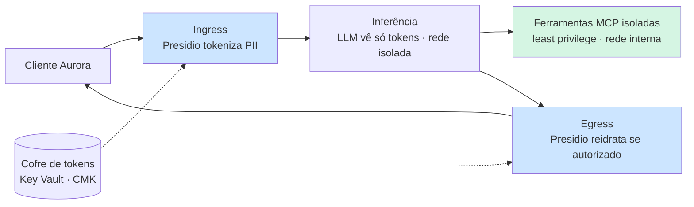

# Aula 03 — Proteção de Dados e Isolamento de Ferramentas em LLMs

> **Disciplina:** Segurança, Guardrails e Conformidade para LLMs · **Caso condutor:** Banco **Aurora** / assistente **Aurora Assist**
> **Pergunta de abertura (Doc 04):** *como o Aurora Assist pode atender o cliente **sem nunca ver o dado bruto**?*

Esta aula sai do **fluxo** (guardrails da Aula 02) e vai para o **dado em si**. Construímos o
pipeline **Zero Trust end-to-end** do Aurora Assist: anonimização de PII com **Microsoft
Presidio** (com *recognizers* brasileiros), **tokenização reversível** com cofre de chaves e
**isolamento de ferramentas** via **MCP** com privilégio mínimo — tudo *offline-first* com
Docker Compose e Ollama (Azure é caminho opcional).

---

## 🎯 Objetivos (Documento 04)

- Adotar a mentalidade **Zero Trust** (NIST SP 800-207): *assume breach*, *verify explicitly*,
  *least privilege* — aplicada à arquitetura RAG do Aurora Assist (Doc 04, §1-2).
- **Detectar e anonimizar PII** brasileira (CPF/CNPJ/RG/CEP) com Presidio + validação de dígito
  verificador, equilibrando **falsos negativos × falsos positivos** (Doc 04, §5-6).
- Aplicar **anonimização reversível** com **cofre de tokens** determinísticos, de modo que o LLM
  **veja apenas tokens** e nunca o dado bruto (Doc 04, §7).
- Reconhecer o **vazamento por embeddings** e anonimizar **antes** de vetorizar (Doc 04, §8).
- **Isolar ferramentas** contra *confused deputy* e *scope creep* com **capability tokens** e MCP
  (Doc 04, §9-10); entender *sandboxing* (seccomp), VM e **Confidential Computing / TEE** (§11).
- Fechar **canais laterais** (logs, caches, telemetria) e praticar **minimização de dados** (§12).

## 🛡️ Riscos OWASP cobertos (Top 10 for LLM Applications, 2025)

| Risco | Como esta aula mitiga |
|---|---|
| **LLM06 — Sensitive Information Disclosure** | Detecção + anonimização de PII em *ingress/egress*, logs e embeddings. |
| **LLM07 — System Prompt Leakage / Insecure Plugin** | Ferramentas MCP isoladas, *capability tokens*, escopos mínimos auditáveis. |
| **LLM08 — Excessive Agency** | *Confused deputy*/*scope creep* barrados: a ferramenta de saldo é **somente leitura**; não existe capacidade de transferir. |

## 🧱 Arquitetura do Lab

Espelha a **Figura 1** do Doc 04 (pipeline Zero Trust *end-to-end*):



Serviços do `docker-compose.yml`:

| Serviço | Papel | Rede |
|---|---|---|
| `ollama` | LLM local (offline-first) | `aurora` |
| `presidio-analyzer` | detecção de PII (imagem oficial MCR) | `aurora` |
| `presidio-anonymizer` | anonimização/operadores (imagem oficial MCR) | `aurora` |
| `rag-api` | **Aurora Assist** — orquestra ingress → LLM → tools → egress | `aurora` + `tools-internal` |
| `mcp-server` | ferramentas isoladas (**somente leitura**) | `tools-internal` (**`internal: true`**, sem egress) |

> O `mcp-server` fica numa rede **`internal: true`**: mesmo se comprometido, **não alcança a
> internet** nem recursos fora do seu escopo (Doc 04, §2 e §10 — *least privilege*).

## 🚀 Como subir

O padrão de integração LLM do curso é Groq (`openai/gpt-oss-20b`). Nesta aula,
os exercícios de PII e isolamento são determinísticos e não fazem chamadas ao
LLM; quando uma integração for adicionada, configure `GROQ_API_KEY` e
`GROQ_MIN_INTERVAL_SECONDS=1` para reduzir `429`. Os testes usam `stub`.

```powershell
# 0) Ambiente Python (para notebooks/testes offline)
uv sync                              # runtime + dev (não baixa Presidio/torch)

# 1) Suba a stack do Lab (vídeo 4)
uv run task up                       # docker compose up -d
docker compose exec ollama ollama pull llama3.2:3b

# 2) Gere os datasets sintéticos (seed fixa = 42)
uv run task seed-data

# 3) Avaliação de detecção de PII (offline, determinística)
uv run task eval                     # -> reports/pii_eval.json
# ...contra a API no ar (ingress real):
uv run task scan                     # -> reports/pii_eval_live.json
```

Endpoints principais do `rag-api` (porta **8000**):
`POST /chat` (pipeline Zero Trust completo) · `POST /anonymize` (ingress) ·
`POST /deanonymize` (egress autorizado) · `POST /tools/{nome}` (ferramenta MCP proxied).

## 📓 Notebooks (vídeos 1-4)

| Vídeo | Notebook | Tipo |
|---|---|---|
| **1 — Zero Trust Architecture** | *(sem notebook — conceitual/panorama)* | teórico |
| **2 — Detecção e Anonimização de PII com Presidio** | [`notebooks/02_presidio_pii.ipynb`](notebooks/02_presidio_pii.ipynb) | conceitual + prático |
| **3 — Isolamento de Ferramentas: MCP, Sandboxing e Confidential Computing** | [`notebooks/03_isolamento_ferramentas_mcp.ipynb`](notebooks/03_isolamento_ferramentas_mcp.ipynb) | conceitual + prático |
| **4 — Lab: Pipeline Zero Trust (Presidio + MCP + Foundry)** | [`notebooks/04_lab_e2e.ipynb`](notebooks/04_lab_e2e.ipynb) | conceitual + prático (E2E) |

Todos executam em **Restart & Run All** (seeds fixas). O `04_lab_e2e` detecta se a stack está no
ar (`AURORA_API_URL`); se não, roda o **mesmo pipeline in-process** (offline).

## 📦 Datasets

Corpora **100% sintéticos** (Faker + templates, seed = 42) — ver o **datasheet**:
[`data/README.md`](data/README.md).

- `data/pii_samples/pii_samples.jsonl` — textos com PII BR (CPF/CNPJ/RG/CEP/e-mail/telefone/conta) + rótulos.
- `data/rag_corpus/*` — documentos bancários; **alguns contêm PII embutida** (risco de embeddings) e um caso de **injeção indireta** que tenta abusar de ferramentas.

> **Omitidos nesta aula:** `attacks/`, `benign/` e `golden/`. O foco é **proteção de dados** e
> **isolamento de ferramentas** (não avaliação de guardrail de fluxo, que é da Aula 02, nem RAGAS,
> que é da Aula 07). Os *payloads* adversariais aqui se restringem a **injeção indireta que abusa
> de ferramentas** (dentro do `rag_corpus/`), suficientes para exercitar o isolamento MCP.

## 🧪 Testes

```powershell
uv run task test                     # pytest (offline, determinístico)
uv run task lint                     # ruff
```

- `tests/test_pii.py` — detecção/anonimização de PII BR (bridge Presidio → *fallback* determinístico).
- `tests/test_tokenvault.py` — tokenização reversível (round-trip, determinismo, isolamento do cofre).
- `tests/test_mcp_isolation.py` — *capability tokens*; *confused deputy*/*scope creep* **bloqueados**; somente leitura.
- `tests/test_security_regression.py` — **regressão de segurança**: vazamentos/abusos já corrigidos não podem voltar.

## ⚠️ Uso ético

O material trata de dados pessoais e de técnicas de ataque a ferramentas **apenas para fins
defensivos, em laboratório controlado**. **Nenhuma PII real** é gerada, usada ou versionada — os
documentos (CPF/CNPJ) têm somente dígitos verificadores válidos, sem corresponder a pessoas reais.
Não utilize os *payloads* de injeção contra sistemas de terceiros.

## 📚 Referências do Documento 04

- Stafford, V. (2020). *NIST SP 800-207 — Zero Trust Architecture*.
- Sweeney, L. (2002). *k-anonymity*. · Machanavajjhala et al. (2007). *l-diversity*.
- Dwork, C. (2006). *Differential Privacy*. · Abadi et al. (2016). *Deep Learning with DP*.
- Carlini et al. (2021). *Extracting Training Data from LLMs*.
- Song & Raghunathan (2020). *Information Leakage in Embedding Models*.
- Shokri et al. (2017). *Membership Inference Attacks*.
- Hardy, N. (1988). *The Confused Deputy*.
- Costan & Devadas (2016). *Intel SGX Explained*.
- Anthropic (2024). *Model Context Protocol (MCP)*. · Microsoft (2024a/b). *Confidential Computing / Presidio*.
- OWASP Foundation (2025). *Top 10 for LLM Applications* — LLM06, LLM07, LLM08.

## 🎥 Vídeos relacionados

1. **Zero Trust Architecture para Sistemas com LLMs** (conceitual — panorama).
2. **Detecção e Anonimização de PII com Microsoft Presidio** → `02_presidio_pii.ipynb`.
3. **Isolamento de Ferramentas: MCP, Sandboxing e Confidential Computing** → `03_isolamento_ferramentas_mcp.ipynb`.
4. **Lab: Pipeline Zero Trust com Presidio + MCP Isolado + Azure Foundry** → `04_lab_e2e.ipynb`.

## Navegação

- ⬅️ [README principal](../README.md) · Anterior: [Aula 02](../aula02_guardrails_politicas/README.md)
- ➡️ Próxima: [Aula 04 — Testes de Segurança e Auditoria](../aula04_testes_seguranca_auditoria/README.md)
