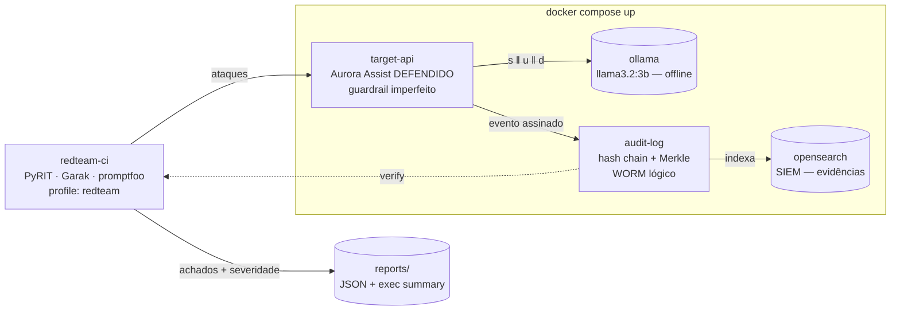

# Aula 04 — Red Teaming, Testes de Segurança e Auditoria em LLMs

> **Disciplina:** Segurança, Guardrails e Conformidade para LLMs
> **Caso condutor:** Banco **Aurora** / assistente **Aurora Assist**
> **Documento-base:** [`MATERIAIS/AULA 4/DOCUMENTO_AULA_4.md`](../../06_Education) · **Status:** ✅ Lab executável

Depois de **construir defesas** nas Aulas 02 (guardrails) e 03 (proteção de dados e isolamento),
esta aula responde à pergunta que separa engenharia de marketing de segurança: *as defesas
resistem a um adversário determinado ou apenas parecem corretas em documentos de arquitetura?*
(Doc 04, seção 1). O lab executa uma campanha controlada de **AI Red Teaming** contra o
Aurora Assist, mede evidências reprodutíveis (**Attack Success Rate**, severidade **CVSS-AI**,
*time-to-detect*), registra tudo em uma **trilha de auditoria imutável** (hash chain + Merkle) e
transforma segurança em **quality gate** de CI/CD.

> [!WARNING]
> ⚠️ **Uso ético e legal.** Este diretório contém payloads adversariais (prompt injection,
> jailbreak, evasão por ofuscação, escalada *crescendo*). Eles existem **exclusivamente para
> uso defensivo em ambiente de laboratório controlado**, com autorização e dados sintéticos
> (Doc 04, seção 14). Não use estas técnicas contra sistemas de terceiros. Toda PII é **100%
> sintética** (Faker). Nunca versione segredos reais — use `.env` a partir de `.env.example`.

---

## 🎯 Objetivos (Doc 04)

Ao concluir esta aula, o estudante será capaz de:

- Distinguir **defender** de **provar segurança** e explicar por que um LLM é um alvo
  **probabilístico**, medindo risco por taxa em vez de teste único — Doc 04, seções 1-2.
- Conduzir uma campanha pelo ciclo **PAIR** (Plan, Act, Iterate, Report) e organizar achados
  pela **taxonomia de harms** (conteúdo, *capabilities*, qualidade) — Doc 04, seções 3-4.
- Automatizar ataques com **PyRIT** (orchestrators/converters/scorers), varrer com **Garak**
  (probes/detectors) e criar **regressão adversarial** com **promptfoo** em CI/CD — Doc 04, seções 6-9.
- Reproduzir ataques **multi-turno / Crescendo** e medir **Attack Success Rate**
  $\text{ASR} = \frac{1}{N}\sum_i \mathbb{1}[\text{scorer}(y_i)=\text{sucesso}]$ e bloqueio
  $B = 1 - \text{ASR}$ — Doc 04, seções 2, 8-9.
- Construir **trilhas de auditoria imutáveis** com *hash chains* $h_i = H(h_{i-1}\,\Vert\,\text{log}_i)$
  e **Merkle trees**, exportáveis a um SIEM — Doc 04, seções 10-12.
- Priorizar mitigação com **CVSS-AI** ($R = P \cdot I$) e medir efetividade
  ($E = 1 - R_1/R_0$), gerando um **relatório executivo** — Doc 04, seções 13-14.

## 🛡️ Riscos OWASP cobertos

Esta aula faz **avaliação sistemática** (a campanha percorre LLM01–LLM10). Os alvos medidos no lab:

| Risco | Onde aparece no lab |
|---|---|
| **LLM01 — Prompt Injection** | ataques diretos/ofuscados e *crescendo* contra `POST /chat` |
| **LLM02 — Insecure Output Handling** | *harms* de conteúdo no guardrail de saída |
| **LLM06 — Sensitive Information Disclosure** | tentativa de exfiltração de PII/canário (gate de bloqueio total) |
| **LLM08 — Excessive Agency** | abuso de ferramenta (*confused deputy*) no assistente |
| LLM03 / LLM05 / LLM10 (conceitual) | catálogo de severidade CVSS-AI + roadmap de mitigação |

## 🧱 Arquitetura do Lab



O Aurora Assist aqui **já tem defesas** (Aulas 02-03), mas o guardrail é **deliberadamente
imperfeito**: evasões por **ofuscação** (leetspeak, Base64 embutido, *payload splitting*) e
ataques **multi-turno** atravessam o filtro de superfície. A campanha **mede** esse risco
residual e a **mitigação** (normalização + análise de conversa) o reduz — evidência quantitativa
de $E = 1 - R_1/R_0$ (Doc 04, seção 13).

## 🚀 Como subir

Pré-requisitos: [Docker](https://docs.docker.com/), [uv](https://docs.astral.sh/uv/) e
[Ollama](https://ollama.com/) (para uso fora do container).

```bash
# 1) ambiente Python (offline-first) desta aula
uv sync

# 2) segredos / endpoints (sem valores reais)
cp .env.example .env            # Windows: copy .env.example .env

# 3) suba a stack do Lab (target-api + audit-log + opensearch + ollama)
uv run task up                  # docker compose up -d

# 4) baixe o modelo local (uma vez)
docker compose exec ollama ollama pull llama3.2:3b

# 5) gere os datasets sintéticos completos (seed fixa)
uv run task seed-data

# 6) rode a campanha de red team e gere o relatório executivo
uv run task scan                # docker compose --profile redteam run --rm redteam-ci

# verifique a integridade da trilha de auditoria
curl http://localhost:8091/verify

# encerrar
uv run task down
```

> **Groq (padrão):** configure `GROQ_API_KEY`; o modelo é `openai/gpt-oss-20b` e `GROQ_MIN_INTERVAL_SECONDS=1` espaça chamadas para reduzir `429`. Testes e notebooks usam `stub` e não consomem a API. Para operação offline, defina `LLM_BACKEND=ollama`.
> **Offline:** o lab roda 100% local via Ollama. O backend **Azure** (Azure OpenAI/Foundry)
> é opcional: defina `LLM_BACKEND=azure` e as variáveis `AZURE_OPENAI_*` no `.env` e instale o
> grupo extra com `uv sync --group azure`. As ferramentas externas (Garak/PyRIT/promptfoo) rodam
> no container `redteam-ci`; sem elas, o harness offline de *replay* ainda mede ASR e severidade.

## 📓 Notebooks (vídeos 1-4)

| Vídeo | Notebook | Tipo | Conteúdo |
|---|---|---|---|
| **1 de 4** — AI Red Teaming: Metodologia Microsoft AI Red Team | *(sem notebook)* | conceitual/teórico | PAIR, harms, lições do *white paper*; a base de código serve aos vídeos 2-4 |
| **2 de 4** — Automação Adversarial com PyRIT e Garak | [`notebooks/02_automacao_adversarial_pyrit_garak.ipynb`](notebooks/02_automacao_adversarial_pyrit_garak.ipynb) | conceitual + prático | orchestrators/converters/scorers, probes, multi-turno/crescendo, promptfoo |
| **3 de 4** — Auditoria, Logs Imutáveis e Trilhas de Evidência | [`notebooks/03_auditoria_logs_imutaveis.ipynb`](notebooks/03_auditoria_logs_imutaveis.ipynb) | conceitual + prático | hash chains, Merkle trees, WORM, CVSS-AI, export SIEM |
| **4 de 4** — Lab: Red Team E2E com Relatório Executivo e Mitigações | [`notebooks/04_lab_e2e.ipynb`](notebooks/04_lab_e2e.ipynb) | conceitual + prático (E2E) | orquestra a stack, mede ASR/severidade/*time-to-detect*, gera `reports/`, mede mitigação |

Abra com `uv run task lab` (JupyterLab). Execute em **Restart & Run All** — seeds fixas garantem
reprodutibilidade. Os notebooks 02 e 03 rodam **em processo** (offline); o 04 consome a stack e,
se ela não estiver no ar, **degrada com elegância** para execução em processo.

## 📦 Datasets

Corpora de **texto** (não CSV numérico), sintéticos e reprodutíveis. Detalhes, proveniência,
licença e **advertência ética** no **[DATASHEET](data/README.md)**.

| Pasta | Conteúdo | Uso |
|---|---|---|
| `data/attacks/attacks.jsonl` | injeção direta, jailbreak, **evasão por ofuscação**, abuso de ferramenta, exfiltração de PII — rotulados por OWASP | medir *attack success rate* por classe |
| `data/attacks/crescendo.jsonl` | sequências **multi-turno** de escalada gradual (Russinovich et al., 2024) | medir falha de guardrail por-mensagem |
| `data/benign/benign.jsonl` | prompts bancários legítimos | medir **falso positivo** do guardrail |

> `data/pii_samples/`, `data/rag_corpus/` e `data/golden/` **são omitidos** nesta aula. PII
> sintética já é gerada *inline* nos ataques de exfiltração; a detecção robusta de PII pertence à
> **Aula 03 (Presidio)** e o *golden set* de RAGAS à **Aula 07 (Ética, Viés e Validação)**.

## 🧪 Testes

```bash
uv run task test    # pytest — determinístico, offline, sem LLM real
uv run task lint    # ruff check
```

Cobrem: detecção/bloqueio de ataques conhecidos pelo alvo defendido, com contabilidade FP/FN
(`test_redteam.py`); **imutabilidade** da trilha de auditoria — adulterar um registro antigo
quebra a cadeia (`test_audit_log.py`); severidade **CVSS-AI** $R = P\cdot I$ e efetividade
$E = 1 - R_1/R_0$ (`test_cvss_ai.py`); e **regressão de segurança** — um ataque já mitigado não
pode voltar a passar e um evento auditado não pode ser silenciosamente alterado
(`test_security_regression.py`).

## ⚠️ Uso Ético

Os payloads e a campanha adversarial destinam-se **apenas ao aprendizado defensivo em
laboratório** (Doc 04, seção 14: autorização formal, ambiente delimitado, dados sintéticos,
critérios de interrupção). Nenhum segredo ou PII real é versionado. Consulte o
[DATASHEET](data/README.md) e a política do repositório em [`../README.md`](../README.md#-uso-ético-e-legal).

## 📚 Referências do Doc 04

- Microsoft (2024). *Lessons from Red Teaming 100 Generative AI Products.* / *PyRIT — Python Risk Identification Tool.* https://github.com/Azure/PyRIT
- Derek, L. (2024). *garak — LLM vulnerability scanner.* https://github.com/NVIDIA/garak
- promptfoo (2026). *promptfoo — test & red-team LLM apps.* https://www.promptfoo.dev/
- Russinovich, M.; Salem, A.; Eldan, R. (2024). *Great, Now Write an Article About That: The Crescendo Multi-Turn LLM Jailbreak Attack.* arXiv:2404.01833
- Mazeika, M. et al. (2024). *HarmBench.* ICML 2024. arXiv:2402.04249
- Merkle, R. C. (1988). *A Digital Signature Based on a Conventional Encryption Function.* CRYPTO '87.
- ISO/IEC 27001:2022 · ISO/IEC 42001:2023 · NIST AI RMF 1.0 (2023) · FIRST CVSS v4.0 (2024)
- Turpin, M. (2025). *The AI Cybersecurity Handbook.*

## 🎥 Vídeos relacionados

1. AI Red Teaming: Metodologia Microsoft AI Red Team — *25 min*
2. Automação Adversarial com PyRIT e Garak — *40 min*
3. Auditoria, Logs Imutáveis e Trilhas de Evidência — *30 min*
4. Lab: Red Team End-to-End com Relatório Executivo e Mitigações — *25 min*

## 🧭 Navegação

- ⬅️ [Voltar ao README principal](../README.md) · Anterior: [Aula 03 — Proteção de Dados e Isolamento](../aula03_protecao_dados_isolamento/README.md)
- 📖 [Arquitetura](../docs/architecture/overview.md) · 💼 [Business Cases](../docs/business/README.md)
- ➡️ Próxima: [Aula 05 — Conformidade (LGPD/GDPR/EU AI Act)](../aula05_conformidade_lgpd_gdpr/README.md)
