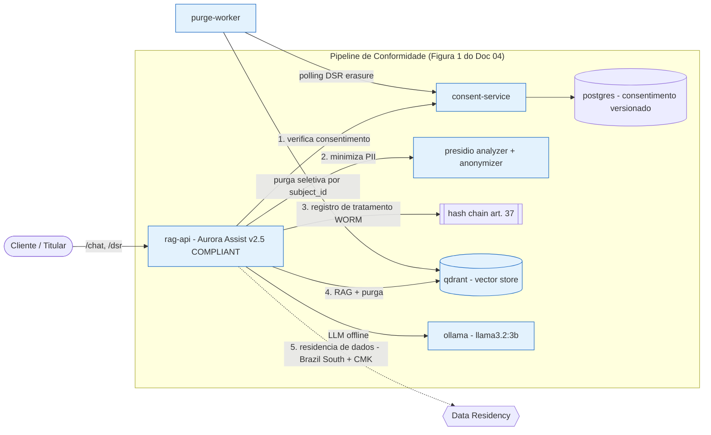

# Aula 05 — Conformidade Regulatória: LGPD, GDPR e EU AI Act

> **Disciplina:** Segurança, Guardrails e Conformidade para LLMs
> **Caso condutor:** Banco **Aurora** / assistente **Aurora Assist**
> **Documento-base:** `MATERIAIS/AULA 5/DOCUMENTO_AULA_5.md`

Esta aula traduz **requisitos jurídicos** (LGPD, GDPR, EU AI Act) em **controles
técnicos verificáveis e auditáveis**. O ponto-chave: *seguro* e *conforme* são
propriedades distintas — conformidade é a **leitura jurídica das defesas técnicas**
já construídas nas Aulas 2, 3 e 4.

---

## 🎯 Objetivos (Documento 04)

- Diferenciar **sistema seguro** de **sistema conforme** (§1).
- Aplicar princípios e **bases legais** da LGPD (arts. 6, 7, 11) e operacionalizar os
  **direitos do titular** (arts. 17-22) (§2-3).
- Manter o **registro de operações de tratamento** (art. 37 / GDPR art. 30) sobre uma
  trilha **WORM** imutável (§4).
- Interpretar o **GDPR** (arts. 22, 25, 35) e classificar o sistema pela **pirâmide de
  risco do EU AI Act** (§5-7), com o cálculo $R = \sum_j P_j \cdot I_j$.
- Conduzir uma **DPIA** ancorada em **Privacy by Design** (§8).
- Operacionalizar o **direito ao esquecimento** com **purga seletiva** em vector store e
  discutir os limites do **machine unlearning** (§9-10).
- Tratar **residência de dados** e soberania (Schrems II) (§11).

## 🛡️ Riscos OWASP cobertos (leitura jurídica)

| OWASP LLM (2025) | Como a conformidade endereça |
|---|---|
| **LLM06 — Sensitive Information Disclosure** | Minimização de PII no prompt e no egresso do RAG (art. 6, V); purga seletiva de embeddings (art. 18, VI). |
| **LLM08 — Excessive Agency** | Recusa de **decisão automatizada de crédito** (GDPR art. 22) + human-in-the-loop, mantendo risco **limitado**. |
| **LLM02 — Insecure Output Handling** | Contexto recuperado é **minimizado** antes de compor a resposta (evita vazar PII de embeddings). |

> Conformidade **não** é uma camada à parte: é a leitura legal dos guardrails (Aula 2),
> da anonimização (Aula 3) e da auditoria imutável (Aula 4).

## 🧱 Arquitetura do Lab



**Serviços** (todos *hardened*: `user` non-root, `read_only`, `cap_drop: [ALL]`,
`seccomp`, imagens pinadas):

| Serviço | Papel | Base legal / Doc 04 |
|---|---|---|
| `rag-api` | Aurora Assist compliant (chat, RAG, DSR) | pipeline integrado (Figura 1) |
| `consent-service` + `postgres` | consentimento granular e versionado | art. 7/8; Snippet 1 |
| `presidio-analyzer` / `-anonymizer` | minimização de PII | art. 6, V (§2) |
| `qdrant` | vector store (alvo da purga) | art. 18, VI (§10) |
| `purge-worker` | processa exclusões (direito ao esquecimento) | §10, Snippet 3 |
| `ollama` | LLM local offline-first | — |

> **Offline-first:** a `rag-api` funciona sem nuvem — se `consent-service`, `presidio` ou
> `qdrant` estiverem ausentes, ela cai em *store* em memória e detector BR determinístico.

## 🚀 Como subir

```bash
# 1) Ambiente Python (UV)
uv sync

# 2) Stack do Lab (vídeo 4)
uv run task up                       # docker compose up -d
docker compose exec ollama ollama pull llama3.2:3b

# 3) Datasets sintéticos (seed fixa = 42)
uv run task seed-data

# 4) Explorar
#    rag-api:          http://localhost:8000/docs
#    consent-service:  http://localhost:8010/docs
#    qdrant:           http://localhost:6333/dashboard

# 5) Encerrar
uv run task down
```

**Sem Docker (100% offline):** os notebooks 02/03 rodam direto; o notebook 04 sobe o app
*in-process* (backend `stub`) automaticamente. Rode `uv run task api` para servir a
`rag-api` localmente com backend Groq (`openai/gpt-oss-20b`). Configure `GROQ_API_KEY`
e mantenha `GROQ_MIN_INTERVAL_SECONDS=1` para espaçar chamadas e reduzir `429`.
Testes e notebooks usam `stub` e não consomem a API. Para operação offline, defina
`LLM_BACKEND=ollama`.

### Backend Azure (opcional)

```bash
uv sync --group azure                # openai, azure-identity, azure-cosmos, azure-search-documents
# defina LLM_BACKEND=azure e AZURE_OPENAI_* no .env (nunca versione segredos)
```

## 📓 Notebooks

| Vídeo | Notebook | Tipo | Conteúdo |
|---|---|---|---|
| **1** | — (conceitual) | teórico | LGPD aplicada a IA generativa: princípios, bases legais, papéis, art. 37. **Sem notebook**; a base de código serve aos vídeos 2-4. |
| **2** | [`notebooks/02_gdpr_eu_ai_act.ipynb`](notebooks/02_gdpr_eu_ai_act.ipynb) | conceitual + prático | GDPR (arts. 22/25/35), pirâmide de risco EU AI Act, classificação limited vs high, $R = \sum_j P_j \cdot I_j$. |
| **3** | [`notebooks/03_dpia_consentimento_direitos.ipynb`](notebooks/03_dpia_consentimento_direitos.ipynb) | conceitual + prático | Consentimento granular/versionado, direitos do titular, DPIA + Privacy by Design, purga seletiva e *unlearning*. |
| **4** | [`notebooks/04_lab_e2e.ipynb`](notebooks/04_lab_e2e.ipynb) | conceitual + prático (E2E) | Pipeline LGPD-compliant consumindo a stack: consentimento → minimização → tratamento WORM → recusa de crédito → purga → painel. |

CLIs úteis:

```bash
uv run task dpia         # classifica risco + gera reports/dpia_aurora_assist.md
uv run task ropa         # self-test da integridade da trilha de tratamento (WORM)
uv run task purge        # processa solicitações de exclusão (direito ao esquecimento)
uv run task consent-api  # sobe apenas o consent-service local (porta 8010)
```

## 📦 Datasets

Corpora **100% sintéticos** (Faker `pt_BR`, seed fixa = 42) — ver o **DATASHEET** em
[`data/README.md`](data/README.md):

- `subjects/` — titulares com consentimento granular por finalidade.
- `pii_samples/` — textos com PII BR sintética (+ benignos) para a minimização.
- `rag_corpus/` — documentos por `subject_id` (alguns com PII) para a purga seletiva.
- `dsr/` — solicitações do titular (acesso, exclusão, revisão).

## 🧪 Testes

```bash
uv run task test         # pytest (consentimento, PII, purga, DPIA, regressão)
uv run task lint         # ruff check
uv run task fmt          # ruff format
```

Cobrem: consentimento granular/versionado e *enforcement*, minimização de PII BR,
purga seletiva (direito ao esquecimento), classificação de risco EU AI Act, e uma
**suíte de regressão** de conformidade (recusa de crédito, não-vazamento de PII,
transparência, integridade WORM).

## ⚠️ Uso ético

Toda a PII é **sintética** (CPF/CNPJ apenas com dígitos verificadores válidos, sem
corresponder a pessoas reais). O material existe para **ensinar a proteger dados**
(minimização, consentimento, purga) — nunca para reidentificação ou uso fora do
laboratório. Segredos **jamais** são versionados (use `.env`, veja `.env.example`).

## 📚 Referências do Documento 04

- BRASIL (2018). **LGPD** (Lei 13.709) — arts. 6, 7, 11, 17-22, 37.
- UNIÃO EUROPEIA (2016). **GDPR** — arts. 22, 25, 30, 35.
- UNIÃO EUROPEIA (2024). **EU AI Act** (Regulation EU 2024/1689).
- CAVOUKIAN, A. (2009). *Privacy by Design: The 7 Foundational Principles.*
- BOURTOULE, L. et al. (2021). *Machine Unlearning.* IEEE S&P.
- WACHTER, S.; MITTELSTADT, B.; FLORIDI, L. (2017). *Why a Right to Explanation Does Not Exist in the GDPR.*
- TJUE (2020). *Caso C-311/18 (Schrems II).*
- NIST (2023). *AI Risk Management Framework (AI RMF 1.0).*

## 🎥 Vídeos relacionados

1. **LGPD Aplicada a Sistemas de IA Generativa** (conceitual) — princípios, bases legais, papéis, art. 37.
2. **GDPR e EU AI Act para LLMs e Foundation Models** → `02_gdpr_eu_ai_act.ipynb`.
3. **DPIA, Consentimento Granular e Direitos do Titular** → `03_dpia_consentimento_direitos.ipynb`.
4. **Lab: Pipeline LGPD-Compliant com Audit Trail e Purga Seletiva** → `04_lab_e2e.ipynb`.

---

### Navegação

- ⬅️ Anterior: [Aula 04 — Red Teaming, Testes de Segurança e Auditoria](../aula04_testes_seguranca_auditoria/README.md)
- ➡️ Próxima: [Aula 06 — LLMOps: Governança de Dados e Monitoramento Contínuo](../aula06_governanca_monitoramento/README.md)
- 🏠 [README principal](../README.md)
