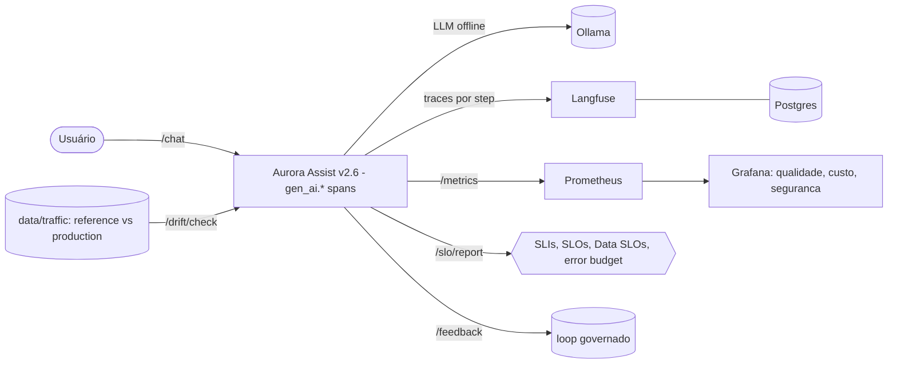

# Aula 06 — LLMOps: Governança de Dados e Monitoramento Contínuo

> **Disciplina:** Segurança, Guardrails e Conformidade para LLMs
> **Caso condutor:** Banco **Aurora** / assistente **Aurora Assist v2.6**
> **Tema:** transformar o Aurora Assist de um sistema "implantado e esquecido" em
> um sistema **monitorado, governado e continuamente aprimorado** (Doc 04).

Na Aula 05 o Aurora Assist ficou legalmente conforme. Mas *conformidade e
segurança não são carimbos únicos*: os dados mudam, o comportamento dos clientes
evolui e a qualidade se degrada em silêncio. Esta aula responde à pergunta *"como
saber, em tempo real, que o Aurora Assist continua seguro, conforme e funcionando
bem?"* com **detecção de drift**, **observabilidade gen_ai.***, **SLIs/SLOs/Data
SLOs** e um **loop de feedback governado**.

---

## 🎯 Objetivos (Documento 04)

- **Drift** (§Drift): detectar data, concept, prompt e response drift com **KS,
  PSI, MMD e Wasserstein** (NumPy puro; cross-validação opcional com scipy/sklearn).
- **Observabilidade** (§Observabilidade): instrumentar cada chamada com as
  **convenções semânticas gen_ai.*** do OpenTelemetry; exportar traces para
  **Langfuse** e métricas para **Prometheus/Grafana** (Azure Monitor é o caminho
  de produção).
- **SLIs/SLOs/Data SLOs** (§SLOs): metas numéricas verificáveis (latência P95,
  groundedness, custo, frescor, **vazamento de PII ≤ 1%**) com **error budget**.
- **Token economics** (§token economics): **caching semântico** e **model routing**.
- **Feedback loop** (§Feedback loops): captura pseudonimizada e governada.

## 🛡️ Riscos OWASP LLM (2025) cobertos pelo monitoramento

| Risco | Como esta aula endereça |
|---|---|
| **LLM01 — Prompt Injection** | taxa de bloqueio de jailbreak monitorada como SLI |
| **LLM04 — Data & Model Poisoning** | drift (KS/PSI/MMD/Wasserstein) sinaliza mudança de distribuição |
| **LLM06 — Sensitive Information Disclosure** | **Data SLO de PII** (≤ 1% de respostas com PII) |
| **LLM09 — Misinformation** | SLO de **groundedness** (proxy) em perguntas reguladas |
| **LLM10 — Unbounded Consumption** | SLO de **custo por conversa** + caching/routing |

## 🧱 Arquitetura do Lab



Serviços do `docker-compose.yml`: `ollama`, `postgres`, `langfuse`, `app`,
`prometheus`, `grafana`. Todos com imagens **pinadas** e o `app` **endurecido**
(non-root, `read_only`, `cap_drop: [ALL]`, seccomp, tmpfs).

> **Evidently AI** é usado como **biblioteca** (notebook 02 e `uv run task drift
> --evidently`), gerando relatórios HTML em `reports/` — não como serviço, para
> manter o `docker compose up` enxuto e confiável (justificativa no datasheet).

## 🚀 Como subir

O backend padrão é Groq (`openai/gpt-oss-20b`). Configure `GROQ_API_KEY` e mantenha
`GROQ_MIN_INTERVAL_SECONDS=1` para espaçar chamadas e reduzir `429`. Testes e
notebooks usam `stub` e não consomem a API.

```bash
# 1) Dependências (offline-first, leve)
uv sync

# 2) Stack do Lab (vídeo 4)
uv run task up                              # docker compose up -d
docker compose exec ollama ollama pull llama3.1:8b

# 3) Datasets sintéticos (seed fixa)
uv run task seed-data

# 4) Acesse:
#    app        -> http://localhost:8000  (/chat, /metrics, /drift/check, /slo/report)
#    Langfuse   -> http://localhost:3000  (crie chaves e habilite LANGFUSE_ENABLED)
#    Prometheus -> http://localhost:9090
#    Grafana    -> http://localhost:3001  (dashboard "Aurora LLMOps")
```

Sem Docker? Rode só o app: `uv run task api` (backend `ollama` ou `stub`).

### Tarefas úteis (`uv run task <nome>`)

| Task | O que faz |
|---|---|
| `up` / `down` / `logs` | ciclo de vida da stack |
| `api` | sobe o app localmente (reload) |
| `seed-data` | gera os datasets sintéticos |
| `drift` | roda a detecção de drift -> `reports/drift_report.json` |
| `slo` | self-test dos SLOs (`configs/slo.yaml`) |
| `monitor` | demo offline da instrumentação (spans + /metrics + SLOs) |
| `test` / `lint` / `fmt` | pytest / ruff |

## 📓 Notebooks (vídeos 1-4)

- **Vídeo 1 — LLMOps Lifecycle e Modelo de Maturidade** — *conceitual/teórico
  (panorama); sem notebook hands-on.* A base de código serve aos vídeos 2-4.
- **Vídeo 2 — [`02_drift_detection.ipynb`](notebooks/02_drift_detection.ipynb)** —
  data/concept/prompt/response drift com KS, PSI, MMD e Wasserstein.
- **Vídeo 3 — [`03_observability_otel.ipynb`](notebooks/03_observability_otel.ipynb)** —
  spans gen_ai.*, tracing, tokens/latência/custo, caching semântico e model routing.
- **Vídeo 4 — [`04_lab_e2e.ipynb`](notebooks/04_lab_e2e.ipynb)** — **consome a
  stack** (LIVE) ou roda o app in-process (OFFLINE): coleta SLIs, avalia SLOs/error
  budget, verifica o Data SLO de PII e gera `reports/`.

## 📦 Datasets

Texto/tráfego **100% sintético** (Faker + NumPy, seed 42). Ver o **DATASHEET**
em [`data/README.md`](data/README.md). O drift é **injetado por design** na janela
de produção para exercitar os quatro testes.

## 🧪 Testes

```bash
uv run task test     # drift, observabilidade, SLOs e regressão de segurança
```

A suíte de **regressão** garante que: jailbreak permaneça bloqueado e
contabilizado, o **Data SLO de PII** capture vazamentos, um drift conhecido sempre
vire incidente e a telemetria **nunca** registre PII em claro.

## ⚠️ Uso ético

Ataques (jailbreak) e PII aqui são **sintéticos** e servem **exclusivamente ao uso
defensivo em laboratório**. A telemetria aplica **minimização de dados** (a
observabilidade não pode virar nova fonte de risco — Doc 04, §Obs.). Nenhum
segredo ou PII real é versionado.

## 📚 Referências do Documento 04

- Beyer et al. (2016). *Site Reliability Engineering* (SLIs/SLOs/error budget).
- Gama et al. (2014). *A Survey on Concept Drift Adaptation*.
- Gretton et al. (2012). *A Kernel Two-Sample Test* (MMD).
- Huyen (2022). *Designing ML Systems*. · Trevelyan (2024). *LLMOps*.
- OpenTelemetry (2024). *Semantic Conventions for Generative AI*.
- Sculley et al. (2015). *Hidden Technical Debt in ML Systems*.
- DAMA International (2017). *DAMA-DMBOK*. · NIST (2024). *AI RMF: GenAI Profile*.

## 🎥 Vídeos relacionados

| Vídeo | Título | Artefatos |
|---|---|---|
| 1 de 4 | LLMOps Lifecycle e Modelo de Maturidade | conceitual (panorama) |
| 2 de 4 | Drift Detection: Data, Concept, Prompt e Response | `notebooks/02` · `src/security/drift.py` |
| 3 de 4 | Observability com OpenTelemetry, Langfuse e Azure Monitor | `notebooks/03` · `app/observability.py` |
| 4 de 4 | Lab: Dashboard End-to-End de Qualidade, Custo e Segurança | `notebooks/04` · stack Compose |

---

- ⬅️ Anterior: [Aula 05 — Conformidade LGPD/GDPR](../aula05_conformidade_lgpd_gdpr/README.md)
- ➡️ Próxima: [Aula 07 — Ética, Viés e Validação](../aula07_etica_vies_validacao/README.md)
