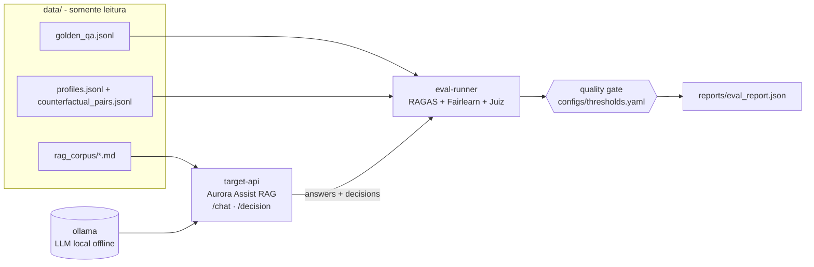

# Aula 07 — Ética, Viés e Validação de Qualidade em LLMs

> **Disciplina:** Segurança, Guardrails e Conformidade para LLMs
> **Caso condutor:** Banco **Aurora** / assistente **Aurora Assist** (RAG).
>
> Código executável e offline-first que converte "parece justo e bom" em
> **evidência mensurável e auditável** (Doc 04). O Aurora Assist é avaliado quanto
> a **qualidade**, **viés (fairness)** e **fidelidade (groundedness)**, com um
> **quality gate ético** integrável ao CI/CD.

---

## 🎯 Objetivos (Documento 04)

- Aplicar os 6 princípios do **Microsoft Responsible AI Standard v2**, com foco em
  **Fairness** e **Transparency**.
- Formalizar as **definições estatísticas de fairness** (paridade demográfica,
  igualdade de oportunidade, chances equalizadas) e o **Teorema da Impossibilidade**.
- Auditar viés com **Fairlearn** (API espelhada em `src/security/fairness.py`) e o
  **teste contrafactual** (Kusner et al., 2017).
- Medir qualidade das métricas **clássicas** (BLEU/ROUGE) às **neurais** (BERTScore),
  passando por **LLM-as-Judge** (com de-viés) e **RAGAS** (*faithfulness*).
- Montar um **quality gate** contínuo (Fairlearn + RAGAS + juiz) que reprova a
  promoção de versões que aumentem viés ou reduzam fidelidade/qualidade.

## 🛡️ Riscos cobertos (OWASP LLM + Responsible AI)

- **LLM09:2025 — Misinformation / Overreliance:** medimos *faithfulness* (RAGAS) e
  penalizamos alucinação; o *grounding* estrito faz o assistente **abster-se** em
  vez de inventar fatos.
- **LLM08:2025 — (qualidade de saída):** validação semântica e por juiz das respostas.
- **Fairness/Viés (Microsoft RAI Standard):** o viés algorítmico **não** é um item
  isolado do OWASP Top 10 — é tratado como risco de **IA Responsável**. Auditamos
  disparidade de grupo e viés contrafactual, complementando os controles de segurança
  das Aulas 01-06.

## 🧱 Arquitetura do Lab



- **`groq`** — backend padrão (`openai/gpt-oss-20b`); configure `GROQ_API_KEY`.
  `GROQ_MIN_INTERVAL_SECONDS=1` espaça chamadas. Testes e notebooks usam `stub`.
- **`ollama`** — LLM local. Azure é caminho opcional.
- **`target-api`** — Aurora Assist (RAG) avaliado. Duas flags de mitigação
  (`FAIRNESS_MITIGATION`, `RAG_STRICT_GROUNDING`) começam **desligadas**, expondo
  problemas mensuráveis; ligá-las mede a efetividade $E = 1 - R_1/R_0$.
- **`eval-runner`** (perfil `eval`, opt-in/pesado) — roda a avaliação responsável
  contra a `target-api` e aplica o **quality gate**.

## 🚀 Como subir

```bash
# 1) Ambiente Python (offline-first; libs pesadas ficam em grupos opcionais)
uv sync

# 2) Datasets sintéticos reprodutíveis (seed fixa = 42)
uv run task seed-data

# 3) Stack do Lab (LLM local + Aurora Assist RAG)
docker compose up -d
docker compose exec ollama ollama pull llama3.2:3b

# 4) Avaliação responsável + quality gate (offline, determinístico)
uv run task eval     # relatório da versão ingênua (reprova o gate)
uv run task gate     # versão mitigada (passa o gate)

# 5) Avaliação conteinerizada com libs de referência (opcional/pesado)
uv sync --group eval
docker compose --profile eval run --rm eval-runner
```

> **Azure (opcional):** `uv sync --group azure` e defina `LLM_BACKEND=azure` +
> variáveis `AZURE_OPENAI_*` (ver `.env.example`). O **Azure AI Evaluation SDK**
> entra por este grupo.

## 📓 Notebooks

| Vídeo | Notebook | Conteúdo |
|---|---|---|
| **1** (conceitual) | — | Responsible AI e fundamentos de fairness (panorama, **sem notebook**). |
| **2** | [`02_validacao_metricas_llm_judge_ragas.ipynb`](notebooks/02_validacao_metricas_llm_judge_ragas.ipynb) | BLEU/ROUGE vs. BERTScore, RAGAS, LLM-as-Judge (conceitual + prático). |
| **3** | [`03_fairness_toolbox_explicabilidade.ipynb`](notebooks/03_fairness_toolbox_explicabilidade.ipynb) | Fairlearn, Teorema da Impossibilidade, teste contrafactual, explicabilidade. |
| **4** | [`04_lab_e2e.ipynb`](notebooks/04_lab_e2e.ipynb) | Lab E2E: avaliação contínua + quality gate no CI/CD (consome a stack). |

Todos executam **offline** (backend stub) via *Restart & Run All*; o Lab detecta a
stack ao vivo e, se ausente, degrada com elegância para execução em processo.

## 📦 Datasets

Corpora de **texto** 100% sintéticos (Faker `pt_BR`, seed = 42) — ver o
**[DATASHEET](data/README.md)**: `rag_corpus/` (documentos do Aurora), `golden/`
(Q&A de referência) e `fairness/` (perfis balanceados + pares contrafactuais).
`attacks/`, `benign/` e `pii_samples/` são omitidos (foco das Aulas 01-05).

## 🧪 Testes

```bash
uv run task test   # fairness, qualidade, LLM-as-Judge e regressão do quality gate
uv run task lint   # ruff
```

A suíte fixa a linha de base: o assistente **ingênuo reprova** o gate (viés +
alucinação) e a versão **mitigada passa**; uma regressão que reintroduza viés ou
alucinação volta a falhar.

## ⚠️ Uso ético

Perfis, nomes, rendas e grupos são **fictícios**. Os grupos "A"/"B" são rótulos
abstratos de **atributo protegido** para auditoria de *fairness* — não representam
pessoas reais nem grupos sociais específicos. **Nenhum** dado pessoal real é usado.
O material destina-se a auditoria **defensiva** de viés e qualidade em laboratório.

## 📚 Referências do Documento 04

- Microsoft (2022). *Responsible AI Standard v2*.
- Hardt, Price & Srebro (2016). *Equality of Opportunity in Supervised Learning*.
- Chouldechova (2017). *Fair Prediction with Disparate Impact* (Teorema da Impossibilidade).
- Kusner et al. (2017). *Counterfactual Fairness*.
- Bird et al. (2020). *Fairlearn*. · Bellamy et al. (2019). *AIF360*.
- Papineni et al. (2002) *BLEU* · Lin (2004) *ROUGE* · Zhang et al. (2020) *BERTScore*.
- Zheng et al. (2023). *Judging LLM-as-a-Judge (MT-Bench, Chatbot Arena)*.
- Es et al. (2024). *RAGAS*. · Microsoft (2026). *Azure AI Evaluation SDK*.

## 🎥 Vídeos relacionados

1. Responsible AI e Fundamentos de Fairness em LLMs *(conceitual)*.
2. Validação de LLMs: Métricas Clássicas, Neurais e LLM-as-Judge.
3. Microsoft Responsible AI Toolbox e Explicabilidade Adaptada a LLMs.
4. Lab: Avaliação Contínua de Viés e Qualidade em CI/CD.

## 🧭 Navegação

- ⬅️ Anterior: **Aula 06 — LLMOps: Governança de Dados e Monitoramento Contínuo**
- ➡️ Próxima: **Aula 08 — Governança de IA e Implantação Segura em Produção**
