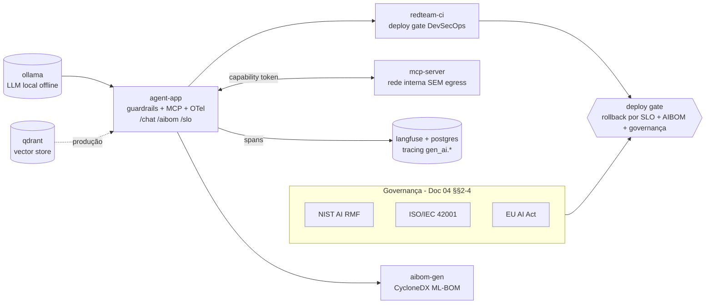

# Aula 08 — Governança de IA e Implantação Segura em Produção

> **Disciplina:** Segurança, Guardrails e Conformidade para LLMs
> **Caso condutor:** Banco **Aurora** / assistente **Aurora Assist** (agente RAG).
>
> **Capstone** do curso. Código executável e *offline-first* que faz o Aurora Assist
> deixar de ser um conjunto de controles isolados (Aulas 1-7) e passar a operar como
> um sistema **governado, auditável e pronto para produção** (Doc 04): frameworks de
> governança, deploy seguro (blue/green · canary · shadow), **rollback por SLO**,
> **AIBOM**, resposta a incidentes e **DevSecOps**.

---

## 🎯 Objetivos (Documento 04)

- Aplicar os **frameworks de governança** — **NIST AI RMF** (Govern/Map/Measure/
  Manage + GenAI Profile), **ISO/IEC 42001** (AIMS/PDCA/Anexo A) e **EU AI Act**
  (obrigações por papel) — como **crosswalk** para os controles das Aulas 1-7.
- Implementar **padrões de deployment seguro** (Blue/Green, Canary, Shadow) com
  **rollback automatizado orientado por SLO** (Snippet 2 / fórmula da §6).
- Gerar o **AIBOM** (CycloneDX ML-BOM): modelo base, datasets, fine-tunes e deps (§8).
- Operar **resposta a incidentes** de IA (jailbreak escape, data leak, drift crítico)
  com trilha de auditoria imutável e **postmortems blameless** (§7).
- Materializar um **pipeline DevSecOps** com **gates de segurança** que reprovam a
  promoção de uma versão insegura (§9) — integrando red team (Aula 4), grounding
  (Aula 7), PII (Aula 3/5) e observabilidade (Aula 6).

## 🛡️ Riscos cobertos (OWASP LLM + governança)

- **LLM01:2025 — Prompt Injection:** o *deploy gate* roda uma campanha de red team;
  o agente **endurecido** bloqueia jailbreaks na entrada (`jailbreak_rate → 0`).
- **LLM06:2025 — Sensitive Information Disclosure:** a camada de saída redige PII;
  `pii_block_rate` é um SLO **crítico** (sem error budget).
- **LLM05:2025 — Supply Chain:** o **AIBOM** (CycloneDX) inventaria modelo/dados/deps;
  o gate bloqueia a promoção se o inventário estiver incompleto.
- **LLM07/LLM08 — Insecure Plugin / Excessive Agency:** ferramentas MCP isoladas com
  *capability tokens* (menor privilégio; *confused deputy* e *scope creep* negados).
- **LLM09:2025 — Misinformation:** groundedness/drift são SLOs **críticos** e gatilhos
  de rollback (Doc 04, §6).

## 🧱 Arquitetura do Lab



- **`agent-app`** — Aurora Assist v3.0 (análogo ao **Microsoft Agent Framework**):
  guardrails (Aula 2) + ferramentas MCP isoladas (Aula 3) + observabilidade (Aula 6).
  A flag `AGENT_GUARDRAILS_ENABLED` começa **desligada** (agente ingênuo), expondo
  problemas mensuráveis; ligá-la endurece o agente e permite a promoção.
- **`mcp-server`** — ferramentas de leitura isoladas em **rede interna sem egress**.
- **`langfuse` + `postgres`** — tracing por step (Aula 6). **`qdrant`** — vector store
  de produção para o RAG (o agente é *offline-first* com retriever in-memory).
- **`redteam-ci`** / **`aibom-gen`** (perfil `security`, opt-in) — pipeline DevSecOps:
  deploy gate ao vivo e geração do AIBOM.

> **Decisões de escopo (justificadas):** o *guardrail-gateway* da Aula 02 foi
> **embarcado no `agent-app`** (é o que o Doc 04, §9, atribui ao Agent Framework:
> "agentes com guardrails e isolamento de ferramentas"), em vez de um serviço à
> parte. O **`qdrant`** entra como caminho de **produção**; o Lab roda *offline* com
> retriever in-memory. Ambos mantêm o Lab reprodutível com um comando.

## 🚀 Como subir

O backend padrão é Groq (`openai/gpt-oss-20b`). Configure `GROQ_API_KEY` e mantenha
`GROQ_MIN_INTERVAL_SECONDS=1` para espaçar chamadas e reduzir `429`. Testes e
notebooks usam `stub` e não consomem a API.

```bash
# 1) Ambiente Python (offline-first; libs de segurança ficam em grupos opcionais)
uv sync

# 2) Datasets sintéticos reprodutíveis (seed fixa = 42)
uv run task seed-data

# 3) Stack do Lab (agente + LLM local + observabilidade + vector store)
docker compose up -d
docker compose exec ollama ollama pull llama3.2:3b

# 4) Deploy gate DevSecOps (offline, determinístico)
uv run task gate-naive   # versão INGÊNUA  -> BLOQUEIA (rollback por SLO)
uv run task gate         # versão ENDURECIDA -> PROMOVE

# 5) AIBOM (CycloneDX ML-BOM) do sistema
uv run task aibom

# 6) Pipeline conteinerizado com ferramentas reais (opcional/pesado)
uv sync --group security
docker compose --profile security run --rm redteam-ci   # deploy gate ao vivo
docker compose --profile security run --rm aibom-gen    # AIBOM real (CycloneDX)
```

> **Azure (opcional):** `uv sync --group azure` e defina `LLM_BACKEND=azure` +
> `AZURE_OPENAI_*` (ver `.env.example`). O caminho de produção é **Azure AI Foundry**
> + **Microsoft Agent Framework** + **Azure Policy** + **Microsoft Purview AI Hub**.

## 📓 Notebooks

| Vídeo | Notebook | Conteúdo |
|---|---|---|
| **1** (conceitual) | — | Frameworks de Governança: NIST AI RMF, ISO/IEC 42001 e EU AI Act (panorama, **sem notebook**). |
| **2** | [`02_deployment_patterns_canary_rollback.ipynb`](notebooks/02_deployment_patterns_canary_rollback.ipynb) | Blue/Green · Canary · Shadow + rollback por SLO (Snippet 2 / fórmula da §6). |
| **3** | [`03_incident_response_aibom_sre.ipynb`](notebooks/03_incident_response_aibom_sre.ipynb) | Incident response + AIBOM (CycloneDX) + SLOs/error budget + postmortem. |
| **4** | [`04_lab_e2e.ipynb`](notebooks/04_lab_e2e.ipynb) | Capstone E2E: pipeline DevSecOps → deploy gate → canary → agente (consome a stack). |

Todos executam **offline** (backend stub) via *Restart & Run All*; o Lab detecta a
stack ao vivo e, se ausente, degrada com elegância para execução em processo.

## 📦 Datasets

Corpora de **texto** 100% sintéticos (Faker `pt_BR`, seed = 42) — ver o
**[DATASHEET](data/README.md)**: `rag_corpus/` (produtos + cadastros com PII),
`attacks/` (jailbreak/injeção rotulados por OWASP), `benign/`, `golden/` (Q&A de
referência) e `pii_samples/` (prompts que induzem vazamento de PII).

## 🧪 Testes

```bash
uv run task test   # guardrails, MCP, deploy gate, governança/AIBOM e regressão
uv run task lint   # ruff
```

A suíte fixa a linha de base: a versão **ingênua reprova** o deploy gate (jailbreak,
alucinação e vazamento de PII) e a versão **endurecida passa**; uma regressão que
reintroduza qualquer risco volta a falhar (Doc 04, §§7-9).

## ⚠️ Uso ético

Nomes, CPF/CNPJ/RG/CEP, e-mails e telefones são **fictícios** (Faker `pt_BR`).
Os ataques existem para **validar defesas** (o deploy gate) em laboratório — não
redistribua payloads além do necessário ao aprendizado. Os cadastros com PII no
corpus RAG são um **cenário didático** de LLM06, não uma boa prática de produção.

## 📚 Referências do Documento 04

- NIST (2023). *AI Risk Management Framework 1.0 (AI 100-1)*. · NIST (2024). *AI 600-1 (GenAI Profile)*.
- ISO/IEC (2023). *42001:2023 — AI Management System (AIMS)*.
- União Europeia (2024). *Regulation (EU) 2024/1689 (AI Act)*.
- Beyer et al. (2016). *Site Reliability Engineering* (SLO, error budget, postmortem).
- OWASP Foundation; CycloneDX (2026). *ML-BOM specification*. · OWASP (2025). *Top 10 for LLM Applications*.
- Williams, B. (2024). *AI Strategy and Security* (governança, maturidade, DevSecOps).
- Microsoft (2025). *Azure AI Foundry* · *Microsoft Agent Framework* · *Azure Policy* · *Microsoft Purview AI Hub*.

## 🎥 Vídeos relacionados

1. Frameworks de Governança: NIST AI RMF, ISO/IEC 42001 e EU AI Act *(conceitual)*.
2. Deployment Patterns Seguros: Blue/Green, Canary e Shadow para LLMs.
3. AI Incident Response, AIBOM e SRE para Sistemas Generativos.
4. Capstone Lab: Deploy Seguro End-to-End com Azure AI Foundry + Agent Framework.

## 🧭 Navegação

- ⬅️ Anterior: **Aula 07 — Ética, Viés e Validação de Qualidade em LLMs**
- ➡️ Próximo: **CHALLENGE (projeto final)** — consolidação da jornada do Aurora Assist.
