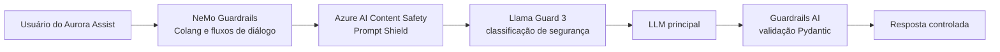

# ADR-0001: Escolha de Frameworks de Guardrails em Camadas

## Status
Aceito

## Contexto
O Aurora Assist, assistente bancário fictício do Banco Aurora, opera sobre fluxos de atendimento com alto impacto regulatório: consulta de dados financeiros, orientação sobre produtos, triagem de fraude e suporte a clientes. Nesse contexto, uma falha de segurança em LLM pode resultar em exposição de dados, respostas discriminatórias, indução a transações indevidas, desvio de políticas internas ou violação de obrigações de conformidade.

A literatura e os benchmarks recentes mostram que ataques de jailbreak e prompt injection são dinâmicos e transferíveis entre modelos. Benchmarks como HarmBench e AdvBench evidenciam que filtros isolados tendem a falhar diante de ataques adaptativos, reformulações semânticas e cadeias de raciocínio maliciosas. Na taxonomia do OWASP Top 10 for LLM Applications, a decisão endereça principalmente LLM01: Prompt Injection e LLM02: Sensitive Information Disclosure.

Para um domínio bancário, o controle deve combinar prevenção, detecção, validação e rastreabilidade. Portanto, o problema arquitetural não é escolher “um guardrail”, mas definir uma composição defensiva que reduza risco residual sem tornar o sistema impraticável em termos de latência, custo e manutenibilidade.

## Decisão
Adotar uma abordagem em camadas de guardrails combinando:

1. **NeMo Guardrails** para orquestração de diálogo, políticas conversacionais e policy-as-code em Colang.
2. **Azure AI Content Safety e Prompt Shield** para detecção de jailbreak, prompt injection e categorias de conteúdo inseguro.
3. **Llama Guard 3** como classificador de segurança complementar, especialmente para avaliação semântica de entradas e saídas.
4. **Guardrails AI** para validação estrutural de saída com Pydantic, garantindo schemas, tipos e invariantes de resposta.

A decisão privilegia defense-in-depth: cada camada cobre um modo de falha distinto. NeMo Guardrails controla o comportamento conversacional e os caminhos permitidos; Azure AI Content Safety provê detecção gerenciada e atualizada para conteúdo e ataques; Llama Guard 3 adiciona avaliação classificatória independente; Guardrails AI reduz erros de contrato entre LLM e aplicação, evitando saídas malformadas ou campos não autorizados.

## Consequências

### Positivas
- Reduz dependência de um único mecanismo de segurança e melhora resiliência contra jailbreaks adaptativos.
- Permite expressar políticas do Banco Aurora como código revisável, versionado e testável em Colang.
- Separa controles de conteúdo, controles de fluxo e validação de schema, facilitando auditoria e evolução.
- Aumenta aderência a OWASP LLM01/LLM02 e às práticas de governança recomendadas por NIST AI RMF.
- Viabiliza avaliação contínua com suites como HarmBench, AdvBench, PyRIT, Garak e promptfoo.

### Negativas
- Aumenta latência e custo por chamada, pois múltiplos classificadores podem ser executados no caminho crítico.
- Exige governança de versões entre políticas Colang, taxonomias de segurança e schemas Pydantic.
- Pode gerar falsos positivos que bloqueiam atendimentos legítimos, exigindo calibração por contexto bancário.
- Introduz complexidade operacional para observabilidade, fallback e tratamento consistente de erros.

## Alternativas Consideradas
1. **Usar apenas NeMo Guardrails** - Rejeitada porque a orquestração de fluxo não substitui classificadores especializados de conteúdo e jailbreak.
2. **Usar apenas Azure AI Content Safety** - Rejeitada por centralizar a defesa em detecção gerenciada, sem policy-as-code de diálogo nem validação estrutural de saída.
3. **Usar apenas Llama Guard 3** - Rejeitada porque classificação semântica não garante aderência a schemas, fluxos de negócio e políticas transacionais.
4. **Usar apenas Guardrails AI** - Rejeitada porque validação de schema não detecta, por si só, prompt injection, conteúdo abusivo ou tentativa de exfiltração.

## Referências
- OWASP Foundation. *OWASP Top 10 for LLM Applications*. https://owasp.org/www-project-top-10-for-large-language-model-applications/
- Mazeika et al. *HarmBench: A Standardized Evaluation Framework for Automated Red Teaming and Robust Refusal*. https://arxiv.org/abs/2402.04249
- Zou et al. *Universal and Transferable Adversarial Attacks on Aligned Language Models*. https://arxiv.org/abs/2307.15043
- NVIDIA. *NeMo Guardrails Documentation*. https://docs.nvidia.com/nemo/guardrails/
- Microsoft. *Azure AI Content Safety documentation*. https://learn.microsoft.com/azure/ai-services/content-safety/
- Meta. *Llama Guard 3*. https://www.llama.com/docs/model-cards-and-prompt-formats/llama-guard-3/
- Guardrails AI. *Guardrails AI Documentation*. https://www.guardrailsai.com/docs/

Voltar para [Visão Geral da Arquitetura](../overview.md)
