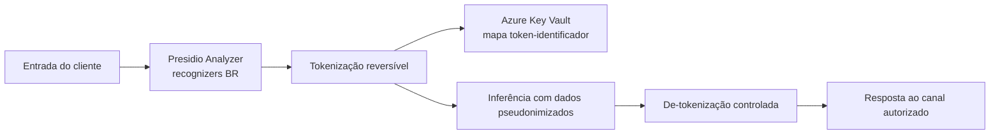

# ADR-0002: Estratégia de Proteção, Pseudonimização e Anonimização de Dados

## Status
Aceito

## Contexto
O Aurora Assist processa dados bancários e pessoais sensíveis ou quase sensíveis, incluindo identificação civil, dados cadastrais, transações, reclamações e intenções financeiras. Sob a LGPD e o GDPR, o Banco Aurora deve observar necessidade, finalidade, minimização, segurança, prevenção, prestação de contas e direitos do titular. Mesmo quando o LLM é hospedado em ambiente controlado, o envio desnecessário de PII para inferência aumenta a superfície de exposição e o impacto de logs, traces, caches e reprocessamentos.

O desafio técnico é preservar utilidade conversacional sem expor CPF, CNPJ, RG, CEP, número de conta, chaves PIX e outros identificadores no prompt efetivo. Em português do Brasil, recognizers genéricos frequentemente têm baixa cobertura para documentos locais; por isso, a arquitetura requer detectores específicos e um mecanismo seguro para reversibilidade quando a resposta precisa referenciar o titular.

## Decisão
Adotar **Microsoft Presidio** como mecanismo principal de detecção e anonimização, usando **Analyzer** e **Anonymizer** com recognizers customizados para padrões brasileiros, incluindo CPF, CNPJ, RG e CEP. Antes da inferência, dados pessoais identificáveis serão pseudonimizados. Quando a experiência exigir restauração controlada, será usada **tokenização reversível** com material criptográfico e segredos protegidos no **Azure Key Vault**.

A tokenização reversível deve separar o valor original do prompt enviado ao LLM. O LLM recebe tokens sem significado externo, por exemplo `{{CLIENTE_ID_001}}` ou `{{CPF_TOKEN_004}}`. A de-tokenização ocorrerá somente após validações de autorização, finalidade e canal, preferencialmente fora do contexto do modelo, em componente determinístico da aplicação.

A decisão reconhece que pseudonimização não equivale automaticamente a anonimização legal. Portanto, os dados tokenizados continuam sob governança de dados pessoais, mas com risco materialmente reduzido durante inferência, observabilidade e avaliação.

## Consequências

### Positivas
- Reduz exposição de PII em prompts, completions, logs, traces e bases de avaliação.
- Aumenta aderência à LGPD, GDPR e princípios de privacy by design.
- Permite recognizers específicos para documentos e formatos brasileiros, melhorando precisão no domínio bancário.
- Mantém reversibilidade controlada quando necessária para atendimento legítimo e autorizado.
- Centraliza chaves e segredos no Azure Key Vault, reduzindo risco de vazamento por configuração local.

### Negativas
- Exige manutenção de recognizers para formatos nacionais, variações textuais, erros de digitação e novos identificadores.
- Pode haver falsos negativos, especialmente em dados não estruturados ou documentos digitalizados por OCR.
- A tokenização reversível aumenta complexidade operacional e exige controles fortes de acesso e auditoria.
- Pode reduzir qualidade de respostas quando muitos atributos contextuais são substituídos por tokens opacos.

## Alternativas Consideradas
1. **Regex própria para PII** - Rejeitada por fragilidade, baixa explicabilidade operacional, alto custo de manutenção e maior risco de falsos negativos em linguagem natural.
2. **Mascaramento irreversível** - Rejeitada como solução única porque impede de-tokenização em fluxos legítimos, como confirmação de dados autorizada pelo cliente.
3. **DLP de terceiros como camada exclusiva** - Rejeitada por dependência operacional externa e menor flexibilidade para recognizers brasileiros específicos do Banco Aurora.
4. **Enviar dados completos ao LLM e confiar em política contratual** - Rejeitada por contrariar minimização de dados e aumentar risco residual em logs, caches e avaliação.

## Referências
- Microsoft. *Presidio documentation*. https://microsoft.github.io/presidio/
- Microsoft. *Azure Key Vault documentation*. https://learn.microsoft.com/azure/key-vault/
- Brasil. *Lei Geral de Proteção de Dados Pessoais — Lei nº 13.709/2018*. https://www.planalto.gov.br/ccivil_03/_ato2015-2018/2018/lei/l13709.htm
- European Union. *General Data Protection Regulation*. https://gdpr.eu/
- NIST. *Artificial Intelligence Risk Management Framework (AI RMF 1.0)*. https://www.nist.gov/itl/ai-risk-management-framework
- OWASP Foundation. *LLM02: Sensitive Information Disclosure*. https://owasp.org/www-project-top-10-for-large-language-model-applications/

Voltar para [Visão Geral da Arquitetura](../overview.md)
