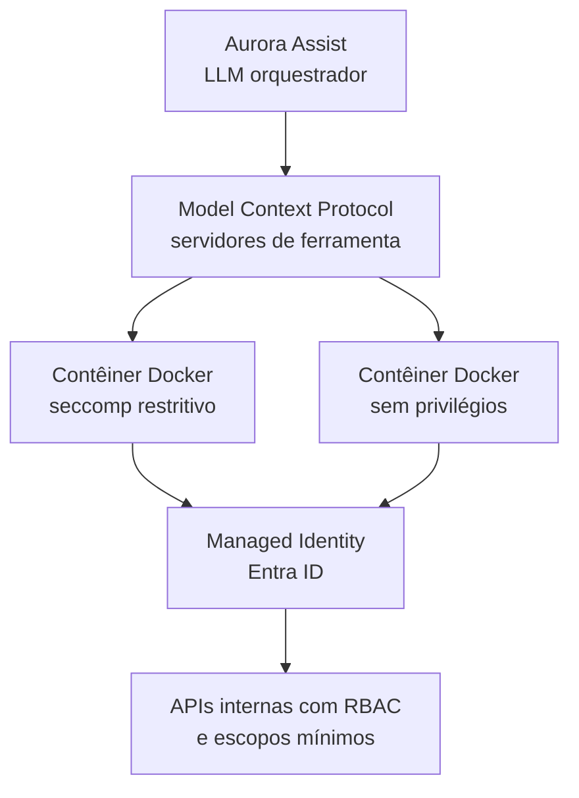

# ADR-0003: Isolamento de Ferramentas Expostas ao LLM via MCP

## Status
Aceito

## Contexto
O Aurora Assist precisa consultar sistemas auxiliares, como base de conhecimento, simuladores, extratos sintéticos, validadores de documentos e serviços internos. Entretanto, conceder agência excessiva ao LLM amplia riscos descritos pelo OWASP Top 10 for LLM Applications, especialmente LLM07: Insecure Plugin Design e LLM08: Excessive Agency.

Em sistemas bancários, uma chamada indevida de ferramenta pode causar vazamento de dados, execução de ações não autorizadas, bypass de workflow, alteração de registros ou consulta abusiva a sistemas internos. O problema arquitetural é permitir extensibilidade e tool use sem transformar o LLM em um ator privilegiado e irrestrito.

## Decisão
Expor ferramentas ao LLM por meio do **Model Context Protocol (MCP)**, com contratos explícitos de capacidade, autenticação e autorização por ferramenta. Cada servidor MCP deve operar com **least privilege**, isolado em contêineres **Docker** sem privilégios, com política **seccomp** restritiva, sistema de arquivos mínimo, variáveis de ambiente controladas e allowlist de rede.

A autenticação com serviços Azure e APIs internas será feita por **Managed Identities** do **Microsoft Entra ID**, evitando credenciais estáticas no prompt, no código ou no ambiente. As permissões devem ser concedidas por escopo mínimo e revisadas em pipeline DevSecOps. Ferramentas que executam ações de maior impacto devem exigir confirmação determinística fora do LLM, validação de política e trilha de auditoria.

A decisão separa raciocínio linguístico de autoridade operacional. O LLM pode solicitar uma ação, mas o servidor MCP valida schema, autorização, parâmetros, contexto e políticas antes de executar.

## Consequências

### Positivas
- Reduz risco de agência excessiva ao impor fronteiras explícitas entre LLM, ferramentas e sistemas internos.
- Melhora auditabilidade: cada chamada MCP pode ser logada com parâmetros, identidade, decisão de política e resultado.
- Elimina necessidade de segredos estáticos para ferramentas, usando Managed Identities e RBAC.
- Facilita evolução independente de ferramentas por contratos MCP versionados.
- Contêineres com seccomp e ausência de privilégios reduzem impacto de exploração do runtime da ferramenta.

### Negativas
- Aumenta complexidade de empacotamento, deploy e observabilidade de servidores MCP.
- Requer desenho cuidadoso de contratos para evitar ferramentas genéricas demais, como “executar SQL arbitrário”.
- Pode introduzir latência por validações adicionais e hops de rede.
- Políticas seccomp muito restritivas podem quebrar bibliotecas ou SDKs que dependem de syscalls específicas.

## Alternativas Consideradas
1. **Function calling direto sem isolamento** - Rejeitada porque acopla o LLM a funções de alto privilégio e dificulta impor fronteiras de segurança consistentes.
2. **Plugins monolíticos com muitas permissões** - Rejeitada por aumentar blast radius e contrariar least privilege.
3. **Ferramentas executadas no mesmo processo da aplicação principal** - Rejeitada porque falhas de validação ou execução afetam diretamente o processo crítico do assistente.
4. **Sem ferramentas externas** - Rejeitada porque limitaria o Aurora Assist a conhecimento estático, reduzindo utilidade e atualidade.

## Referências
- Model Context Protocol. *Specification and documentation*. https://modelcontextprotocol.io/
- OWASP Foundation. *OWASP Top 10 for LLM Applications*. https://owasp.org/www-project-top-10-for-large-language-model-applications/
- Microsoft. *Managed identities for Azure resources*. https://learn.microsoft.com/entra/identity/managed-identities-azure-resources/overview
- Microsoft. *Microsoft Entra ID documentation*. https://learn.microsoft.com/entra/
- Docker. *Seccomp security profiles for Docker*. https://docs.docker.com/engine/security/seccomp/
- MITRE. *ATLAS: Adversarial Threat Landscape for Artificial-Intelligence Systems*. https://atlas.mitre.org/

Voltar para [Visão Geral da Arquitetura](../overview.md)
