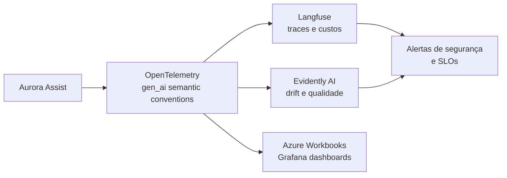

# ADR-0004: Observabilidade e LLMOps para Segurança e Qualidade

## Status
Aceito

## Contexto
A segurança do Aurora Assist não pode depender apenas de controles síncronos no momento da inferência. Em produção, modelos e prompts sofrem drift comportamental, mudanças de distribuição de usuários, degradação de qualidade, novas técnicas de ataque e alterações de custo. Para um assistente bancário, é necessário observar cada etapa da cadeia: entrada, guardrails, recuperação de contexto, chamadas a ferramentas, inferência, validação de saída e decisão final.

A arquitetura deve responder a perguntas operacionais e acadêmicas: quais políticas bloquearam uma interação, qual foi a latência por camada, quantos tokens foram consumidos, quais prompts geraram maior risco, se há drift na distribuição de intenções e se a qualidade factual está degradando. Também é necessário padronizar telemetria para evitar aprisionamento em uma única plataforma.

## Decisão
Adotar **OpenTelemetry** como padrão de instrumentação e transporte de telemetria, seguindo as **gen_ai semantic conventions** para spans, atributos, eventos e métricas de aplicações generativas. Sobre essa base, utilizar **Langfuse** para tracing detalhado por step — latência, tokens, custo, prompt, resposta, guardrail acionado e avaliação humana — e **Evidently AI** para monitoramento de drift, qualidade, regressão e métricas de avaliação.

Dashboards operacionais serão construídos em **Azure Workbooks** e/ou **Grafana**, consumindo métricas e traces padronizados. Eventos de segurança, como bloqueios por prompt injection, saída recusada, violação de schema ou chamada MCP negada, devem ser observáveis como sinais de primeira classe.

A decisão separa instrumentação de visualização. OpenTelemetry garante portabilidade; Langfuse e Evidently agregam capacidades especializadas de LLMOps; dashboards Azure/Grafana apoiam operação e governança.

## Consequências

### Positivas
- Padroniza telemetria com OpenTelemetry, reduzindo lock-in e facilitando integração com observabilidade corporativa.
- Permite análise granular de latência, custo e consumo de tokens por camada de guardrail, ferramenta e modelo.
- Viabiliza detecção de drift e regressões de qualidade com Evidently AI.
- Facilita auditoria e explicabilidade operacional para incidentes de segurança em LLM.
- Apoia experimentação acadêmica com datasets, avaliações e comparações reprodutíveis.

### Negativas
- Exige políticas rigorosas de redaction para impedir que PII apareça em traces, prompts e datasets de avaliação.
- A instrumentação detalhada aumenta volume de dados, custo de armazenamento e complexidade de retenção.
- Métricas de qualidade em LLM podem ser probabilísticas e exigir curadoria humana para validação.
- Integrações entre Langfuse, Evidently e backends corporativos podem demandar adaptação de schemas.

## Alternativas Consideradas
1. **LangSmith como plataforma principal** - Rejeitada como padrão único por maior acoplamento ao ecossistema LangChain, embora permaneça tecnicamente viável.
2. **Arize Phoenix como solução central** - Rejeitada por não cobrir, sozinha, todos os requisitos de tracing operacional, custo e integração corporativa definidos para o Banco Aurora.
3. **Solução caseira de logs e dashboards** - Rejeitada por alto custo de manutenção, menor aderência a padrões e risco de lacunas em métricas específicas de LLMOps.
4. **Apenas logs textuais da aplicação** - Rejeitada porque logs não representam adequadamente spans, etapas, custos, avaliações e relações causais entre componentes.

## Referências
- OpenTelemetry. *Semantic conventions for generative AI systems*. https://opentelemetry.io/docs/specs/semconv/gen-ai/
- OpenTelemetry. *Documentation*. https://opentelemetry.io/docs/
- Langfuse. *Documentation*. https://langfuse.com/docs
- Evidently AI. *Documentation*. https://docs.evidentlyai.com/
- Microsoft. *Azure Workbooks documentation*. https://learn.microsoft.com/azure/azure-monitor/visualize/workbooks-overview
- Grafana Labs. *Grafana documentation*. https://grafana.com/docs/grafana/latest/
- NIST. *AI Risk Management Framework*. https://www.nist.gov/itl/ai-risk-management-framework

Voltar para [Visão Geral da Arquitetura](../overview.md)
