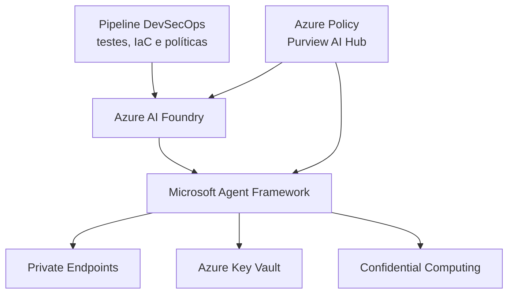

# ADR-0005: Infraestrutura e Deployment Seguro para o Aurora Assist

## Status
Aceito

## Contexto
O Aurora Assist precisa ser implantado de forma compatível com requisitos de segurança bancária, governança de IA, rastreabilidade, segregação de ambientes e conformidade regulatória. A disciplina exige que a arquitetura considere não apenas o modelo, mas todo o ciclo de vida: desenvolvimento, avaliação, aprovação, implantação, operação, monitoramento e resposta a incidentes.

Normas e frameworks como NIST AI RMF, NIST AI 100-2, ISO/IEC 42001, LGPD, GDPR e EU AI Act reforçam a necessidade de gestão de risco, governança contínua, documentação, controles técnicos e prestação de contas. Para o Banco Aurora, a infraestrutura deve reduzir exposição pública, proteger segredos, suportar auditoria e permitir controles centralizados de política.

## Decisão
Implantar o Aurora Assist em uma arquitetura gerenciada baseada em **Azure AI Foundry** e **Microsoft Agent Framework**, com **Private Endpoints**, **Azure Key Vault**, **Confidential Computing** quando aplicável a cargas sensíveis, e governança contínua com **Azure Policy** e **Microsoft Purview AI Hub**. O ciclo de entrega seguirá pipeline **DevSecOps**, integrando análise de dependências, testes de guardrails, red teaming automatizado, IaC, políticas de aprovação e evidências de conformidade.

A decisão privilegia serviços gerenciados para reduzir carga operacional e acelerar adoção de controles corporativos. Azure AI Foundry centraliza construção, avaliação e operação de aplicações de IA; Microsoft Agent Framework estrutura agentes e ferramentas; Private Endpoints reduzem exposição de rede; Key Vault protege segredos e chaves; Confidential Computing mitiga riscos em processamento sensível; Azure Policy e Purview apoiam governança, inventário, classificação e auditoria.

## Consequências

### Positivas
- Reduz esforço operacional ao usar serviços gerenciados e integrados ao ecossistema Azure.
- Melhora postura de segurança com rede privada, gestão centralizada de segredos e identidades corporativas.
- Facilita governança contínua e evidências de conformidade para NIST AI RMF e ISO/IEC 42001.
- Suporta integração com avaliações automatizadas de segurança, como PyRIT, Garak e promptfoo, no pipeline.
- Permite padronização de ambientes acadêmicos e corporativos sem abandonar controles de produção.

### Negativas
- Aumenta dependência do ecossistema Azure e de serviços gerenciados específicos.
- Pode gerar custos superiores a alternativas mínimas ou experimentais.
- Requer maturidade em IaC, RBAC, políticas e observabilidade para evitar configuração insegura.
- Confidential Computing pode impor restrições de SKU, disponibilidade regional e compatibilidade.

## Alternativas Consideradas
1. **Kubernetes self-hosted** - Oferece controle fino e portabilidade, mas aumenta responsabilidade operacional, hardening, upgrades, service mesh, secrets management e auditoria.
2. **Serverless com Azure Functions** - Simplifica execução de workloads pontuais, mas pode ser insuficiente para agentes complexos, sessões longas, tool use, tracing rico e requisitos de rede privada.
3. **On-premises puro** - Maximiza controle físico e soberania operacional, mas eleva custo, reduz elasticidade e dificulta uso de serviços gerenciados de avaliação, governança e segurança de IA.

| Alternativa | Segurança | Operação | Escalabilidade | Governança | Motivo da decisão |
|---|---:|---:|---:|---:|---|
| Azure AI Foundry + Microsoft Agent Framework | Alta | Média | Alta | Alta | Melhor equilíbrio entre controles gerenciados, governança e velocidade acadêmica/experimental. |
| Kubernetes self-hosted | Alta, se bem operado | Alta complexidade | Alta | Média | Exige equipe madura de plataforma e maior superfície de configuração. |
| Serverless com Functions | Média | Baixa complexidade | Alta para eventos curtos | Média | Menos adequado para agentes conversacionais com estado, ferramentas e tracing detalhado. |
| On-premises puro | Variável | Alta complexidade | Limitada | Alta localmente | Reduz dependência de nuvem, mas aumenta custo e diminui acesso a serviços gerenciados de IA. |

## Referências
- Microsoft. *Azure AI Foundry documentation*. https://learn.microsoft.com/azure/ai-foundry/
- Microsoft. *Microsoft Agent Framework documentation*. https://learn.microsoft.com/agent-framework/
- Microsoft. *Azure Private Endpoint documentation*. https://learn.microsoft.com/azure/private-link/private-endpoint-overview
- Microsoft. *Azure Key Vault documentation*. https://learn.microsoft.com/azure/key-vault/
- Microsoft. *Azure confidential computing documentation*. https://learn.microsoft.com/azure/confidential-computing/
- Microsoft. *Azure Policy documentation*. https://learn.microsoft.com/azure/governance/policy/
- Microsoft. *Microsoft Purview AI Hub*. https://learn.microsoft.com/purview/ai-hub
- NIST. *Artificial Intelligence Risk Management Framework (AI RMF 1.0)*. https://www.nist.gov/itl/ai-risk-management-framework
- NIST. *Adversarial Machine Learning: A Taxonomy and Terminology of Attacks and Mitigations (AI 100-2e2025)*. https://csrc.nist.gov/pubs/ai/100/2/e2025/final
- ISO. *ISO/IEC 42001 Artificial intelligence management system*. https://www.iso.org/standard/81230.html
- European Commission. *EU AI Act*. https://digital-strategy.ec.europa.eu/en/policies/regulatory-framework-ai

Voltar para [Visão Geral da Arquitetura](../overview.md)
