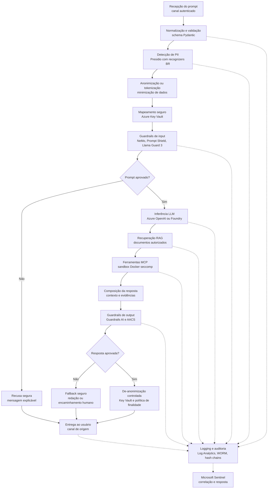

# Fluxo de Dados — Prompt à Resposta

Este documento descreve o caminho de dados do **Aurora Assist**, desde o prompt do usuário até a resposta final. O objetivo é demonstrar como o **Banco Aurora** aplica proteção de dados, guardrails, rastreabilidade e conformidade sem perder a capacidade de auditoria acadêmica.

## Fluxo principal

## Controles de segurança por etapa

| Etapa | Risco mitigado | Controle aplicado | Referenciais |
|---|---|---|---|
| Recepção do prompt | Uso indevido, sessão sequestrada, abuso de taxa | Autenticação forte, Entra ID, rate limiting, correlação de sessão | Zero Trust, NIST AI RMF |
| Normalização e validação | Payload malformado, bypass por encoding, prompt smuggling | Pydantic, canonicalização, limites de tamanho, validação de tipo | OWASP LLM01, LLM02 |
| Detecção de PII | Exposição de CPF, conta, e-mail, telefone e dados financeiros | Microsoft Presidio com recognizers brasileiros | LGPD, GDPR |
| Anonimização ou tokenização | Tratamento excessivo de dados pessoais | Minimização, pseudonimização e política de finalidade | LGPD Art. 6, GDPR Art. 5 |
| Key Vault | Reidentificação não autorizada | Segregação de chaves, Managed Identities, RBAC e trilha de acesso | ISO/IEC 42001, Zero Trust |
| Guardrails de input | Jailbreak, prompt injection e exfiltração | NeMo Guardrails, Prompt Shield, Llama Guard 3 | OWASP Top 10 for LLM, MITRE ATLAS |
| Inferência | Alucinação, conteúdo inseguro, overreliance | Azure OpenAI, parâmetros controlados, avaliação contínua | NIST AI 100-2, NIST AI RMF |
| RAG | Data poisoning, recuperação indevida, vazamento entre clientes | ACL por documento, classificação Purview, groundedness com RAGAS | OWASP LLM03, LLM06 |
| Ferramentas MCP | Tool abuse, SSRF, execução perigosa, escalonamento | Contratos MCP, allowlist, Docker seccomp, rede segmentada | OWASP LLM07, MITRE ATLAS |
| Guardrails de output | Vazamento de PII, aconselhamento indevido, conteúdo proibido | Guardrails AI, Azure AI Content Safety, validação de schema | LGPD, EU AI Act |
| De-anonimização | Reidentificação fora de finalidade | Key Vault, autorização contextual e logging | LGPD, GDPR |
| Logging e auditoria | Evidência incompleta, repúdio, adulteração | Log Analytics, WORM, hash chains e retenção definida | ISO/IEC 42001, NIST AI RMF |
| SIEM | Detecção tardia de incidentes | Sentinel, regras MITRE ATLAS, playbooks e CVSS-AI | NIST AI 100-2 |

## Princípios de proteção de dados

- **Minimização:** o LLM recebe apenas dados necessários para a finalidade da interação.
- **Pseudonimização por padrão:** PII sensível é substituída por tokens antes dos guardrails e da inferência.
- **Finalidade explícita:** de-anonimização só ocorre quando há base legal, autorização e necessidade operacional.
- **Rastreabilidade:** decisões de bloqueio, recusa, recuperação RAG e uso de ferramentas são registradas com identificadores de correlação.
- **Retenção limitada:** logs operacionais e evidências de auditoria seguem política de retenção alinhada à DPIA.

## Observabilidade do fluxo

O fluxo emite traces e métricas para **Langfuse**, **OpenTelemetry**, **Azure Monitor** e **Application Insights**. Para governança de qualidade, o Banco Aurora monitora taxa de recusa, groundedness, incidentes de PII, drift, latência, custo por sessão, uso de ferramentas e sinais de viés com **Evidently AI**, **Fairlearn** e **AIF360**.
