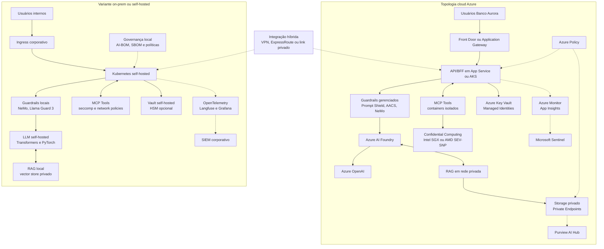

# Deployment — Cloud Azure e Variante On-Prem

Este documento apresenta duas topologias para o **Aurora Assist**: uma implantação cloud-first em Azure e uma variante on-prem/self-hosted para cenários de maior controle operacional. Ambas preservam os princípios de **Zero Trust**, **defense-in-depth**, observabilidade LLMOps, governança e conformidade.

## Topologia comparativa

## Referenciais normativos considerados

As duas topologias são avaliadas contra **OWASP Top 10 for LLM Applications**, **MITRE ATLAS**, **NIST AI 100-2**, **NIST AI RMF**, **ISO/IEC 42001**, **LGPD**, **GDPR** e **EU AI Act**. A diferença central está na alocação de responsabilidades: na cloud, parte dos controles é herdada de serviços gerenciados; no on-prem, a organização precisa operar diretamente evidências, controles técnicos, segurança física, governança de modelos e resposta a incidentes.

## Implantação cloud Azure

A topologia Azure é recomendada para acelerar experimentação acadêmica e demonstrar controles nativos de plataforma:

- **Azure AI Foundry e Azure OpenAI:** hospedagem e governança de modelos, avaliações e endpoints.
- **Azure Key Vault:** proteção de chaves, segredos e mapeamentos de tokenização reversível.
- **Private Endpoints:** isolamento de tráfego para storage, Key Vault e serviços de IA.
- **Confidential Computing:** proteção adicional de workloads sensíveis com Intel SGX ou AMD SEV-SNP.
- **Microsoft Sentinel:** SIEM para correlação de eventos, alertas MITRE ATLAS e playbooks.
- **Purview AI Hub:** catálogo, linhagem, classificação e governança de ativos de IA.
- **Azure Policy:** enforcement de configurações, tags, rede privada, logging e regiões permitidas.
- **DevSecOps:** pipelines com Garak, PyRIT, promptfoo, IaC Bicep e AI-BOM/SBOM CycloneDX.

## Variante on-prem/self-hosted

A variante on-prem é útil para comparar trade-offs de soberania, latência e controle:

- **Kubernetes self-hosted:** execução do BFF, orquestrador, guardrails e ferramentas MCP.
- **LLM local:** modelos via Hugging Face Transformers e PyTorch, com Llama Guard 3 local.
- **Vault self-hosted:** gestão de segredos e tokenização com HSM quando aplicável.
- **Network policies e seccomp:** isolamento granular para ferramentas e conectores.
- **Observabilidade local:** OpenTelemetry, Langfuse, Grafana e SIEM corporativo.
- **Governança por artefatos:** AI-BOM, SBOM, controles de mudança e auditoria interna.

## Comparativo on-prem × cloud

| Critério | Cloud Azure | On-prem/self-hosted |
|---|---|---|
| Custo | Menor custo inicial, cobrança por uso, custos variáveis de tokens e telemetria. | Maior CAPEX/OPEX, necessidade de GPUs, storage, operação e equipe especializada. |
| Controle | Alto controle lógico com Azure Policy, Private Endpoints e RBAC, mas dependente do provedor. | Máximo controle físico e operacional, com maior responsabilidade de hardening. |
| Conformidade | Facilita evidências com Purview, Sentinel, Azure Monitor, certificações e políticas gerenciadas. | Exige implementação própria de evidências, retenção, classificação, auditoria e controles. |
| Esforço operacional | Menor esforço para provisionamento, escalabilidade e atualização de serviços gerenciados. | Maior esforço para patching, capacity planning, MLOps, segurança e disponibilidade. |
| Segurança de dados | Key Vault, Managed Identities, Private Endpoints e Confidential Computing integrados. | Depende de HSM, vault, segmentação, hardening de Kubernetes e práticas internas. |
| Observabilidade | Integração nativa com Azure Monitor, App Insights, Sentinel, Workbooks e Grafana. | Flexível, mas requer integração manual de OpenTelemetry, Langfuse, Grafana e SIEM. |
| Escalabilidade | Escala elástica e rápida para experimentos e cargas variáveis. | Limitada pela capacidade local e ciclo de aquisição de hardware. |
| Portabilidade | Forte integração com Azure AI Foundry e Azure OpenAI. | Maior portabilidade de modelos e menor dependência de APIs gerenciadas. |

## Decisão recomendada para o repositório acadêmico

Para o percurso das oito aulas, a arquitetura recomenda uma abordagem **cloud-first com variante on-prem documentada**. A cloud permite demonstrar rapidamente controles de plataforma, governança e observabilidade. A variante on-prem sustenta discussões de mestrado sobre soberania, confidencialidade, custo total de propriedade e responsabilidades de segurança em modelos self-hosted.
