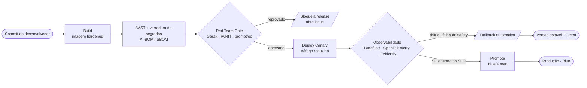

# 🚀 Deploy Seguro — Blue/Green + Canary com Gates de Red Team

> Estratégia de **implantação segura** do assistente bancário **Aurora Assist** (**Banco Aurora**): pipeline **DevSecOps** com **blue/green + canary**, *gates* de **red team** (Garak, PyRIT, promptfoo) em CI/CD e **rollback automatizado** disparado por *drift* ou falha de *safety*. Escopo estritamente de **segurança e operação segura** de sistemas de LLM.

## 🧭 Princípios

- 🧪 **Segurança como *gate*, não como revisão tardia** — cada estágio só avança se o anterior passar.
- 🟦🟩 **Blue/Green** — versão estável (*green*) permanece pronta para *rollback* instantâneo enquanto a nova (*blue*) é promovida.
- 🐤 **Canary** — exposição gradual a uma fração do tráfego, sob observabilidade de segurança.
- ↩️ **Rollback automatizado** — *drift*/*safety* fora do SLO reverte para a versão estável sem intervenção manual.

## 🔧 Pipeline DevSecOps

**Sequência.** `build` de imagem endurecida → `SAST`/segredos + geração de **AI-BOM/SBOM** → **Red Team Gate** (bloqueia release em caso de falha crítica) → **Canary** → **Observabilidade** (decide *promote* ou *rollback*) → **Promote Blue/Green** ou **Rollback automático**.

---

## 🚦 Gates do Pipeline

| Gate | Ferramenta | Critério de aprovação | Ação em falha |
|---|---|---|---|
| 🔍 SAST + Segredos | Scanner SAST + *secret scanning* (DevSecOps) | Zero vulnerabilidades críticas/altas; nenhum segredo exposto | Bloqueia o pipeline e notifica |
| 📦 Cadeia de Suprimentos | AI-BOM / SBOM + verificação de proveniência | Modelos Ollama e dependências com proveniência verificada e *pinning* | Quarentena do artefato; bloqueia release |
| 🧨 Red Team Gate | **Garak** · **PyRIT** · **promptfoo** | Taxa de sucesso de ataque abaixo do limiar; zero falhas críticas de injeção/PII | Reprova release e abre *issue* de correção |
| 🐤 Canary (Safety) | **Langfuse** · **OpenTelemetry** | SLIs de segurança/latência dentro do SLO no tráfego canário | *Rollback* automático para *green* |
| 📉 Drift/Qualidade | **Evidently AI** · **RAGAS** | Sem *drift* significativo (PSI/KS); *groundedness* ≥ limiar | *Rollback* automático para *green* |
| ✅ Promote Blue/Green | **Azure Policy** (governança) | Todos os *gates* anteriores verdes; conformidade validada | Mantém *green*; impede promoção |

---

## ↩️ Estratégia de Rollback

- **Disparo automático.** Violação de SLO de *safety* (ex.: aumento de bloqueios de conteúdo/PII) ou *drift* detectado (PSI/KS) reverte o tráfego para a versão **green** estável.
- **Imutabilidade da versão estável.** O *green* nunca é sobrescrito antes da promoção completa do *blue*, garantindo reversão em segundos.
- **Evidência.** Todo *rollback* gera trilha de auditoria para *due diligence* e análise pós-incidente.

## 🎓 Relação com as Aulas

- 🧪 **[Aula 4 · Testes de Segurança e Auditoria](../../../aula04_testes_seguranca_auditoria/)** — *red teaming* automatizado (Garak, PyRIT, promptfoo) como *gate* de CI/CD e geração de evidências.
- 🏛️ **[Aula 8 · Governança e Deploy Seguro](../../../aula08_governanca_deploy_seguro/)** — blue/green + canary, AI-BOM/SBOM, Azure Policy e governança contínua (NIST AI RMF, ISO/IEC 42001, EU AI Act).

---

## 🔗 Referências e Navegação

- ⬆️ [Visão Geral da Arquitetura de Segurança](../overview.md)
- 🎯 [Modelo de Ameaças](threat-model.md)
- 🔐 [Arquitetura Zero Trust](zero-trust-architecture.md)
- 🧩 ADR: [Deploy Seguro e Gates](../adr/0005-deploy-seguro-gates.md) · [Observabilidade e LLMOps](../adr/0004-observabilidade-llmops.md)

---

*Deploy seguro — Banco Aurora / Aurora Assist · Blue/Green + Canary com gates de red team em DevSecOps.*
