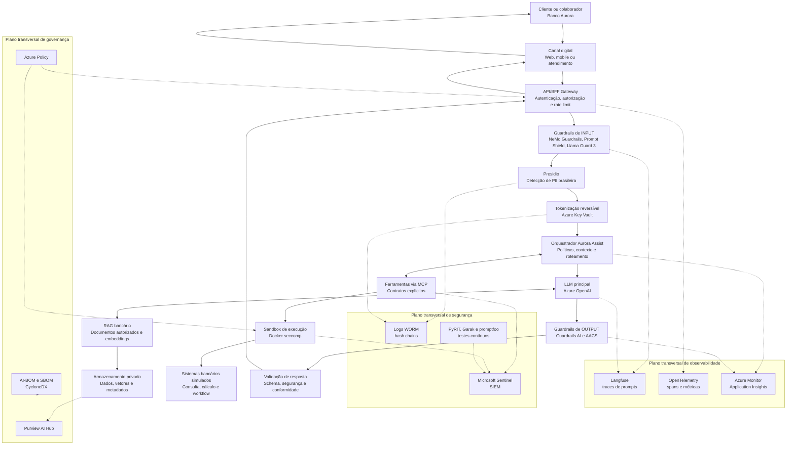

# Diagrama de Arquitetura do Sistema — Aurora Assist

Este documento descreve a arquitetura end-to-end do **Aurora Assist**, chatbot bancário do **Banco Aurora**. O desenho enfatiza a separação entre canais, orquestração, guardrails, inferência, ferramentas isoladas, proteção de dados e planos transversais de observabilidade, auditoria e SIEM.

## Arquitetura end-to-end

## Referenciais de segurança e governança

A arquitetura deve ser interpretada à luz de **OWASP Top 10 for LLM Applications**, **MITRE ATLAS**, **NIST AI 100-2**, **NIST AI RMF**, **ISO/IEC 42001**, **LGPD**, **GDPR** e **EU AI Act**. Esses referenciais orientam tanto os controles preventivos, como guardrails e isolamento de ferramentas, quanto os controles detectivos, como SIEM, auditoria imutável e avaliação contínua de risco.

## Explicação dos principais componentes

| Componente | Responsabilidade | Controles principais |
|---|---|---|
| API/BFF Gateway | Centraliza entrada de canais e reduz acoplamento com clientes. | Autenticação, autorização, rate limit, correlação de sessão e Zero Trust. |
| Guardrails de input | Bloqueia prompt injection, jailbreak, exfiltração e abuso. | NeMo Guardrails, Prompt Shield, Llama Guard 3, OWASP LLM01 e LLM02. |
| Presidio e Key Vault | Detecta PII e aplica anonimização ou tokenização reversível. | Recognizers BR, Managed Identities, segregação de chaves e trilha LGPD/GDPR. |
| Orquestrador | Decide se a resposta exige RAG, ferramenta MCP ou recusa segura. | Strategy, Factory, policy-as-code, validação Pydantic. |
| Azure OpenAI | Executa inferência principal do Aurora Assist. | Rede privada, monitoramento de abuso, avaliação contínua e fallback controlado. |
| RAG bancário | Recupera conhecimento autorizado e auditável. | Controle por identidade, classificação Purview, groundedness com RAGAS. |
| MCP + Docker seccomp | Isola ferramentas e reduz risco de tool abuse. | Contratos explícitos, menor privilégio, sandbox e allowlist de operações. |
| Guardrails de output | Previne vazamento, conteúdo inseguro e respostas fora do escopo. | Guardrails AI, Azure AI Content Safety, schemas e políticas de recusa. |
| Observabilidade | Mede comportamento, qualidade, drift, latência e custo. | Langfuse, OpenTelemetry, Application Insights, Workbooks e Grafana. |
| SIEM e auditoria | Detecta incidentes e preserva evidências. | Sentinel, WORM, hash chains, MITRE ATLAS e CVSS-AI. |

## Relação com as oito aulas

1. **Ameaças e vulnerabilidades:** Garak e PyRIT exercitam ataques contra input, RAG e ferramentas.
2. **Guardrails e políticas:** NeMo Guardrails, Guardrails AI, Llama Guard 3 e Prompt Shield protegem entrada e saída.
3. **Proteção de dados e isolamento:** Presidio, Key Vault, MCP, Private Endpoints e Confidential Computing limitam exposição.
4. **Testes e auditoria:** CI/CD executa PyRIT, Garak e promptfoo; logs imutáveis sustentam investigação.
5. **Conformidade LGPD/GDPR:** DPIA, minimização, consentimento, retenção e direitos do titular são rastreados.
6. **Governança e monitoramento:** Langfuse, OpenTelemetry, Evidently AI e Azure Monitor observam qualidade e risco.
7. **Ética e viés:** Fairlearn, AIF360, RAGAS e Azure AI Evaluation SDK medem equidade, groundedness e robustez.
8. **Produção segura:** Azure AI Foundry, Purview AI Hub, Azure Policy, DevSecOps e CycloneDX governam implantação.
