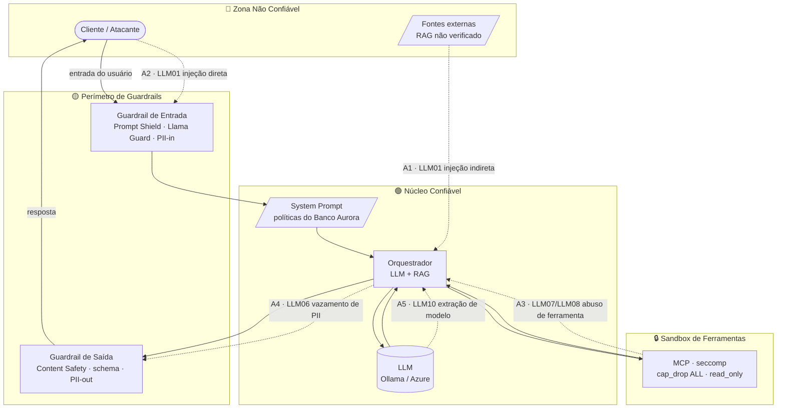

# 🎯 Modelo de Ameaças — Aurora Assist

> Modelo de ameaças do assistente bancário **Aurora Assist** (**Banco Aurora**), combinando **STRIDE** e o **OWASP Top 10 for LLM Applications (2023)**. O objetivo é mapear **ativos, superfícies de ataque e limites de confiança** e associar cada ameaça a **mitigações defensivas** e às aulas correspondentes. Escopo estritamente de **segurança de sistemas de LLM**.

## 🗂️ Ativos e Superfícies de Ataque

| Ativo | Descrição | Sensibilidade |
|---|---|---|
| 👤 Entrada do usuário | Mensagens do cliente no chat | Não confiável |
| 📄 Documentos/RAG | Fontes externas recuperadas para *grounding* | Não confiável (injeção indireta) |
| 🧱 System prompt | Políticas e instruções do Banco Aurora | Confiável — alvo de vazamento |
| 🧠 Orquestrador + LLM | Núcleo de inferência (Ollama/Azure) | Confiável — alvo de extração |
| 🔧 Ferramentas (MCP) | *Function calling* com efeitos colaterais | Privilegiado — alvo de abuso |
| 🗄️ PII / dados bancários | Dados pessoais e financeiros | Crítico (LGPD/GDPR) |
| 📜 Logs/trilhas de auditoria | Evidências de conformidade | Crítico (integridade) |

## 🔐 Limites de Confiança e Pontos de Ataque

**Pontos de ataque (A1–A5).** `A1` injeção indireta via documento envenenado no RAG; `A2` injeção direta no chat; `A3` abuso/escalonamento via ferramentas MCP; `A4` exfiltração de PII na saída; `A5` extração de modelo/system prompt por consultas adversariais.

---

## 🧭 STRIDE aplicado ao Aurora Assist

| Categoria STRIDE | Exemplo no Aurora Assist | Impacto | Relação OWASP LLM |
|---|---|---|---|
| **S**poofing (falsificação de identidade) | Token de sessão roubado; atacante se passa por cliente legítimo | Acesso indevido a dados/operações bancárias | LLM10 |
| **T**ampering (adulteração) | Documento do RAG adulterado com instruções ocultas; alteração de logs | Manipulação de respostas; perda de integridade da auditoria | LLM01, LLM03 |
| **R**epudiation (repúdio) | Cliente nega ter solicitado uma ação; ausência de trilha imutável | Disputa/fraude sem evidência de *due diligence* | — (governança) |
| **I**nformation Disclosure (divulgação) | Vazamento de PII/segredos em resposta ou log | Violação de LGPD/GDPR; dano reputacional | LLM06 |
| **D**enial of Service (negação de serviço) | Prompts custosos (contexto gigante, loops) exaurindo recursos | Indisponibilidade do assistente | LLM04 |
| **E**levation of Privilege (elevação de privilégio) | LLM invoca ferramenta fora do escopo; tentativa de escapar do sandbox | Execução de ações privilegiadas/irreversíveis | LLM07, LLM08 |

---

## 📊 OWASP LLM Top 10 → Vetor no Aurora → Mitigação → Aula

| Risco OWASP (2023) | Vetor no Aurora Assist | Mitigação defensiva | Aula(s) |
|---|---|---|---|
| **LLM01 · Prompt Injection** | Injeção direta no chat e indireta via RAG | Guardrail de Entrada (Prompt Shield, Llama Guard 3, NeMo); isolamento do system prompt | 1, 2 |
| **LLM02 · Insecure Output Handling** | Saída do LLM renderizada/executada sem validação (XSS, comandos) | Guardrail de Saída com validação de **schema** (Guardrails AI) e sanitização | 2 |
| **LLM03 · Training Data Poisoning** | Envenenamento da **base de conhecimento/índice RAG** ingerido | Curadoria e proveniência de fontes; validação de ingestão; isolamento de dados | 3, 6 |
| **LLM04 · Model Denial of Service** | Prompts de consumo ilimitado (contexto/loops) | **Rate limiting**, cotas, *timeouts* e limites de tokens na Borda | 1, 8 |
| **LLM05 · Supply Chain** | Modelos Ollama, pacotes e servidores MCP comprometidos | **AI-BOM/SBOM**, *pinning*, verificação de proveniência, *scan* em CI/CD | 8 |
| **LLM06 · Sensitive Information Disclosure** | Vazamento de PII bancária em resposta/logs | **Presidio** PII-in/PII-out; minimização; redação em logs | 3, 5 |
| **LLM07 · Insecure Plugin Design** | Ferramentas MCP com permissões amplas | Isolamento MCP + **sandbox** (seccomp, cap_drop ALL, read_only, internal); validação de args | 3 |
| **LLM08 · Excessive Agency** | LLM executa transferências/ações irreversíveis sozinho | *Least privilege* de ferramentas, *allowlist* de ações, **human-in-the-loop** | 1, 3 |
| **LLM09 · Overreliance** | Confiança cega em aconselhamento financeiro incorreto | *Grounding*/RAGAS, LLM-as-Judge, *disclaimers*, monitoramento de *drift* | 6, 7 |
| **LLM10 · Model Theft** | Exfiltração de modelo/pesos (Ollama) e vazamento de system prompt | AuthN/AuthZ (Entra ID), *rate limiting* anti-extração, segredos no Key Vault | 3, 8 |

---

## 🔗 Referências e Navegação

- ⬆️ [Visão Geral da Arquitetura de Segurança](../overview.md)
- 🔐 [Arquitetura Zero Trust](zero-trust-architecture.md)
- 🚀 [Deploy Seguro (Blue/Green + Canary)](secure-deployment.md)
- 🧩 ADRs: [Guardrails](../adr/0001-framework-guardrails.md) · [PII](../adr/0002-estrategia-pii.md) · [Isolamento MCP](../adr/0003-isolamento-ferramentas-mcp.md)
- 📚 Aulas: [1 · Ameaças](../../../aula01_ameacas_vulnerabilidades/) · [2 · Guardrails](../../../aula02_guardrails_politicas/) · [3 · Proteção de Dados](../../../aula03_protecao_dados_isolamento/) · [4 · Testes e Auditoria](../../../aula04_testes_seguranca_auditoria/)

---

*Modelo de ameaças — Banco Aurora / Aurora Assist · Fundamentado em STRIDE e OWASP Top 10 for LLM Applications.*
