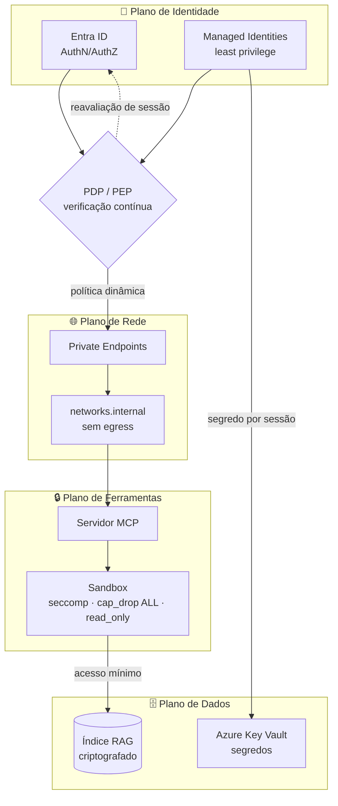

# 🔐 Arquitetura Zero Trust — Aurora Assist

> Aplicação dos princípios de **Zero Trust** (NIST SP 800-207) ao assistente bancário **Aurora Assist** (**Banco Aurora**). Premissa central: **"nunca confie, sempre verifique"** — nenhuma identidade, rede, dado ou ferramenta é confiável por padrão. A arquitetura é **identity-first**, com **microssegmentação**, **least privilege**, **sandbox de ferramentas** e **verificação contínua**.

## 🧭 Pilares Zero Trust no Aurora Assist

- 🔑 **Identity-first** — **Entra ID** e **Managed Identities** como raiz de confiança; sem credenciais estáticas de longa duração.
- 🌐 **Microssegmentação** — **Private Endpoints** e `networks.internal` (sem *egress*) isolam o núcleo e as ferramentas.
- 🎯 **Least privilege** — cada componente e ferramenta recebe o mínimo de permissões necessárias.
- 🔒 **Sandbox de ferramentas** — **MCP** com `seccomp`, `cap_drop: [ALL]`, `read_only: true`.
- 🔁 **Verificação contínua** — política dinâmica avaliada por sessão (PDP/PEP), com reavaliação constante.

## 🗺️ Topologia Zero Trust

**Fluxo de decisão.** O **PDP/PEP** (*Policy Decision/Enforcement Point*) recebe sinais de identidade (Entra ID, Managed Identities) e aplica **política dinâmica** antes de liberar o tráfego pela rede microssegmentada. Ferramentas só alcançam o índice RAG por **acesso mínimo**, e segredos são obtidos **por sessão** no Key Vault. A confiança é **reavaliada continuamente**, nunca persistida.

---

## 📐 NIST SP 800-207 → Implementação no Repositório → Aula

| Princípio (NIST SP 800-207) | Implementação no Aurora Assist | Aula |
|---|---|---|
| 1. Todos os dados/serviços são recursos protegidos | LLM, índice RAG, ferramentas MCP e Key Vault tratados como recursos com controle de acesso | 3 |
| 2. Toda comunicação é segura, independente da rede | TLS + **Private Endpoints** + `networks.internal` (sem *egress*) | 3, 8 |
| 3. Acesso concedido por sessão | Tokens **Entra ID** de curta duração; sem confiança persistente entre chamadas | 3 |
| 4. Acesso determinado por política dinâmica | *Policy-as-code* (guardrails) + **PDP/PEP** avaliando contexto e risco | 3, 8 |
| 5. Monitoramento contínuo da postura de segurança | Telemetria (Langfuse/OpenTelemetry) e auditoria alimentam a avaliação de postura | 8 |
| 6. AuthN/AuthZ dinâmica e estrita antes do acesso | **Entra ID** + **Managed Identities** verificados a cada invocação de ferramenta | 3 |
| 7. Coleta de sinais para melhorar a postura | Trilhas imutáveis + métricas realimentam políticas e *gates* de deploy | 8 |

---

## 🛠️ Controles-Chave por Plano

| Plano | Controle | Tecnologia | Risco OWASP mitigado |
|---|---|---|---|
| 🔑 Identidade | AuthN/AuthZ e identidades gerenciadas | Entra ID · Managed Identities | LLM10 |
| 🌐 Rede | Microssegmentação sem egress | Private Endpoints · networks.internal | LLM07, LLM10 |
| 🗄️ Dados | Segredos e índice criptografado | Azure Key Vault · RAG cifrado | LLM06 |
| 🔒 Ferramentas | Sandbox de execução mínima | MCP · seccomp · cap_drop ALL · read_only | LLM07, LLM08 |

---

## 🔗 Referências e Navegação

- ⬆️ [Visão Geral da Arquitetura de Segurança](../overview.md)
- 🎯 [Modelo de Ameaças](threat-model.md)
- 🚀 [Deploy Seguro (Blue/Green + Canary)](secure-deployment.md)
- 🧩 ADRs: [Isolamento de Ferramentas com MCP](../adr/0003-isolamento-ferramentas-mcp.md) · [Estratégia de PII](../adr/0002-estrategia-pii.md)
- 📚 Aulas: [3 · Proteção de Dados e Isolamento](../../../aula03_protecao_dados_isolamento/) · [8 · Governança e Deploy Seguro](../../../aula08_governanca_deploy_seguro/)

---

*Arquitetura Zero Trust — Banco Aurora / Aurora Assist · Fundamentada em NIST SP 800-207.*
