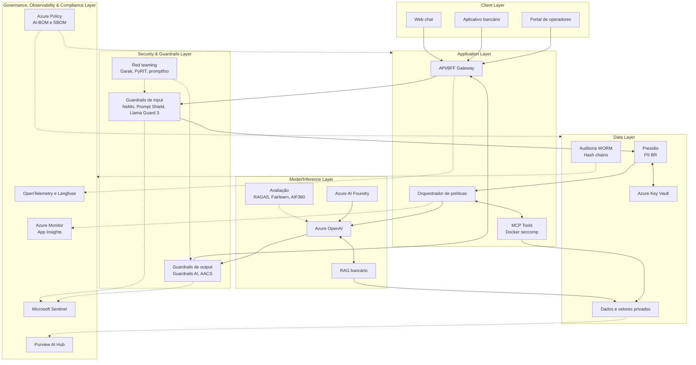

# Arquitetura de Referência — Aurora Assist

> Repositório: [`9mlet-llm-security`](https://github.com/miyake-san/9mlet-llm-security)  
> Disciplina: **Segurança, Conformidade e Guardrails para LLMs**  
> Caso condutor: **Banco Aurora** e seu assistente bancário **Aurora Assist**

## Visão Geral

O **Aurora Assist** é um chatbot bancário baseado em LLM projetado para evoluir, ao longo das oito aulas, de uma aplicação deliberadamente vulnerável para uma solução governada em produção. A arquitetura combina **defense-in-depth**, **Zero Trust**, **policy-as-code**, observabilidade LLMOps e controles de conformidade para mitigar riscos descritos por **OWASP Top 10 for LLM Applications**, **MITRE ATLAS**, **NIST AI 100-2**, **NIST AI RMF**, **ISO/IEC 42001**, **LGPD**, **GDPR** e **EU AI Act**.

A proposta acadêmica é tratar segurança de LLMs como um sistema sociotécnico: prompts, modelos, dados, ferramentas, usuários, infraestrutura, métricas e governança são analisados conjuntamente. Cada aula acrescenta uma camada de maturidade ao Aurora Assist.

## Camadas Arquiteturais

### 1. Data Layer

Responsável por ingestão, classificação, proteção, persistência e rastreabilidade dos dados bancários e dos dados de interação com o assistente.

| Capacidade | Tecnologias | Aulas relacionadas |
|---|---|---|
| Ingestão e preparação de dados | Python 3.12+, Pydantic, spaCy, NLTK, Hugging Face Transformers | A1, A3 |
| Detecção e anonimização de PII | Microsoft Presidio com recognizers BR | A3, A5 |
| Tokenização reversível | Azure Key Vault, Managed Identities | A3, A5 |
| Armazenamento seguro | Storage privado, Private Endpoints, criptografia em repouso | A3, A8 |
| Auditoria imutável | Log Analytics, WORM, hash chains | A4, A5, A6 |

### 2. Model/Inference Layer

Executa inferência, recuperação de contexto e validação do comportamento do modelo.

| Capacidade | Tecnologias | Aulas relacionadas |
|---|---|---|
| LLM principal | Azure OpenAI, Azure AI Foundry, PyTorch quando self-hosted | A1, A8 |
| Filtros de segurança de modelo | Llama Guard 3, Azure AI Content Safety | A2, A8 |
| RAG bancário | Vector store, embeddings, políticas de acesso por documento | A3, A6 |
| Avaliação de qualidade e groundedness | RAGAS, Azure AI Evaluation SDK | A7 |
| Robustez contra ataques | Garak, PyRIT, promptfoo | A1, A4 |

### 3. Application Layer

Orquestra a experiência conversacional, políticas, chamadas a ferramentas e integração com canais.

| Capacidade | Tecnologias | Aulas relacionadas |
|---|---|---|
| API e BFF | FastAPI ou framework equivalente, Pydantic, Strategy/Factory | Transversal |
| Orquestração de guardrails | NeMo Guardrails em Colang, Guardrails AI | A2 |
| Isolamento de ferramentas | Model Context Protocol, Docker com seccomp | A3 |
| DevSecOps | CI/CD com PyRIT, Garak, promptfoo e CycloneDX | A4, A8 |
| Infraestrutura como código | Bicep, Azure Policy | A8 |

### 4. Client Layer

Contém os pontos de entrada do usuário final e dos operadores internos.

| Capacidade | Tecnologias | Aulas relacionadas |
|---|---|---|
| Canais digitais | Web chat, app bancário, canais assistidos | Transversal |
| Experiência segura | Avisos, consentimento, explicabilidade proporcional | A5, A7 |
| Controle de sessão | Entra ID, autenticação forte, claims contextuais | A3, A8 |

### 5. Security & Guardrails Layer

Camada transversal que aplica controles antes, durante e depois da inferência.

- **Input guardrails:** NeMo Guardrails, Azure AI Content Safety Prompt Shield, Llama Guard 3.
- **Output guardrails:** Guardrails AI, Azure AI Content Safety, validação de esquemas Pydantic.
- **Threat modeling:** OWASP Top 10 for LLM, MITRE ATLAS e NIST AI 100-2.
- **Isolamento:** MCP, Docker seccomp, identidades gerenciadas, Private Endpoints e Confidential Computing com Intel SGX ou AMD SEV-SNP.

### 6. Governance, Observability & Compliance Layer

Camada transversal voltada a governança, monitoramento e evidências auditáveis.

- **Observabilidade LLMOps:** Langfuse, OpenTelemetry, Azure Monitor, Application Insights, Workbooks e Grafana.
- **SIEM e resposta:** Microsoft Sentinel, correlação de eventos, playbooks de investigação.
- **Governança:** Purview AI Hub, Azure Policy, AI-BOM/SBOM em CycloneDX.
- **Conformidade:** DPIA, LGPD, GDPR, EU AI Act, ISO/IEC 42001 e NIST AI RMF.
- **Equidade e validação:** Fairlearn, AIF360, Evidently AI, RAGAS e Azure AI Evaluation SDK.

## Padrões Arquiteturais

| Padrão | Aplicação no Aurora Assist |
|---|---|
| Defense-in-depth | Controles em cliente, API, guardrails, modelo, dados, ferramentas, rede e auditoria. |
| Policy-as-code | Políticas Colang, Azure Policy, regras de conteúdo e validações versionadas no repositório. |
| Guardrail gateway/sidecar | Intercepta prompts e respostas sem acoplar regras diretamente ao domínio bancário. |
| Repository | Isola acesso a logs, evidências, documentos RAG e metadados de auditoria. |
| Factory | Seleciona provedores de LLM, guardrails e avaliadores por ambiente. |
| Strategy | Permite estratégias distintas de anonimização, avaliação, red teaming e resposta a incidentes. |
| BFF/Gateway | Consolida autenticação, autorização, rate limiting, roteamento e telemetria por canal. |
| Zero Trust | Verificação explícita de identidade, menor privilégio e segmentação de rede para cada chamada. |

## Diagrama de Arquitetura

## Decisões Técnicas

As decisões arquiteturais são documentadas como ADRs:

- [ADR 0001 — Escolha de framework de guardrails](adr/0001-escolha-framework-guardrails.md)
- [ADR 0002 — Estratégia de proteção e anonimização de dados](adr/0002-estrategia-protecao-anonimizacao-dados.md)
- [ADR 0003 — Isolamento de ferramentas com MCP](adr/0003-isolamento-de-ferramentas-mcp.md)
- [ADR 0004 — Observabilidade LLMOps](adr/0004-observabilidade-llmops.md)
- [ADR 0005 — Infraestrutura e deployment seguro](adr/0005-infraestrutura-deployment-seguro.md)

## Diagramas Complementares

- [Arquitetura do sistema](diagrams/system-architecture.md)
- [Fluxo de dados](diagrams/data-flow.md)
- [Deployment on-prem vs cloud](diagrams/deployment.md)
- [Voltar ao README](../../README.md)
