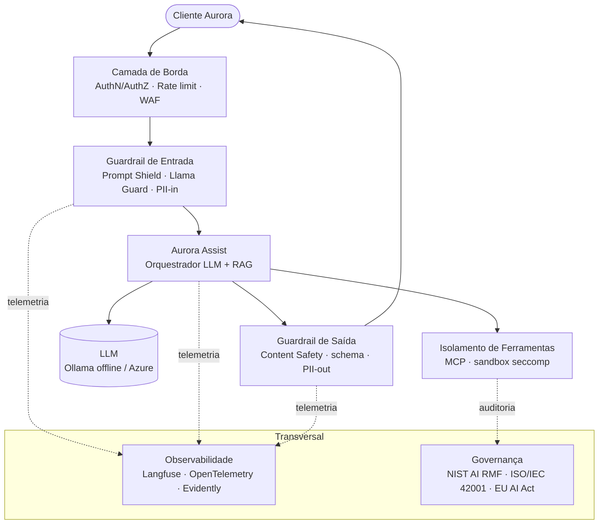

# 🛡️ Arquitetura de Segurança do Aurora Assist — Defesa em Profundidade

> Visão geral da arquitetura **defensiva** (defense-in-depth) do assistente bancário **Aurora Assist**, do **Banco Aurora**. O documento descreve **camadas de segurança**, o mapeamento a riscos do **OWASP Top 10 for LLM Applications (2023)** e a correspondência com as 8 aulas da disciplina. O foco é **exclusivamente segurança de sistemas de LLM** — não há tratamento de treino, ajuste fino ou avaliação de qualidade de modelos.

## 🧭 Princípio Arquitetural

O Aurora Assist adota **defesa em profundidade**: nenhuma camada é suficiente isoladamente. Cada controle assume que os anteriores podem falhar e reduz o **risco residual** por composição. O sistema é **offline-first** — o backend de inferência padrão é o **Ollama** local, com **Azure** como opção — e executa sob **contêineres endurecidos** (`seccomp`, `cap_drop: [ALL]`, `read_only: true`, `networks.internal`).

---

## 🧱 Camadas de Segurança

### (a) 🚪 Camada de Borda — *Edge*

**Função.** Primeiro perímetro de confiança: autentica e autoriza o cliente **antes** de qualquer contato com o LLM.

**Controles.** Autenticação e autorização via **Microsoft Entra ID** (tokens de curta duração, escopos mínimos), **rate limiting** e cotas por identidade, e **WAF** para tráfego web. É aqui que se contém abuso volumétrico e tentativas de extração por consultas massivas.

**Riscos OWASP mitigados.** `LLM04` (Model Denial of Service, por *rate limiting*/cotas), `LLM10` (Model Theft, por AuthN/AuthZ e limites anti-extração).

**Aulas.** [Aula 3 · Proteção de Dados e Isolamento](../../aula03_protecao_dados_isolamento/) · [Aula 8 · Governança e Deploy Seguro](../../aula08_governanca_deploy_seguro/)

### (b) 🧪 Guardrail de Entrada — *Input Guardrail*

**Função.** Inspeciona e sanitiza toda entrada do usuário e do contexto (RAG) antes do núcleo.

**Controles.** **Azure AI Content Safety / Prompt Shield** e **Llama Guard 3** para detecção de *prompt injection* e *jailbreak*; **NeMo Guardrails (Colang)** para *policy-as-code* de diálogo; **Microsoft Presidio** para **PII-in** (detecção/anonimização de PII bancária antes do processamento).

**Riscos OWASP mitigados.** `LLM01` (Prompt Injection), `LLM06` (Sensitive Information Disclosure, na entrada).

**Aulas.** [Aula 1 · Ameaças e Vulnerabilidades](../../aula01_ameacas_vulnerabilidades/) · [Aula 2 · Guardrails e Políticas](../../aula02_guardrails_politicas/) · [Aula 3 · Proteção de Dados](../../aula03_protecao_dados_isolamento/)

### (c) 🧠 Núcleo Aurora Assist — Orquestrador LLM + RAG

**Função.** Orquestra o fluxo conversacional, a recuperação (RAG) e a inferência. É o ativo central a ser protegido, **não** o alvo de treino/avaliação.

**Controles.** Isolamento do **system prompt** (limite de confiança), *grounding* controlado por RAG, backend **Ollama offline** (padrão) ou **Azure** (opcional). O orquestrador nunca confia diretamente na saída do modelo: encaminha-a ao guardrail de saída.

**Riscos OWASP mitigados.** `LLM01` (superfície de injeção via contexto), `LLM09` (Overreliance, por *grounding* verificável).

**Aulas.** [Aula 1 · Ameaças](../../aula01_ameacas_vulnerabilidades/) · [Aula 2 · Guardrails](../../aula02_guardrails_politicas/)

### (d) 🔒 Isolamento de Ferramentas — *Tool Sandbox*

**Função.** Confina a execução de ferramentas (*function calling*) para conter **agência excessiva** e escapes.

**Controles.** **MCP (Model Context Protocol)** como fronteira de invocação, com **sandbox** endurecida: `seccomp`, `cap_drop: [ALL]`, `read_only: true`, `networks.internal` (sem *egress*). *Least privilege* por ferramenta, validação de argumentos e **human-in-the-loop** para ações irreversíveis (ex.: transferências).

**Riscos OWASP mitigados.** `LLM07` (Insecure Plugin Design), `LLM08` (Excessive Agency).

**Aulas.** [Aula 3 · Proteção de Dados e Isolamento](../../aula03_protecao_dados_isolamento/)

### (e) 🧾 Guardrail de Saída — *Output Guardrail*

**Função.** Valida e sanitiza a resposta **antes** de devolvê-la ao cliente.

**Controles.** **Azure AI Content Safety** para conteúdo inseguro; **Guardrails AI (Pydantic)** para validação de **schema**/contrato de saída; **Presidio** para **PII-out** (redação de dados sensíveis que escapariam ao usuário).

**Riscos OWASP mitigados.** `LLM02` (Insecure Output Handling), `LLM06` (Sensitive Information Disclosure, na saída).

**Aulas.** [Aula 2 · Guardrails](../../aula02_guardrails_politicas/) · [Aula 5 · Conformidade LGPD/GDPR](../../aula05_conformidade_lgpd_gdpr/) · [Aula 7 · Ética, Viés e Validação](../../aula07_etica_vies_validacao/)

### (f) 📊 Observabilidade — *Transversal*

**Função.** Fornece visibilidade contínua de segurança, custo e qualidade operacional (LLMOps defensivo).

**Controles.** **Langfuse** (*tracing* de interações), **OpenTelemetry** (telemetria distribuída) e **Evidently AI** (detecção de *drift*: PSI/KS). Alimenta os *gates* de deploy e a resposta a incidentes.

**Riscos OWASP mitigados.** `LLM09` (Overreliance/degradação), suporte transversal a `LLM01`–`LLM10` por detecção e auditoria.

**Aulas.** [Aula 4 · Testes de Segurança e Auditoria](../../aula04_testes_seguranca_auditoria/) · [Aula 6 · Governança e Monitoramento](../../aula06_governanca_monitoramento/)

### (g) 🏛️ Governança e Deploy — *Transversal*

**Função.** Assegura implantação segura e conformidade contínua ao longo do ciclo de vida.

**Controles.** **Blue/Green + Canary** com *gates* de **red team** (Garak, PyRIT, promptfoo) em CI/CD; **rollback** automatizado por *drift*/*safety*; alinhamento a **NIST AI RMF**, **ISO/IEC 42001** e **EU AI Act**; **AI-BOM/SBOM** e **Azure Policy**.

**Riscos OWASP mitigados.** `LLM05` (Supply Chain), reforço a `LLM01`/`LLM06`/`LLM08` via *gates* de teste.

**Aulas.** [Aula 4 · Testes e Auditoria](../../aula04_testes_seguranca_auditoria/) · [Aula 5 · Conformidade](../../aula05_conformidade_lgpd_gdpr/) · [Aula 8 · Governança e Deploy Seguro](../../aula08_governanca_deploy_seguro/)

---

## 📋 Camadas × Riscos × Aulas

| Camada | Função de segurança | Principais controles | Riscos OWASP (2023) | Aula(s) |
|---|---|---|---|---|
| 🚪 Borda | Autenticar/autorizar e conter abuso | Entra ID · Rate limit · WAF | LLM04, LLM10 | 3, 8 |
| 🧪 Guardrail de Entrada | Filtrar injeção e PII na entrada | Prompt Shield · Llama Guard 3 · NeMo · Presidio | LLM01, LLM06 | 1, 2, 3 |
| 🧠 Núcleo (LLM + RAG) | Orquestrar com *grounding* controlado | System prompt isolado · RAG · Ollama/Azure | LLM01, LLM09 | 1, 2 |
| 🔒 Isolamento de Ferramentas | Conter agência excessiva | MCP · seccomp · cap_drop ALL · read_only · internal | LLM07, LLM08 | 3 |
| 🧾 Guardrail de Saída | Validar schema e redigir PII | Content Safety · Guardrails AI · Presidio | LLM02, LLM06 | 2, 5, 7 |
| 📊 Observabilidade | Detectar drift e auditar | Langfuse · OpenTelemetry · Evidently | LLM09 (+ transversal) | 4, 6 |
| 🏛️ Governança/Deploy | Implantar com gates e conformidade | Blue/Green · Canary · Garak/PyRIT/promptfoo · AI-BOM | LLM05 (+ reforço) | 4, 5, 8 |

## 🔗 Mapeamento OWASP LLM Top 10 → Camada Primária

| Risco OWASP (2023) | Camada primária de defesa | Aula(s) |
|---|---|---|
| LLM01 · Prompt Injection | Guardrail de Entrada | 1, 2 |
| LLM02 · Insecure Output Handling | Guardrail de Saída | 2 |
| LLM03 · Training Data Poisoning *(base RAG/conhecimento)* | Isolamento/curadoria de dados | 3, 6 |
| LLM04 · Model Denial of Service | Camada de Borda | 1, 8 |
| LLM05 · Supply Chain Vulnerabilities | Governança/Deploy (AI-BOM/SBOM) | 8 |
| LLM06 · Sensitive Information Disclosure | Guardrails de Entrada/Saída (Presidio) | 3, 5 |
| LLM07 · Insecure Plugin Design | Isolamento de Ferramentas (MCP) | 3 |
| LLM08 · Excessive Agency | Isolamento de Ferramentas + HITL | 1, 3 |
| LLM09 · Overreliance | Núcleo (grounding) + Observabilidade | 6, 7 |
| LLM10 · Model Theft | Camada de Borda + Governança | 3, 8 |

> Detalhamento completo de vetores e mitigações em **[Modelo de Ameaças](diagrams/threat-model.md)**.

---

## 🧩 Decisões Técnicas (ADRs)

As escolhas arquiteturais estão registradas como **Architecture Decision Records**:

- [ADR-0001 · Framework de Guardrails em Camadas](adr/0001-framework-guardrails.md) — camadas (b) e (e).
- [ADR-0002 · Estratégia de PII](adr/0002-estrategia-pii.md) — PII-in/PII-out com Presidio.
- [ADR-0003 · Isolamento de Ferramentas com MCP](adr/0003-isolamento-ferramentas-mcp.md) — camada (d).
- [ADR-0004 · Observabilidade e LLMOps](adr/0004-observabilidade-llmops.md) — camada (f).
- [ADR-0005 · Deploy Seguro e Gates](adr/0005-deploy-seguro-gates.md) — camada (g).

## 🗺️ Diagramas Relacionados

- 🎯 [Modelo de Ameaças (STRIDE + OWASP LLM)](diagrams/threat-model.md)
- 🔐 [Arquitetura Zero Trust](diagrams/zero-trust-architecture.md)
- 🚀 [Deploy Seguro (Blue/Green + Canary)](diagrams/secure-deployment.md)

---

*Documento de arquitetura de segurança — Banco Aurora / Aurora Assist · Disciplina "Segurança, Guardrails e Conformidade para LLMs".*
