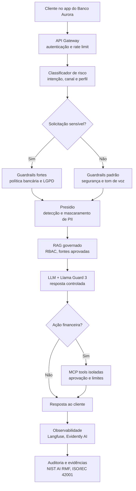

# Business Case: Aurora Assist — Assistente Bancário Seguro

## Contexto de Negócio

O **Banco Aurora** deseja escalar atendimento digital sem aumentar proporcionalmente o contact center. O **Aurora Assist** responde dúvidas sobre conta, cartões, PIX, crédito, investimentos e contestação de transações, usando RAG sobre políticas internas e integrações controladas com sistemas bancários.

O caso é estratégico porque combina alto volume, dados pessoais, risco financeiro e exposição regulatória. Em vez de tratar segurança como etapa final, o banco adota **Secure LLMOps** desde o desenho.

## Problema

Chatbots bancários com LLM podem gerar perdas por prompt injection, vazamento de PII, alucinação de taxas e prazos, execução indevida de ferramentas e ausência de evidências para auditoria LGPD, Banco Central e governança de IA.

## Solução com LLM Seguro

A solução combina classificação de intenção e risco, detecção de prompt injection, redaction de PII, RAG com controle de acesso, guardrails de resposta, ferramentas isoladas por MCP e telemetria com Langfuse/Evidently AI.

### Arquitetura da Solução

## ROI Esperado

Premissas: 1,2 milhão de interações digitais/mês; custo humano médio de R$ 7,50; 28% das interações elegíveis para automação segura no primeiro ano; custo anual da plataforma e governança de R$ 4,2 milhões; redução de perdas operacionais de R$ 1,8 milhão/ano.

**Benefício anual estimado:** 1.200.000 × 28% × R$ 7,50 × 12 = **R$ 30,24 milhões** em capacidade evitada. Com custos e ajustes conservadores, ROI líquido aproximado de **520% no ano 1** e payback em **2 a 3 meses**.

## Métricas de Sucesso

| Métrica | Baseline | Meta em 12 meses |
|---|---:|---:|
| Deflexão segura de atendimento | 8% | 28% |
| Taxa de jailbreak bem-sucedido em testes | 18% | < 2% |
| Vazamento de PII em respostas/logs | 3,0 por 10 mil sessões | < 0,2 por 10 mil sessões |
| First Contact Resolution digital | 42% | 62% |
| Alucinação em respostas reguladas | 7% | < 1,5% |
| Tempo médio de atendimento | 9 min | 3,5 min |
| Evidências de auditoria geradas automaticamente | 15% | 85% |

## Riscos e Mitigações

| Risco | Impacto | Mitigação |
|---|---|---|
| Prompt injection no RAG | Vazamento ou resposta manipulada | Garak/PyRIT, isolamento de contexto, filtros OWASP LLM, allowlist de fontes |
| Exposição de dados pessoais | Multas LGPD e dano reputacional | Presidio, Purview, minimização de logs, criptografia e retenção limitada |
| Ação financeira indevida | Perda financeira direta | MCP com escopo mínimo, aprovação humana e limites transacionais |
| Viés em oferta de crédito | Discriminação e risco regulatório | Fairlearn/AIF360, validação por segmentos, governança NIST AI RMF |
| Drift de comportamento | Degradação silenciosa | Evidently AI, Langfuse, alertas e revalidação periódica |

## Tecnologias

Garak, PyRIT, NeMo Guardrails, Guardrails AI, Llama Guard 3, Azure AI Content Safety, Microsoft Presidio, MCP, Azure Key Vault, Evidently AI, Langfuse, Fairlearn, AIF360, RAGAS, Azure AI Foundry, Azure Policy e Purview.

## Implementação

- [Aula 1 — Ameaças e vulnerabilidades](../../aula01_ameacas_vulnerabilidades/)
- [Aula 2 — Guardrails e políticas](../../aula02_guardrails_politicas/)
- [Aula 3 — Proteção de dados e isolamento](../../aula03_protecao_dados_isolamento/)
- [Aula 4 — Testes de segurança e auditoria](../../aula04_testes_seguranca_auditoria/)
- [Aula 6 — Governança e monitoramento](../../aula06_governanca_monitoramento/)
- [Aula 8 — Governança de IA e produção](../../aula08_governanca_deploy_seguro/)

## Referências

- OWASP Foundation — OWASP Top 10 for Large Language Model Applications.
- MITRE — ATLAS: Adversarial Threat Landscape for Artificial-Intelligence Systems.
- NIST — Artificial Intelligence Risk Management Framework 1.0.
- ISO/IEC 42001:2023 — Artificial intelligence management system.
- European Union — EU Artificial Intelligence Act.
- OpenAI, 2023 — postmortem público sobre bug de biblioteca open-source e exposição limitada de dados.
- Reuters e imprensa especializada, 2023 — restrições corporativas ao uso de IA generativa por risco de vazamento de dados.
