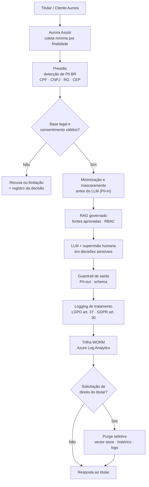

# Business Case: Conformidade LGPD/GDPR/EU AI Act — Aurora Assist

## Contexto de Negócio

O **Aurora Assist** automatiza o atendimento do **Banco Aurora** processando, a cada interação, **dados pessoais** e **dados pessoais sensíveis** sob sigilo bancário: CPF, CNPJ, RG, CEP, número de conta, cartão e histórico transacional. Como instituição financeira com clientes no Brasil e na União Europeia, o banco está simultaneamente sujeito à **LGPD** (Lei nº 13.709/2018), ao **GDPR** (Regulation (EU) 2016/679) e ao **EU AI Act** (Regulation (EU) 2024/1689).

Diferentemente do [business case base](business-case-aurora-assist-guardrails.md) — cujo ROI é orientado à **deflexão segura de atendimento** — este caso trata especificamente do **risco regulatório de privacidade**: a probabilidade e o impacto de tratar dados pessoais em um sistema de LLM sem os controles exigidos por lei. A tese é que **conformidade demonstrável** (não apenas declarada) é um requisito de engenharia que se converte em **perda evitada**.

## Problema / Risco Regulatório

Um assistente bancário com LLM cria caminhos de não conformidade que não existem em canais tradicionais:

- 🔓 **Vazamento de PII** em respostas, *prompts*, *traces* de observabilidade e logs de aplicação (LGPD art. 6º; GDPR art. 5).
- 🧠 **Memorização e reuso** de dados pessoais em contexto de RAG e histórico de conversa, sem base legal clara (LGPD arts. 7º/11; GDPR arts. 6/9).
- ⚖️ **Decisão automatizada** que afeta o titular sem supervisão humana ou explicabilidade (GDPR art. 22; EU AI Act — sistemas de alto risco).
- 🗂️ **Ausência de registro** das operações de tratamento e de **DPIA**, inviabilizando auditoria pela ANPD e *due diligence* (LGPD art. 37; GDPR arts. 30/35).
- ⏱️ **Incapacidade de atender direitos do titular** (acesso, correção, exclusão) em prazo legal, especialmente a **exclusão** em *vector stores* e logs (LGPD art. 18; GDPR arts. 15–17).

O impacto combinado inclui **multas** (LGPD: até 2% do faturamento, limitado a R$ 50 milhões por infração; GDPR: até €20 milhões ou 4% do faturamento global), **sanções da ANPD**, **dano reputacional** e **perda de confiança** — crítica para um banco.

## Solução de Segurança (Privacy by Design)

A conformidade é implementada como **controle técnico verificável**, seguindo *privacy by design* e minimização:

- 🕵️ **Detecção e anonimização de PII** com **Microsoft Presidio** e *recognizers* brasileiros (CPF, CNPJ, RG, CEP), aplicados **antes** do LLM (*PII-in*) e **antes** da persistência (*PII-out* em respostas, *traces* e logs).
- ✂️ **Minimização de dados** em *prompts* e no *vector store*: só entra o mínimo necessário; identificadores diretos são substituídos por *tokens* reversíveis apenas sob autorização.
- 📝 **Base legal e consentimento** registrados por finalidade, com bloqueio de tratamento fora de escopo.
- 🔍 **DPIA** (Data Protection Impact Assessment) obrigatória para casos de uso de alto risco, versionada como artefato de engenharia.
- 🧹 **Purga seletiva** — *right to erasure* — capaz de remover dados de um titular específico do *vector store*, do histórico e dos logs, com comprovante.
- 📚 **Logging de operações de tratamento** (LGPD art. 37 / GDPR art. 30 — *Record of Processing Activities*) em trilha imutável (WORM) no **Azure Log Analytics**, com segredos protegidos no **Azure Key Vault**.
- 👤 **Supervisão humana** em decisões sensíveis (crédito, contestação), atendendo ao GDPR art. 22 e ao EU AI Act.

### Arquitetura da Solução

## Impacto / ROI de Risco Evitado

O ROI deste caso é medido como **perda esperada evitada** (probabilidade × impacto), não como receita incremental.

**Premissas (ilustrativas):**

- Sem controles, a probabilidade anual de um incidente relevante de vazamento/não conformidade de PII no atendimento é estimada em **15%**.
- Impacto combinado por incidente (multa + remediação + notificação + *churn*/reputação): **R$ 60 milhões**.
- Perda esperada anual sem controles: 15% × R$ 60 mi = **R$ 9,0 milhões/ano**.
- Com os controles (Presidio, minimização, DPIA, purga, logging), a probabilidade cai para **2%** → perda esperada **R$ 1,2 milhão/ano**.
- Custo anual do programa de conformidade técnica (plataforma, DPIA, encarregado, operação): **R$ 1,5 milhão/ano**.

**Redução de perda esperada:** R$ 9,0 mi − R$ 1,2 mi = **R$ 7,8 milhões/ano**.
**ROI de risco evitado:** (R$ 7,8 mi − R$ 1,5 mi) / R$ 1,5 mi ≈ **420% no ano 1**, sem contabilizar o valor intangível de reputação e da relação de confiança.

## Métricas de Sucesso

| Métrica | Baseline | Meta em 12 meses |
|---|---:|---:|
| Taxa de vazamento de PII em respostas/logs | 3,0 por 10 mil sessões | < 0,2 por 10 mil sessões |
| % de logs contendo PII **não** mascarada | 22% | < 1% |
| Tempo médio de atendimento a direitos do titular (LGPD art. 18) | 15 dias | < 72 h |
| Cobertura de DPIA em casos de uso de alto risco | 20% | 100% |
| Bases legais e consentimento devidamente registrados | 40% | > 98% |
| Sucesso de purga seletiva verificada (*right to erasure*) | não medido | > 99% |

## Riscos Residuais

| Risco residual | Impacto | Mitigação contínua |
|---|---|---|
| PII em formato não previsto pelos *recognizers* | Vazamento pontual | Ampliar *recognizers* Presidio, testes adversariais de PII, revisão amostral |
| Reidentificação por combinação de dados anonimizados | Reversão de anonimização | Avaliação de *k-anonymity*, minimização agressiva, controle de acesso ao *mapping* |
| Dados pessoais em *embeddings* do *vector store* | Dificuldade de exclusão | Segmentação por titular, reindexação, purga verificável |
| Divergência entre finalidade declarada e uso real | Não conformidade | Revisão periódica de base legal, *policy-as-code*, auditoria |
| Transferência internacional de dados (EU↔BR) | Sanção regulatória | Cláusulas contratuais, residência de dados, avaliação jurídica |

## Tecnologias

Microsoft Presidio (*recognizers* BR: CPF, CNPJ, RG, CEP), Azure Key Vault, Azure Log Analytics (trilha WORM), Microsoft Purview, guardrails de entrada/saída, RAG com RBAC, DPIA como código e integração de *logging* com OpenTelemetry.

## Implementação

- [Aula 3 — Proteção de dados e isolamento](../../aula03_protecao_dados_isolamento/) — detecção/anonimização de PII, minimização e Zero Trust.
- [Aula 5 — Conformidade LGPD/GDPR](../../aula05_conformidade_lgpd_gdpr/) — base legal, DPIA, direitos do titular e *logging* de tratamento.
- Rastreabilidade normativa: [mapa LGPD/GDPR/EU AI Act](../compliance/mapa-lgpd-gdpr-euaiact.md).

## Referências

- Brasil — Lei nº 13.709/2018 (Lei Geral de Proteção de Dados Pessoais — LGPD).
- European Union — Regulation (EU) 2016/679 (General Data Protection Regulation — GDPR).
- European Union — Regulation (EU) 2024/1689 (EU Artificial Intelligence Act).
- ANPD — Autoridade Nacional de Proteção de Dados: guias e regulamentos aplicáveis.
- ISO/IEC 27701:2019 — Privacy Information Management System (PIMS).
- OWASP Foundation — OWASP Top 10 for Large Language Model Applications (LLM06 — Sensitive Information Disclosure).
- Microsoft — Presidio: data protection and de-identification SDK (documentação oficial).

---

> ⚠️ Material **educacional**; não constitui aconselhamento jurídico. A adequação regulatória real depende de análise do encarregado (DPO) e do jurídico da organização.
