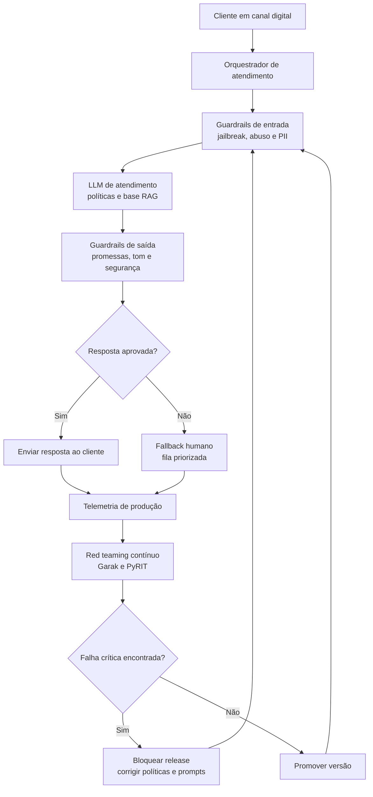

# Business Case: Atendimento ao Cliente com Guardrails e Red Teaming Contínuo

## Contexto de Negócio

Uma empresa de serviços digitais, inspirada nas necessidades do Banco Aurora, opera canais de atendimento por chat, WhatsApp e e-mail. O objetivo é reduzir filas e melhorar satisfação, mantendo controle sobre promessas comerciais, conteúdo ofensivo, dados pessoais e instruções internas.

O diferencial do caso é tratar red teaming como processo contínuo, não como teste pontual antes do lançamento.

## Problema

LLMs em atendimento podem oferecer descontos fora da política, revelar prompts ou dados internos, responder de modo ofensivo, ser manipulados por jailbreaks públicos e degradar após mudanças de modelo, base de conhecimento ou política comercial. O caso Air Canada (2024) mostrou que informação incorreta de chatbot pode gerar obrigação comercial real.

## Solução com LLM Seguro

A solução cria uma esteira de segurança operacional com guardrails de política comercial e linguagem, testes Garak/PyRIT a cada release, datasets adversariais OWASP LLM/MITRE ATLAS, monitoramento com Langfuse/Evidently AI, revisão humana para risco financeiro e backlog de remediação com SLA.

### Arquitetura da Solução

## ROI Esperado

Premissas: 500 mil contatos/mês; custo humano médio de R$ 6,20 por contato; automação segura adicional de 18 pontos percentuais; redução de 35% no retrabalho por respostas incorretas; custo anual de red teaming e guardrails de R$ 2,4 milhões.

Economia de atendimento: 500.000 × 18% × R$ 6,20 × 12 = **R$ 6,70 milhões/ano**. Com redução de retrabalho estimada em R$ 1,1 milhão, benefício total é **R$ 7,80 milhões**, ROI líquido aproximado de **225%** e payback em **4 meses**.

## Métricas de Sucesso

| Métrica | Baseline | Meta em 12 meses |
|---|---:|---:|
| Taxa de automação segura | 22% | 40% |
| Jailbreak bem-sucedido em suite adversarial | 15% | < 3% |
| Respostas com promessa comercial indevida | 4,2% | < 0,5% |
| Escalonamento humano por baixa confiança | 31% | 18% |
| CSAT em atendimento digital | 72/100 | 82/100 |
| Tempo de correção de falha crítica | 14 dias | < 72 horas |
| Cobertura de testes OWASP LLM | 25% | > 90% |

## Riscos e Mitigações

| Risco | Impacto | Mitigação |
|---|---|---|
| Informação comercial incorreta | Custo legal e reembolso | Guardrails de política, RAG versionado e aprovação jurídica |
| Toxicidade ou resposta inadequada | Reputação e churn | Azure AI Content Safety, Llama Guard 3 e avaliação humana amostral |
| Regressão após troca de modelo | Falha em produção | Red teaming contínuo, gates CI/CD e canary release |
| Exposição de prompt ou dados internos | Perda de propriedade intelectual | Prompt hardening, segregação de contexto e monitoramento |
| Falso bloqueio excessivo | Piora de experiência | Métricas precision/recall e ajuste por segmento/canal |

## Tecnologias

Garak, PyRIT, NeMo Guardrails, Guardrails AI, Llama Guard 3, Azure AI Content Safety, Microsoft Presidio, Langfuse, Evidently AI, RAGAS, Azure AI Foundry, Azure Policy e Purview.

## Implementação

- [Aula 1 — Ameaças e vulnerabilidades](../../01_ameacas_e_vulnerabilidades/)
- [Aula 2 — Guardrails e políticas](../../02_guardrails_e_politicas/)
- [Aula 4 — Testes de segurança e auditoria](../../04_testes_de_seguranca_e_auditoria/)
- [Aula 6 — Governança e monitoramento](../../06_governanca_e_monitoramento/)
- [Aula 8 — Governança de IA e produção](../../08_governanca_de_ia_e_producao/)

## Referências

- Civil Resolution Tribunal of British Columbia, 2024 — caso Moffatt v. Air Canada sobre informação incorreta fornecida por chatbot.
- OWASP Foundation — OWASP Top 10 for LLM Applications.
- MITRE — ATLAS knowledge base.
- Microsoft — PyRIT documentation for generative AI red teaming.
- NVIDIA — Garak LLM vulnerability scanner documentation.
- NIST — AI RMF 1.0.
