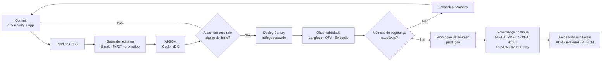

# Business Case: Deploy Seguro e Governança Contínua — Aurora Assist

## Contexto de Negócio

Depois de proteger o produto ([caso base](business-case-aurora-assist-guardrails.md)) e garantir a privacidade ([caso de conformidade](business-case-conformidade-lgpd.md)), o **Banco Aurora** enfrenta um desafio operacional: **manter a postura de segurança do Aurora Assist ao longo do tempo**. Sistemas de LLM evoluem continuamente — novos *prompts*, novas versões de modelo, novos guardrails e novas ferramentas MCP —, e cada mudança pode **reintroduzir vulnerabilidades** já corrigidas.

Este business case trata do **ciclo de vida** do sistema: como implantar novas versões **sem regressão de segurança**, com **governança contínua** e **evidências auditáveis**. A tese é que velocidade e segurança não são opostas — uma **esteira DevSecOps** com gates adversariais permite entregar rápido **e** com risco controlado.

## Problema / Risco

A operação de um assistente bancário com LLM sem esteira segura expõe o banco a três classes de risco:

- 🔁 **Regressão de segurança:** uma alteração de *prompt* de sistema ou de guardrail derruba proteções contra *prompt injection* que passavam antes, sem que ninguém perceba até o incidente.
- 🚀 **Deploy inseguro:** mudanças vão a produção para 100% dos clientes de uma vez, sem *canary* nem *rollback* automático, amplificando o impacto de qualquer falha.
- 🏛️ **Falta de governança:** ausência de inventário de componentes (modelos, *datasets*, dependências), de rastreabilidade de decisões e de gestão de risco contínua — inviabilizando conformidade com **NIST AI RMF**, **ISO/IEC 42001** e **EU AI Act**, e a resposta a auditorias.

O resultado são **incidentes recorrentes**, **MTTD/MTTR elevados**, indisponibilidade e exposição regulatória — tudo com custo direto e reputacional para o banco.

## Solução de Segurança (DevSecOps + Governança)

A solução incorpora segurança ao *pipeline* e à operação, tratando políticas e evidências como artefatos versionados:

- 🧪 **Gates de red team em CI/CD:** cada *pull request* dispara campanhas **Garak**, **PyRIT** e **promptfoo**; o *pipeline* **falha** se o *attack success rate* ultrapassar o limite acordado.
- 🟦🟩 **Blue/Green + Canary:** a nova versão recebe tráfego reduzido (*canary*), é observada e só então promovida (*blue/green*); **rollback automático** por métricas de segurança/qualidade.
- 📦 **AI-BOM (CycloneDX):** inventário rastreável de modelos, *datasets*, *prompts*, guardrails e dependências — base para *supply chain security* (LLM05) e transparência do EU AI Act.
- 🧭 **Governança contínua:** **NIST AI RMF** (Govern · Map · Measure · Manage) e **ISO/IEC 42001** (AIMS/PDCA) operacionalizados via ADRs, matriz de risco e revisões periódicas.
- 🛡️ **Policy-as-code e catálogo:** **Azure Policy** para *guardrails* de infraestrutura e **Microsoft Purview** para catálogo, classificação e linhagem de dados de IA.
- 📈 **Observabilidade de segurança** integrada ao *pipeline*: **Langfuse**, **OpenTelemetry** e **Evidently** alimentam os gates e o *rollback*.

### Arquitetura da Solução

## Impacto / ROI

O ROI é orientado à **redução de incidentes** e à **eficiência operacional de segurança** (MTTD/MTTR e *time-to-deploy* seguro).

**Premissas (ilustrativas):**

- Sem esteira segura: **4 incidentes críticos/ano**, custo médio por incidente (indisponibilidade + remediação + eventual multa + reputação) de **R$ 3,5 milhões** → **R$ 14,0 milhões/ano**.
- Com gates, *canary* e governança: incidentes caem para **1/ano** → **R$ 3,5 milhões/ano**.
- Custo anual da esteira DevSecOps + governança (ferramentas, automação, equipe): **R$ 2,0 milhões/ano**.

**Perda evitada:** R$ 14,0 mi − R$ 3,5 mi = **R$ 10,5 milhões/ano**.
**ROI:** (R$ 10,5 mi − R$ 2,0 mi) / R$ 2,0 mi ≈ **425% no ano 1**, além de ganho de agilidade: *time-to-deploy* seguro cai de **semanas** para **dias**, liberando capacidade de engenharia.

## Métricas de Sucesso

| Métrica | Baseline | Meta em 12 meses |
|---|---:|---:|
| *Attack success rate* em produção (red team amostral) | 18% | < 2% |
| MTTD — detecção de incidente de segurança | 72 h | < 30 min |
| MTTR — recuperação após incidente | 5 dias | < 4 h |
| % de deploys com gate de segurança aprovado | 0% | 100% |
| Cobertura de AI-BOM (componentes rastreados) | 30% | > 95% |
| *Time-to-deploy* seguro (commit → produção) | 3 semanas | < 3 dias |

## Riscos Residuais

| Risco residual | Impacto | Mitigação contínua |
|---|---|---|
| Ataque *zero-day* não coberto pelos gates | Regressão passa despercebida | Atualização contínua de *probes* Garak/PyRIT, *bug bounty*, monitoramento em produção |
| Falso negativo no *canary* (amostra pequena) | Promoção de versão insegura | Aumentar janela/tráfego do *canary*, *rollback* automático, alertas |
| AI-BOM desatualizado | Cegueira de *supply chain* | Geração automática do CycloneDX no *pipeline*, verificação de completude |
| *Drift* de configuração de governança | Não conformidade silenciosa | Azure Policy *as-code*, revisões periódicas, ADRs versionados |
| Dependência de fornecedor de modelo | Indisponibilidade/mudança de comportamento | *Offline-first* com Ollama, testes de regressão por versão de modelo |

## Tecnologias

Garak, PyRIT, promptfoo, blue/green + canary, CycloneDX (AI-BOM), NIST AI RMF, ISO/IEC 42001, Microsoft Purview, Azure Policy, Azure AI Foundry, Microsoft Agent Framework, Langfuse, OpenTelemetry, Evidently e Azure Monitor/Sentinel.

## Implementação

- [Aula 4 — Testes de segurança e auditoria](../../aula04_testes_seguranca_auditoria/) — red teaming automatizado e gates adversariais.
- [Aula 6 — Governança e monitoramento](../../aula06_governanca_monitoramento/) — observabilidade, SLIs/SLOs de segurança e *drift*.
- [Aula 8 — Governança de IA e deploy seguro](../../aula08_governanca_deploy_seguro/) — DevSecOps, AI-BOM e governança contínua.
- Fluxos relacionados: [Secure SDLC](process-diagrams/secure-sdlc.md) e [resposta a incidentes](process-diagrams/incident-response.md).

## Referências

- NIST — Artificial Intelligence Risk Management Framework (AI RMF 1.0).
- ISO/IEC 42001:2023 — Artificial Intelligence Management System (AIMS).
- OWASP Foundation — OWASP Top 10 for Large Language Model Applications (LLM05 — Supply Chain).
- OWASP CycloneDX — especificação de *Software/AI Bill of Materials* (SBOM/AI-BOM).
- NIST SP 800-61 — Computer Security Incident Handling Guide.
- Microsoft — Security Development Lifecycle (SDL) e Azure Well-Architected Framework.
- European Union — Regulation (EU) 2024/1689 (EU Artificial Intelligence Act) — transparência e gestão de risco.

---

> ⚠️ Material **educacional**. ROI e métricas são estimativas ilustrativas para fins didáticos.
