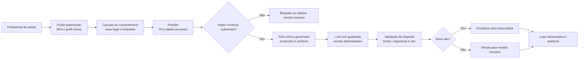

# Business Case: Copiloto Clínico com Conformidade LGPD/GDPR

## Contexto de Negócio

Uma rede de saúde privada deseja reduzir tempo administrativo de médicos, enfermeiros e equipes de faturamento. O copiloto clínico resume prontuários, prepara minutas de encaminhamento, identifica pendências de documentação e responde perguntas operacionais com base em protocolos aprovados.

Embora o setor seja diferente do Banco Aurora, o padrão de risco é semelhante: dados sensíveis, obrigação de rastreabilidade e alto custo reputacional de falhas.

## Problema

A adoção de LLM em saúde enfrenta dados pessoais sensíveis, risco de inserção de informação de paciente em provedores externos, respostas clínicas fora de escopo, viés em triagem e dificuldade de provar conformidade em auditorias.

## Solução com LLM Seguro

O copiloto é limitado a atividades administrativas e de apoio à decisão, sem substituir julgamento clínico. A arquitetura aplica privacy by design com Presidio, segregação por perfil, RAG de protocolos aprovados, citação obrigatória, avaliação de segurança/viés e trilhas de auditoria compatíveis com LGPD, GDPR, NIST AI RMF e ISO/IEC 42001.

### Arquitetura da Solução

## ROI Esperado

Premissas: 800 profissionais; 22 minutos/dia economizados por profissional; custo carregado de R$ 95/hora; 220 dias úteis/ano; investimento anual de R$ 3,8 milhões.

Economia bruta: 800 × 22/60 × R$ 95 × 220 = **R$ 6,13 milhões/ano**. Somando redução de retrabalho de faturamento e auditoria estimada em R$ 1,2 milhão, o benefício anual é **R$ 7,33 milhões**, com ROI líquido aproximado de **93%** e payback em **7 meses**.

## Métricas de Sucesso

| Métrica | Baseline | Meta em 12 meses |
|---|---:|---:|
| Tempo médio para resumo de prontuário | 18 min | 5 min |
| Documentos com PII indevida em logs | 2,5% | < 0,1% |
| Respostas sem fonte aprovada | 12% | < 2% |
| Retrabalho por documentação incompleta | 16% | 8% |
| Precisão de detecção de PII | 88% | > 97% |
| Recall em detecção de PII sensível | 82% | > 95% |
| Achados críticos em auditoria | 6 por ciclo | 0 a 1 por ciclo |

## Riscos e Mitigações

| Risco | Impacto | Mitigação |
|---|---|---|
| Uso clínico fora de escopo | Segurança do paciente | Guardrails de escopo, disclaimers, revisão humana obrigatória |
| Vazamento de PII/PHI | Multas e perda de confiança | Presidio, Purview, criptografia, minimização e segregação |
| Base legal inadequada | Não conformidade LGPD/GDPR | Registro de finalidade, consentimento quando aplicável, DPO review |
| Viés em recomendações | Risco ético e discriminatório | Fairlearn, AIF360, testes por subgrupos e comitê clínico |
| Alucinação de protocolo | Erro operacional | RAG com fontes aprovadas, citação obrigatória e bloqueio sem evidência |

## Tecnologias

Microsoft Presidio, Azure AI Content Safety, Guardrails AI, NeMo Guardrails, Llama Guard 3, RAGAS, Fairlearn, AIF360, Evidently AI, Langfuse, Azure AI Foundry, Azure Key Vault, Azure Policy e Purview.

## Implementação

- [Aula 2 — Guardrails e políticas](../../02_guardrails_e_politicas/)
- [Aula 3 — Proteção de dados e isolamento](../../03_protecao_de_dados_e_isolamento/)
- [Aula 5 — Conformidade LGPD/GDPR](../../05_conformidade_lgpd_gdpr/)
- [Aula 7 — Ética, viés e validação](../../07_etica_vies_e_validacao/)
- [Aula 8 — Governança de IA e produção](../../08_governanca_de_ia_e_producao/)

## Referências

- Autoridade Nacional de Proteção de Dados — LGPD e orientações sobre tratamento de dados pessoais.
- European Data Protection Board — guidelines on personal data processing and GDPR.
- NIST — AI RMF 1.0 e AI RMF Playbook.
- ISO/IEC 42001:2023 — AI management system.
- U.S. HHS OCR — public breach portal and enforcement actions for healthcare data breaches.
- World Health Organization, 2021 — Ethics and governance of artificial intelligence for health.
