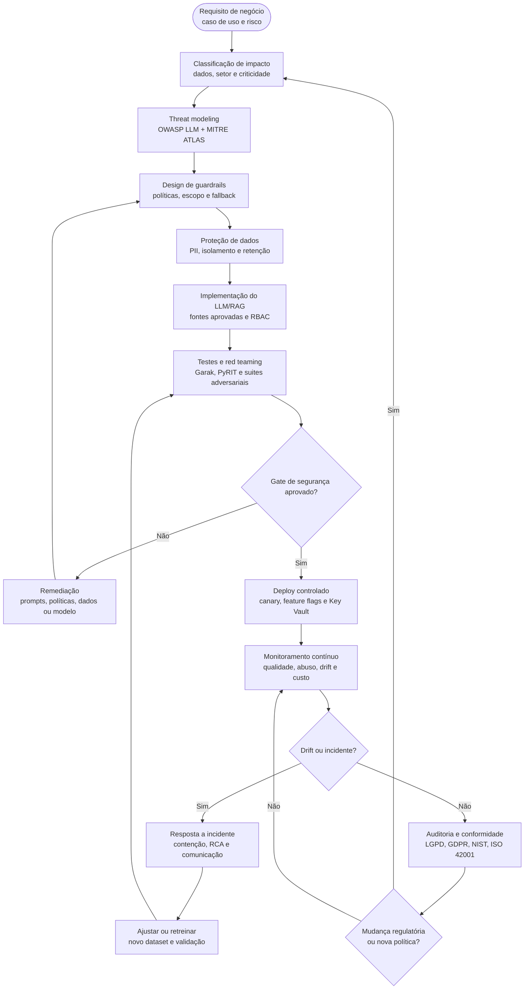

# Processo de Negócio — Secure LLMOps Lifecycle

Este fluxo representa o ciclo end-to-end de um **LLM seguro em produção**, conectando requisitos de negócio, engenharia de ML, segurança ofensiva, governança e auditoria contínua.

## Controles-chave por etapa

| Etapa | Controle principal | Evidência esperada |
|---|---|---|
| Requisito | Matriz de risco e finalidade | Documento de caso de uso aprovado |
| Threat modeling | OWASP LLM e MITRE ATLAS | Registro de ameaças e severidade |
| Guardrails | Políticas versionadas | Testes unitários e regras de bloqueio |
| Dados | PII, criptografia e retenção | Relatório de DLP/Presidio/Purview |
| Red teaming | Ataques automatizados e humanos | Relatório Garak/PyRIT com SLA |
| Gate | Critérios de aceite | Aprovação de segurança e negócio |
| Produção | Observabilidade e alertas | Dashboards Langfuse/Evidently AI |
| Auditoria | NIST AI RMF, ISO/IEC 42001, LGPD/GDPR | Evidências imutáveis e revisão periódica |
