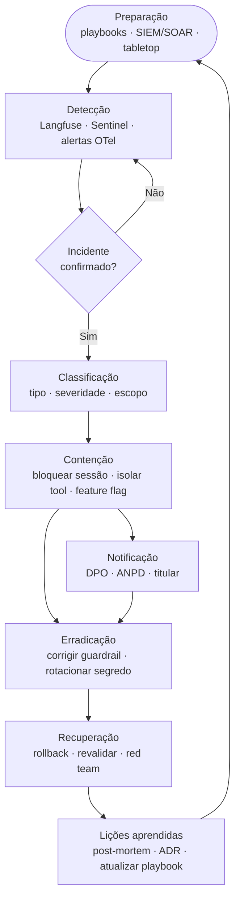

# 🚨 Playbook de Resposta a Incidentes de Segurança de LLM — Aurora Assist

Este playbook define como o **Banco Aurora** responde a **incidentes de segurança** do **Aurora Assist** — por exemplo, *jailbreak escape* (fuga de guardrail em produção), **vazamento de PII**, **drift crítico** de comportamento ou **ação indevida de ferramenta** (*excessive agency*). O processo segue as fases do **NIST SP 800-61** e integra-se ao **Azure Sentinel (SIEM/SOAR)** para detecção, orquestração e automação de contenção.

O objetivo é reduzir **MTTD** e **MTTR**, preservar **evidências auditáveis** (LGPD art. 37 / GDPR art. 30) e realimentar o [Secure SDLC](secure-sdlc.md) com lições aprendidas.

## Fases (NIST)

1. **🛠️ Preparação** — playbooks, *runbooks*, integração SIEM/SOAR (Azure Sentinel), *tabletop exercises* e definição de severidade.
2. **🔎 Detecção** — sinais de Llama Guard 3, Azure AI Content Safety, Presidio (*PII-out*), Langfuse, Evidently e alertas OpenTelemetry correlacionados no Sentinel.
3. **⛔ Contenção** — bloquear sessão/usuário, ativar *feature flag*, isolar ferramenta MCP, reforçar guardrail; **notificação** paralela (DPO, ANPD, titular) quando houver dados pessoais.
4. **🧹 Erradicação** — corrigir a causa-raiz (guardrail, *prompt* de sistema, escopo de ferramenta), rotacionar segredos no Azure Key Vault.
5. **♻️ Recuperação** — restaurar o serviço (*rollback* canary/blue-green), revalidar com red team e retomar operação monitorada.
6. **📚 Lições aprendidas** — *post-mortem*, ADR, atualização de playbook e do *threat model*.

## Fluxo de resposta

## Matriz por tipo de incidente

| Tipo de incidente | Gatilho | Detecção | Contenção | Evidência / Auditoria |
|---|---|---|---|---|
| **Jailbreak escape** (LLM01) | Resposta fora de política / conteúdo proibido | Llama Guard 3 + Content Safety + Langfuse | Bloquear sessão, reforçar guardrail, *feature flag* | *Trace* Langfuse + trilha WORM (Sentinel) |
| **Vazamento de PII** (LLM06) | PII detectada na saída ou em log | Presidio (*PII-out*) + DLP Purview | *Redaction* retroativa, purga, revogar token | Registro LGPD art. 37 / GDPR art. 30, notificação ANPD |
| **Drift crítico** (LLM09) | PSI/KS acima do limite, queda de *groundedness* (RAGAS) | Evidently + alertas OpenTelemetry | *Rollback* canary/blue-green, congelar deploy | Dashboard de *drift*, ADR de mudança |
| **Excessive agency** (LLM08) | Chamada MCP fora de escopo/limite | Auditoria MCP + limites transacionais | Revogar escopo, *kill-switch* da ferramenta | Log de ferramenta, registro de aprovação humana |

## Integração com Azure Sentinel (SIEM/SOAR)

- 📥 **Ingestão:** telemetria de Langfuse, OpenTelemetry, Presidio, guardrails e logs de aplicação são centralizados no Sentinel.
- 🧠 **Correlação:** regras analíticas correlacionam sinais (ex.: pico de recusas + PII na saída) e geram *incidents* com severidade.
- 🤖 **SOAR:** *playbooks* automatizados (Logic Apps) executam contenção inicial — bloqueio de sessão, *feature flag*, abertura de *ticket* e notificação ao DPO.
- 🔐 **Evidência imutável:** todos os artefatos são gravados em trilha **WORM** (Azure Log Analytics) para auditoria e *due diligence*.

## Relação com as aulas

- [Aula 4 — Testes de segurança e auditoria](../../../aula04_testes_seguranca_auditoria/) — detecção, red teaming e geração de evidências para o playbook.
- [Aula 8 — Governança e deploy seguro](../../../aula08_governanca_deploy_seguro/) — governança de incidentes, *rollback* e melhoria contínua.

> 🔗 Fluxo complementar: [Secure SDLC](secure-sdlc.md) · Business case relacionado: [deploy seguro e governança](../business-case-deploy-seguro-governanca.md).

## Referências

- NIST SP 800-61 — Computer Security Incident Handling Guide.
- OWASP Foundation — OWASP Top 10 for Large Language Model Applications.
- Microsoft — Azure Sentinel (Microsoft Sentinel): SIEM/SOAR.
- Brasil — LGPD (Lei nº 13.709/2018), arts. 37 e 48 (registro e comunicação de incidente).
- European Union — GDPR (Regulation (EU) 2016/679), arts. 30 e 33 (RoPA e notificação de violação).
