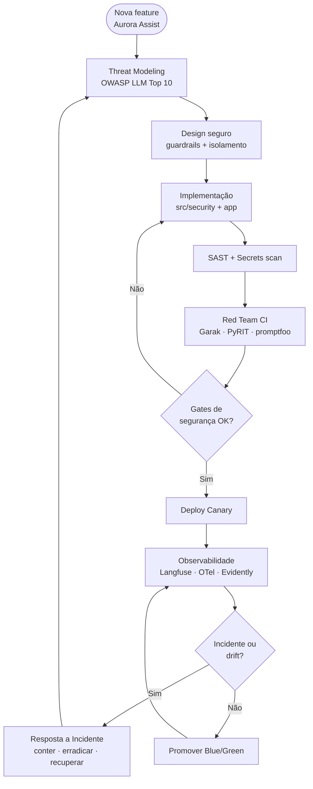

# 🔄 Secure SDLC — Ciclo de Desenvolvimento Seguro do Aurora Assist

Este diagrama descreve o **ciclo de vida de desenvolvimento seguro** (*Secure Software Development Life Cycle*) aplicado ao **Aurora Assist**, o chatbot bancário do **Banco Aurora**. A premissa é de **defesa em profundidade** e *shift-left*: cada nova funcionalidade passa por *threat modeling*, design seguro e **gates de segurança adversariais** antes de chegar à produção, e a operação retroalimenta o ciclo por meio de observabilidade e resposta a incidentes.

O fluxo garante que segurança de LLM (proteção contra *prompt injection*, vazamento de PII e *excessive agency*) seja um **requisito de engenharia versionável e testável** — não uma etapa final.

## Fluxo do ciclo

## Etapas

| Etapa | Objetivo de segurança | Práticas e ferramentas |
|---|---|---|
| **Nova feature** | Ponto de entrada rastreável do ciclo | Requisito com critérios de segurança e privacidade |
| **Threat Modeling** | Mapear a superfície de ataque | OWASP Top 10 for LLM, MITRE ATLAS, STRIDE adaptado a LLM |
| **Design seguro** | Projetar defesa em profundidade | Guardrails de entrada/saída, isolamento de ferramentas (MCP), Zero Trust |
| **Implementação** | Codificar com segurança | `src/security` + app, *policy-as-code*, revisão de código |
| **SAST + Secrets scan** | Eliminar vulnerabilidades e segredos | Análise estática, varredura de segredos, Azure Key Vault |
| **Red Team CI** | Validar resistência adversarial | Garak, PyRIT, promptfoo com limite de *attack success rate* |
| **Gates de segurança** | Bloquear regressão | Falha do *pipeline* acima do limite → retorno à implementação |
| **Deploy Canary** | Reduzir raio de impacto | Tráfego parcial, avaliação controlada |
| **Observabilidade** | Detectar degradação e ataque | Langfuse, OpenTelemetry, Evidently (KS/PSI/MMD), RAGAS |
| **Resposta a Incidente** | Conter e aprender | Playbook NIST — realimenta o *threat model* |
| **Promoção Blue/Green** | Publicar com reversão pronta | *Rollback* imediato, AI-BOM atualizado |

## Relação com as aulas

- [Aula 1 — Ameaças e vulnerabilidades](../../../aula01_ameacas_vulnerabilidades/) — *threat modeling* e OWASP LLM Top 10.
- [Aula 2 — Guardrails e políticas](../../../aula02_guardrails_politicas/) — design seguro com defesa em profundidade.
- [Aula 3 — Proteção de dados e isolamento](../../../aula03_protecao_dados_isolamento/) — isolamento de ferramentas (MCP) e PII.
- [Aula 4 — Testes de segurança e auditoria](../../../aula04_testes_seguranca_auditoria/) — red team em CI e gates.
- [Aula 6 — Governança e monitoramento](../../../aula06_governanca_monitoramento/) — observabilidade e *drift*.
- [Aula 8 — Governança e deploy seguro](../../../aula08_governanca_deploy_seguro/) — deploy *canary*/blue-green e governança.

> 🔗 Business cases relacionados: [deploy seguro e governança](../business-case-deploy-seguro-governanca.md) e [caso base do Aurora Assist](../business-case-aurora-assist-guardrails.md).
