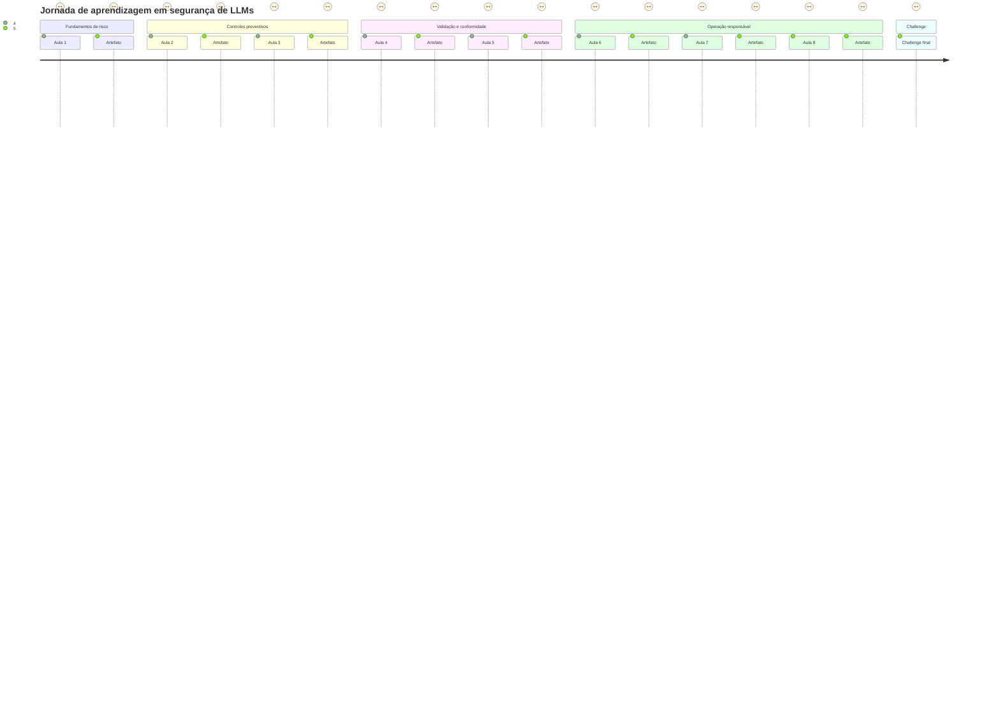
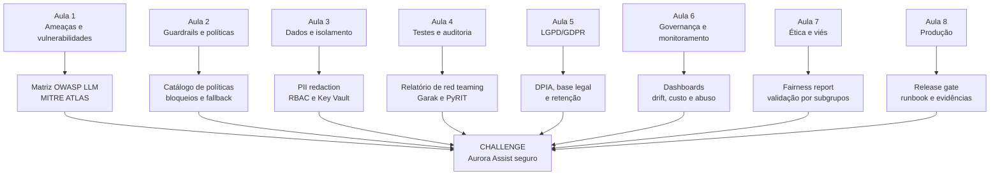

# Jornada do Engenheiro de ML/Segurança no Repositório

A jornada acompanha um engenheiro responsável por levar o **Aurora Assist** de protótipo acadêmico a um desenho de produção governado.

## Fluxo de artefatos

## Marcos de aprendizagem

| Aula | Competência desenvolvida | Artefato produzido | Valor para o negócio |
|---:|---|---|---|
| 1 | Reconhecer ameaças específicas de LLM | Matriz de ameaças | Prioriza risco antes do investimento |
| 2 | Traduzir política em controle técnico | Catálogo de guardrails | Reduz respostas inseguras e retrabalho |
| 3 | Proteger dados e acessos | Pipeline PII/RBAC | Diminui exposição regulatória |
| 4 | Testar ofensivamente | Relatório de red teaming | Evita incidentes antes do go-live |
| 5 | Demonstrar conformidade | Evidências LGPD/GDPR | Acelera auditoria e aprovação jurídica |
| 6 | Operar com observabilidade | Dashboard e alertas | Detecta drift e abuso em produção |
| 7 | Validar ética e viés | Relatório de fairness | Reduz risco discriminatório |
| 8 | Produzir com governança | Gate e runbook | Sustenta ROI com controle contínuo |
